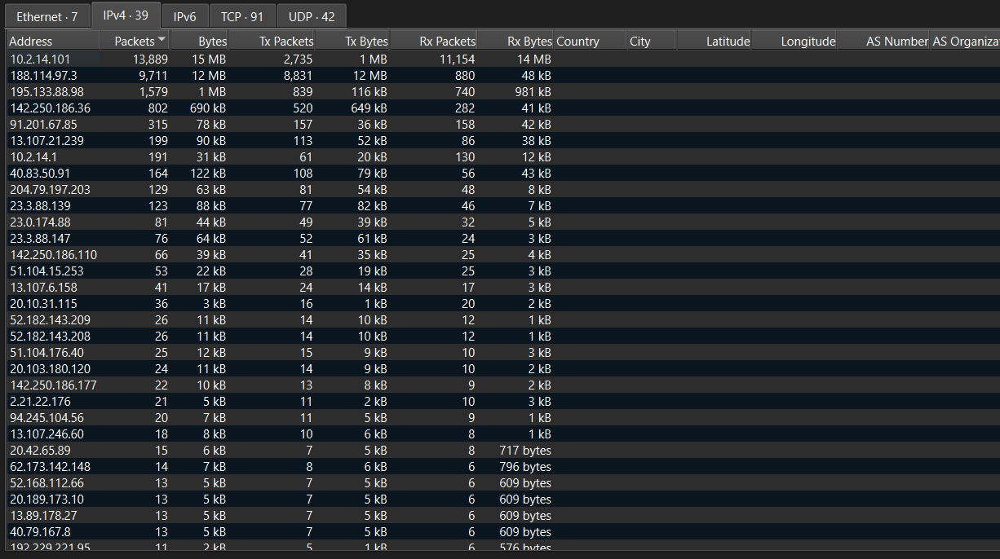
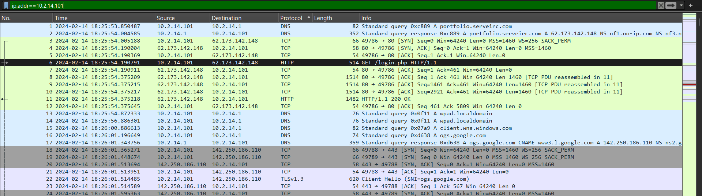
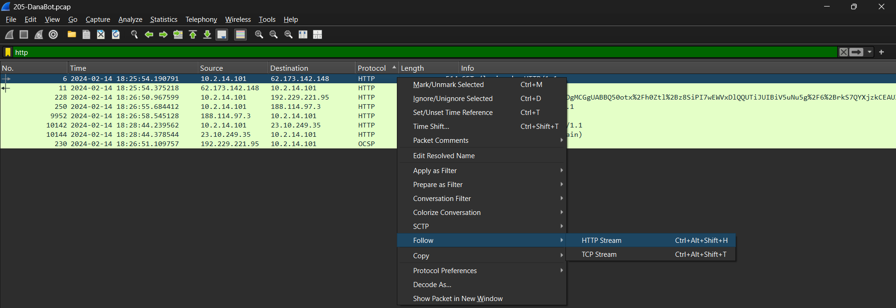
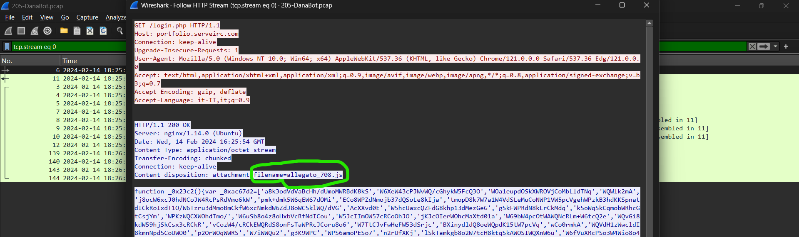
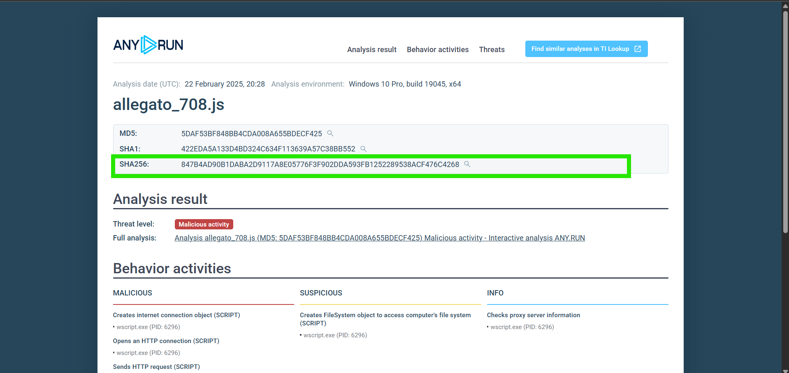
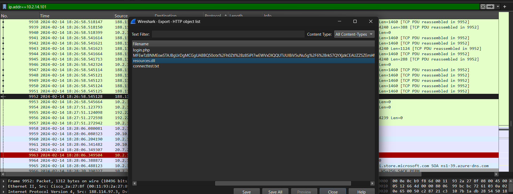
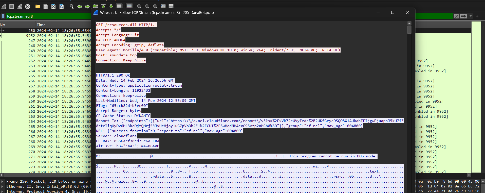
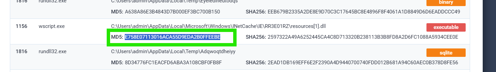

# DanaBot — Network Traffic & Malware Analysis

## Overview

This investigation focuses on analyzing a network packet capture (`205-DanaBot.pcap`) to investigate a suspected DanaBot infection.

Using Wireshark and ANY.RUN, I analyzed the compromised host's network activity, identified the initial access infrastructure, investigated the delivery of a malicious JavaScript file, and examined a second malicious file downloaded during the attack.

The investigation focused on identifying malicious files, recovering their hashes, and understanding how the initial payload was delivered and executed.

## Investigation Details

| Field | Details |
|---|---|
| Lab | CyberDefenders — DanaBot |
| Category | Network Forensics / Malware Analysis |
| Tools | Wireshark, ANY.RUN |
| Evidence | `205-DanaBot.pcap` |
| Victim IP | `10.2.14.101` |
| Initial Access IP | `62.173.142.148` |
| Initial Access Domain | `portfolio.serveirc.com` |
| Initial Malicious File | `allegato_708.js` |
| Execution Process | `wscript.exe` |

---

## Q1 — Which IP address was used by the attacker during the initial access?

**Answer:** `62.173.142.148`

### Investigation

I started by examining the network endpoints through **Statistics → Endpoints**.

The endpoint statistics showed that `10.2.14.101` was responsible for the majority of the observed network traffic.



I then applied a display filter to investigate traffic involving the identified host:

```wireshark
ip.addr == 10.2.14.101
```

The first relevant activity included a DNS query for:

```text
portfolio.serveirc.com
```

The DNS response resolved the domain to:

```text
62.173.142.148
```



### Finding

The IP address identified during initial access was `62.173.142.148`.

---

## Q2 — What is the name of the malicious file used for initial access?

**Answer:** `allegato_708.js`

### Investigation

After identifying the initial access IP, I filtered the traffic using the HTTP protocol to investigate the communication between the victim and the remote server.

The HTTP traffic revealed a request to:

```http
GET /login.php HTTP/1.1
Host: portfolio.serveirc.com
```

The server responded with:

```http
HTTP/1.1 200 OK
Server: nginx/1.14.0 (Ubuntu)
Content-Type: application/octet-stream
Content-Disposition: attachment; filename=allegato_708.js
```

The response indicated that the server delivered a file named `allegato_708.js` as an attachment.





### Finding

The malicious file used for initial access was `allegato_708.js`.

---

## Q3 — What is the SHA-256 hash of the malicious file used for initial access?

**Answer:**

`847B4AD90B1DABA2D9117A8E05776F3F902DDA593FB1252289538ACF476C4268`

### Investigation

After recovering the filename, I searched for the file online to locate an existing malware analysis report.

I found an ANY.RUN analysis report for `allegato_708.js`.

The report identified the file as malicious and provided its cryptographic hashes.



### Finding

The SHA-256 hash of `allegato_708.js` was:

```text
847B4AD90B1DABA2D9117A8E05776F3F902DDA593FB1252289538ACF476C4268
```

---

## Q4 — Which process was used to execute the malicious file?

**Answer:** `wscript.exe`

### Investigation

The ANY.RUN report showed that the JavaScript file was executed through:

```text
wscript.exe
```

`wscript.exe` is the Windows Script Host executable used to run Windows scripts, including JavaScript (`.js`) files.

Its use is consistent with the execution of the downloaded JavaScript payload.

The process information is visible in the ANY.RUN analysis screenshot.

**Evidence:** `screenshots/Anyrun.png`

### Finding

The process used to execute the malicious JavaScript file was `wscript.exe`.

---

## Q5 — What is the file extension of the second malicious file utilized by the attacker?

**Answer:** `.dll`

### Investigation

I continued investigating the HTTP traffic and examined the transferred objects through **File → Export Objects → HTTP**.

The exported HTTP objects included a file named:

```text
resources.dll
```

This indicated that a DLL file was also transferred during the observed activity.



I also correlated this finding with the ANY.RUN report and the TCP stream between:

- `188.114.97.3`
- `10.2.14.101`

The TCP stream provided additional evidence related to the DLL transfer.



The ANY.RUN report also contained information about the second file.



### Finding

The file extension of the second malicious file was `.dll`.

---

## Q6 — What is the MD5 hash of the second malicious file?

**Answer:**

`E758E07113016ACA55D9EDA2B0FFEEBE`

### Investigation

While examining the ANY.RUN report, I located the entry associated with the second malicious file.

The report displayed its MD5 hash:

```text
E758E07113016ACA55D9EDA2B0FFEEBE
```


### Finding

The MD5 hash of the second malicious file was `E758E07113016ACA55D9EDA2B0FFEEBE`.

---

## Indicators of Compromise (IOCs)

| Type | Indicator |
|---|---|
| Victim IP | `10.2.14.101` |
| Initial Access Domain | `portfolio.serveirc.com` |
| Initial Access IP | `62.173.142.148` |
| Initial Malicious File | `allegato_708.js` |
| Initial File SHA-256 | `847B4AD90B1DABA2D9117A8E05776F3F902DDA593FB1252289538ACF476C4268` |
| Execution Process | `wscript.exe` |
| Second Malicious File | `resources.dll` |
| Second File Extension | `.dll` |
| Second File MD5 | `E758E07113016ACA55D9EDA2B0FFEEBE` |

---

## Attack Analysis

Based on the recovered network traffic and sandbox findings, the investigation established the following sequence of activity:

1. **Initial network activity:** The compromised host `10.2.14.101` performed a DNS lookup for `portfolio.serveirc.com`.
2. **Initial access infrastructure:** The domain resolved to `62.173.142.148`.
3. **Malicious file delivery:** The victim requested `/login.php` from the remote server and received an HTTP `200 OK` response containing the attachment `allegato_708.js`.
4. **Script execution:** The ANY.RUN report identified `wscript.exe` as the process used to execute the JavaScript file.
5. **Additional file transfer:** Further investigation identified a second malicious file with a `.dll` extension, named `resources.dll`.
6. **Hash identification:** The ANY.RUN report provided the SHA-256 hash of the JavaScript file and the MD5 hash of the second file.

The evidence supports the identification of the initial delivery and execution mechanism, as well as the presence of a second malicious file.

The exact role of the DLL and the complete execution chain would require further analysis of the file and its behavior.

---

## Recommended Remediation

Based on the findings, the following defensive actions are recommended:

1. Isolate the affected endpoint and preserve relevant forensic evidence.
2. Block confirmed malicious infrastructure, including the identified IP address and domain, after validating their threat status.
3. Quarantine the recovered malicious JavaScript and DLL files.
4. Search endpoint telemetry for executions of `wscript.exe` involving suspicious JavaScript files.
5. Review process creation events and parent-child relationships to identify additional payload execution.
6. Search for the identified file hashes across endpoint and security monitoring systems.
7. Investigate persistence mechanisms and any additional files or processes created during execution.
8. Perform a full endpoint security scan before restoring the affected machine.

---

## Conclusion

This investigation demonstrated how network traffic analysis can reveal the delivery and execution of malicious files.

By analyzing the PCAP in Wireshark, I identified the initial access infrastructure, recovered the malicious JavaScript attachment, and traced its execution to `wscript.exe`.

Further investigation using HTTP object extraction, TCP stream analysis, and ANY.RUN revealed a second malicious DLL file and its MD5 hash.

The recovered indicators provide useful starting points for threat hunting, endpoint investigation, and incident response.

## Tools Used

- **Wireshark:** Network traffic analysis, DNS investigation, HTTP stream inspection, endpoint statistics, and HTTP object extraction.
- **ANY.RUN:** Malware sandbox analysis, process identification, behavioral analysis, and file hash recovery.
