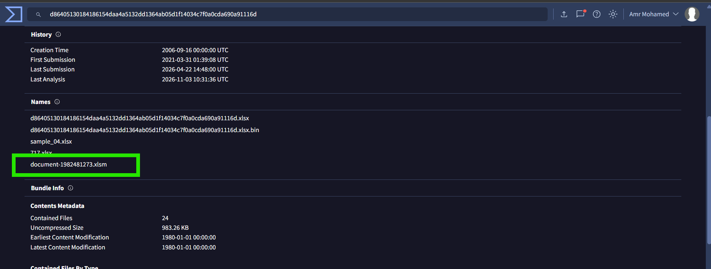
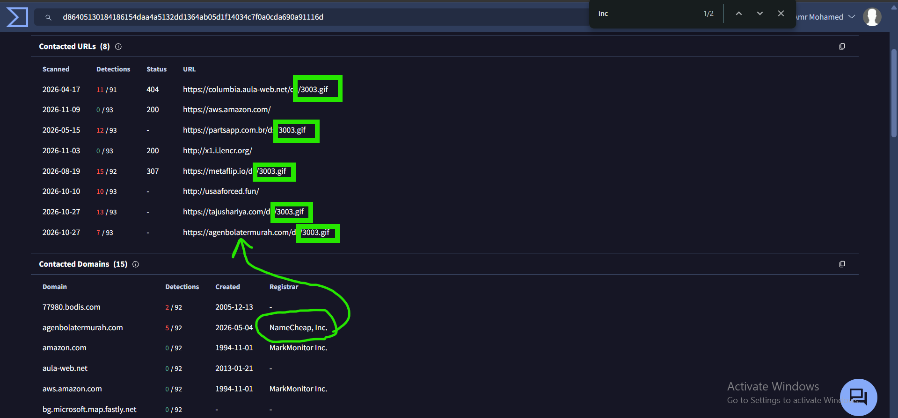
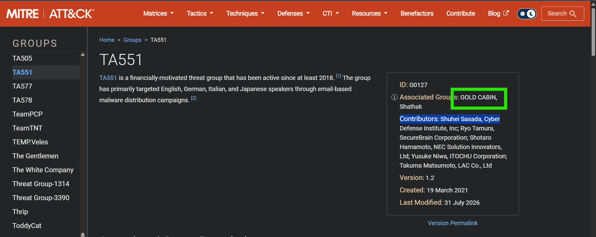
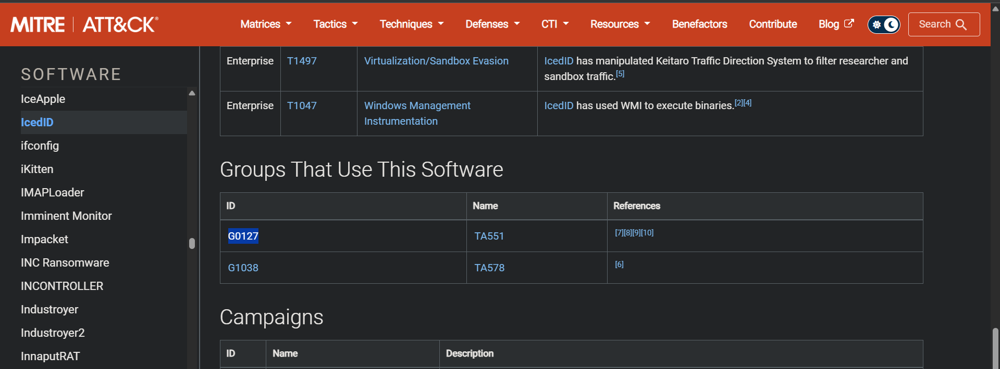
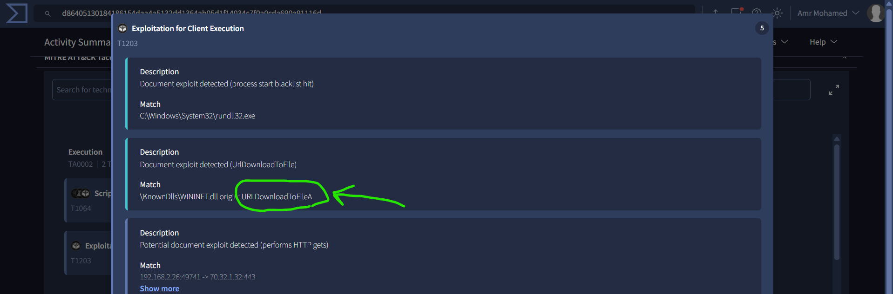
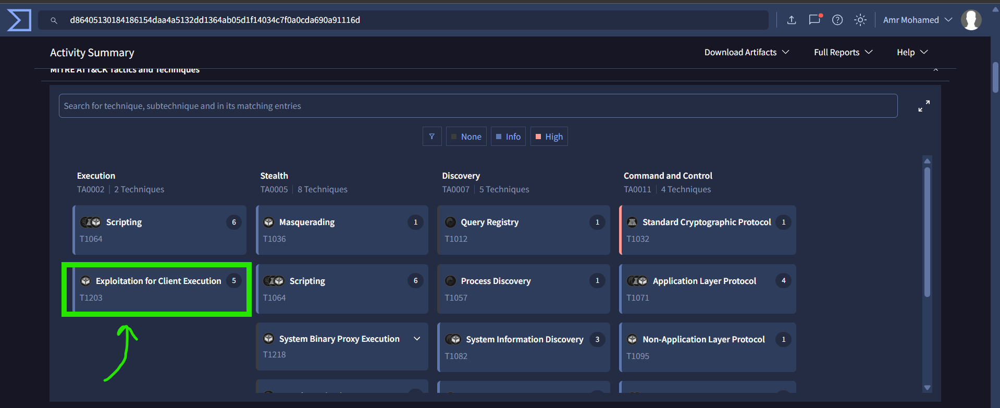

# IcedID Malware Investigation

## Overview

This investigation focuses on analyzing a malicious sample associated with **IcedID**, also known as BokBot.

The investigation involved examining the sample's VirusTotal intelligence, identifying associated filenames, reviewing contacted URLs and domains, investigating infrastructure used to deliver additional content, and correlating the malware with a threat actor using MITRE ATT&CK.

The objective was to extract actionable Indicators of Compromise (IOCs) and understand the malware's delivery and execution-related activity.

## Sample Information

| Attribute | Value |
|---|---|
| Malware | IcedID |
| Analysis Platform | VirusTotal |
| Sample Filename | `document-1982481273.xlsm` |
| Associated GIF Filename | `3003.gif` |
| Threat Group | GOLD CABIN |
| Related MITRE ATT&CK Group | TA551 |

## Investigation Findings

### Q1. What is the name of the file associated with the given hash?

**Answer: `document-1982481273.xlsm`**

**Analysis:**

The VirusTotal report was examined to identify filenames associated with the provided file hash. Under the **Names** section, `document-1982481273.xlsm` appeared among the names associated with the analyzed sample.

The `.xlsm` extension indicates an Excel Macro-Enabled Workbook, which is relevant when investigating potentially malicious documents.

**Evidence:**

### Q2. Can you identify the filename of the GIF file that was deployed?

**Answer: `3003.gif`**

**Analysis:**

The VirusTotal Contacted URLs section revealed multiple URLs containing the filename `3003.gif`. This filename was identified as an artifact associated with the sample's network-related activity.

**Evidence:**

### Q3. How many domains does the malware look to download the additional payload file in Q2?

**Answer: 5**

**Analysis:**

By reviewing the contacted URLs in VirusTotal and filtering for entries containing `3003.gif`, five distinct domains were identified. These domains were associated with URLs referencing the GIF file.

**Evidence:**

### Q4. What is the Registrar INC of the domain ending with .com?

**Answer: NAMECHEAP**

**Analysis:**

The contacted domains were reviewed to identify their registrar information. The VirusTotal domain information showed that `agenbolatermurah.com` was registered through **NameCheap, Inc.**

This information helps identify the domain registration provider associated with the infrastructure observed during the investigation.

**Evidence:**

### Q5. Could you specify the threat actor linked to the sample provided?

**Answer: GOLD CABIN**

**Analysis:**

MITRE ATT&CK was used to investigate the relationship between IcedID and known threat groups.

The IcedID software entry on MITRE ATT&CK lists **TA551** among the groups that use this software. Further examination of the TA551 group profile identifies **GOLD CABIN** as an associated group.

The relationship identified during the investigation is:

- Malware: IcedID
- MITRE ATT&CK Group: TA551
- Associated Group Name: GOLD CABIN

**Evidence:**

### Q6. In the Execution phase, what function does the malware employ to fetch extra payloads onto the system?

**Answer: `URLDownloadToFileA`**

**Analysis:**

The VirusTotal Behavior tab was examined to identify execution-related activities associated with the sample.

Under **Exploitation for Client Execution (T1203)**, VirusTotal displayed a detection matching the Windows API function `URLDownloadToFileA`.

This function can download content from a URL and save it to a local file. Its presence in the observed behavior provides an indicator of how the malware may retrieve additional payloads onto the infected system. The observation alone does not establish that every attempted download succeeded.

**MITRE ATT&CK Reference:**

- Tactic: Execution
- Technique: T1203 – Exploitation for Client Execution
- Observed Function: `URLDownloadToFileA`

**Evidence:**

## Indicators of Compromise (IOCs)

| Indicator | Type | Description |
|---|---|---|
| `document-1982481273.xlsm` | Filename | Filename associated with the analyzed sample |
| `3003.gif` | Filename | GIF filename observed in contacted URLs |
| `agenbolatermurah.com` | Domain | Domain whose registrar was identified as NameCheap |
| `NameCheap, Inc.` | Registrar | Registrar associated with the identified .com domain |
| `URLDownloadToFileA` | Windows API | Function observed in VirusTotal behavior |
| `TA551` | Threat Group ID | MITRE ATT&CK group associated with IcedID |
| `GOLD CABIN` | Threat Group Name | Group associated with TA551 |

## Conclusion

The investigation identified a sample associated with IcedID and recovered several useful artifacts from VirusTotal.

The analysis revealed the associated Excel macro-enabled document filename, the GIF filename `3003.gif`, and five distinct domains containing URLs referencing that file. Domain registration information identified NameCheap, Inc. as the registrar for `agenbolatermurah.com`.

MITRE ATT&CK research established a relationship between IcedID and TA551, with GOLD CABIN listed as an associated group. Finally, VirusTotal behavioral analysis revealed the Windows API function `URLDownloadToFileA`, which can be used to retrieve additional files from remote URLs.

These findings provide useful indicators for threat hunting, network monitoring, and malware investigation.
