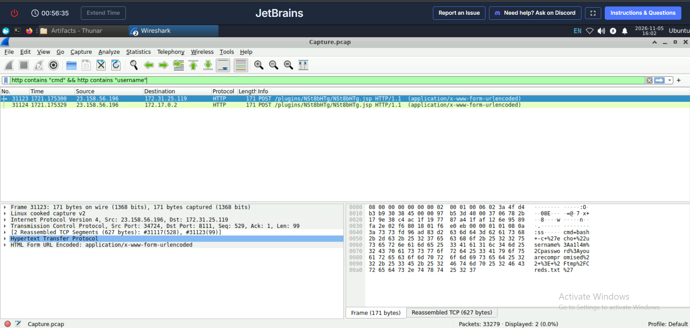
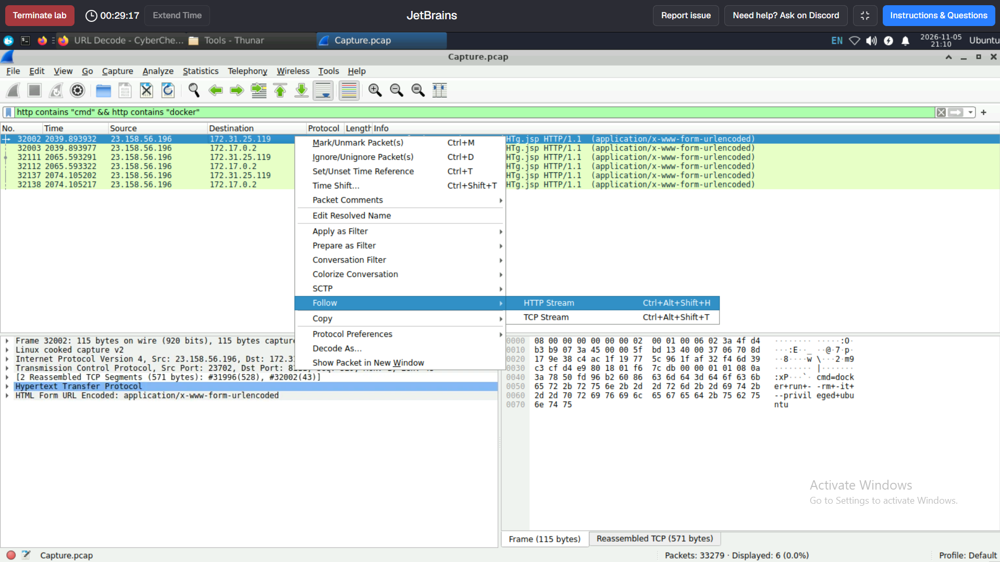
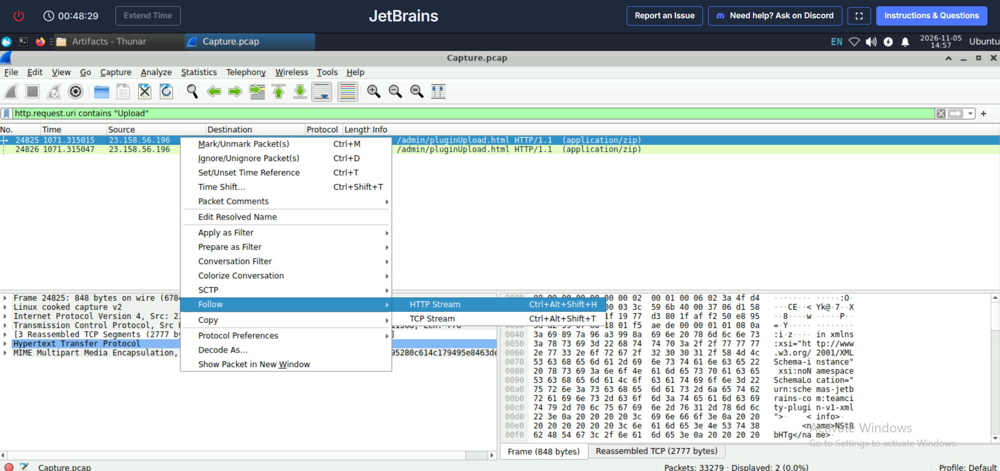

# CyberDefenders – JetBrains TeamCity Lab

## Lab Overview

This investigation analyzes a compromised JetBrains TeamCity On-Premises server using a provided PCAP. The activity includes exploitation of an authentication-bypass vulnerability, unauthorized REST API access, creation of a privileged account, upload of a malicious plugin containing a JSP web shell, command execution, credential collection, and an attempted Docker-to-host access operation.

**Skills:** Wireshark, HTTP stream analysis, PCAP investigation, CVE research, web-shell triage, URL decoding, IOC extraction, and MITRE ATT&CK mapping.

> Training-lab evidence only. The Docker command is treated as an attempted host-access operation; the PCAP does not prove that the attempt succeeded.

## Vulnerability Overview – CVE-2024-27198

The target disclosed TeamCity version **2023.11.3**. This version is affected by **CVE-2024-27198**, a critical authentication-bypass vulnerability in TeamCity On-Premises.

The vulnerability involves alternative request-path handling. A specially crafted URL can bypass authentication checks for certain protected endpoints. One request observed in the capture was:

```http
GET /hax?jsp=/app/rest/server;.jsp HTTP/1.1
```

The request returned TeamCity server information. A similar crafted request was used to reach the users REST endpoint. The vulnerability affected versions up to 2023.11.3 and was fixed in 2023.11.4. It is distinct from CVE-2024-27199, a separate path-traversal issue.

Reference: [CERT-EU security advisory](https://cert.europa.eu/publications/security-advisories/2024-025/)

## Investigation Findings

### 1. Attacker IP Address

I reviewed IPv4 endpoints in Wireshark and pivoted on HTTP POST requests containing an upload-related URI:

```wireshark
http.request.method == "POST" && http.request.uri contains "upload"
```

The suspicious request targeted `/admin/pluginUpload.html`.

**Answer:** `23.158.56.196`


### 2. TeamCity Server Version

The response from the TeamCity REST server endpoint disclosed the build information:

```xml
<server version="2023.11.3 (build 147512)" />
```

**Answer:** `2023.11.3`


### 3. Exploited CVE

The crafted alternative-path requests allowed access to protected REST endpoints without normal authentication. I correlated this behavior with the vendor security advisory.

**Answer:** `CVE-2024-27198`


### 4. Privileged Account Credentials

A POST request to the users REST endpoint contained JSON data creating a new account with the global `SYSTEM_ADMIN` role. The server response confirmed the account creation and role assignment.

**Account:** `c91oyemw`  
**Password:** `CL5vzdwLuK`


### 5. Uploaded File

The multipart form data in the plugin-upload HTTP stream revealed the uploaded archive:

**Answer:** `NSt8bHTg.zip`

The archive contained a JAR plugin with JSP web-shell functionality. The shell accepted a `cmd` parameter and invoked operating-system processes.


### 6. First Web-Shell Command

I searched HTTP requests for the web-shell command parameter and reviewed the earliest matching request. The first observed command was `ls`.

**Answer:** `2024-06-30 08:03`


### 7. Credentials Written to a File

The request parameter was URL-decoded to reveal the following command:

```bash
bash -c 'echo "username:a1l4m,password:youarecompromised" > /tmp/Creds.txt'
```

The `>` operator writes the supplied string to the file, creating it or overwriting it if it already exists.

**Answer:** `a1l4m:youarecompromised`

The following Wireshark filter narrows the packet list to requests containing both the web-shell command parameter and the credential-related string. The selected packet contains the URL-encoded command body.




### 8. MITRE ATT&CK Data Manipulation Sub-technique

The command modifies data stored in a file.

**Answer:** [T1565.001 – Stored Data Manipulation](https://attack.mitre.org/techniques/T1565/001/)


### 9. Docker Command

The URL-decoded command observed in the web-shell request was:

```bash
docker run --rm -it -v /:/host ubuntu chroot /host
```

It launches an Ubuntu container, bind-mounts the host root filesystem at `/host`, and attempts to change the container's root directory to that mount using `chroot`. This is consistent with an attempt to access the host environment. The PCAP confirms the command was issued, not that the attempt succeeded.

The following display filter was used to locate HTTP requests containing both `cmd` and `docker`:

```wireshark
http contains "cmd" && http contains "docker"
```




### 10. HTTP Stream Inspection

Following the suspicious plugin-upload packet through **Follow → HTTP Stream** exposes the reconstructed HTTP exchange and multipart upload content. This is useful for validating the uploaded archive name and examining the request body rather than relying only on the packet-list summary.



## Indicators of Compromise

| Type | Indicator | Context |
|---|---|---|
| Attacker IP | `23.158.56.196` | Source of suspicious activity |
| Target server | `172.31.25.119` | TeamCity server in the lab |
| Product version | `2023.11.3` | Vulnerable TeamCity version |
| CVE | `CVE-2024-27198` | Authentication bypass |
| Uploaded archive | `NSt8bHTg.zip` | Malicious plugin archive |
| Plugin JAR | `NSt8bHTg.jar` | JSP web-shell functionality |
| Created account | `c91oyemw` | Global SYSTEM_ADMIN account |
| Credentials file | `/tmp/Creds.txt` | Target of file-writing command |

## MITRE ATT&CK Mapping

| Tactic | Technique | Observed behavior |
|---|---|---|
| Initial Access | [T1190 – Exploit Public-Facing Application](https://attack.mitre.org/techniques/T1190/) | TeamCity authentication bypass |
| Persistence | [T1136.001 – Create Account: Local Account](https://attack.mitre.org/techniques/T1136/001/) | Creation of privileged account |
| Persistence | [T1505.003 – Server Software Component: Web Shell](https://attack.mitre.org/techniques/T1505/003/) | Malicious plugin with JSP web shell |
| Execution | [T1059.004 – Unix Shell](https://attack.mitre.org/techniques/T1059/004/) | Linux shell commands via web shell |
| Impact | [T1565.001 – Stored Data Manipulation](https://attack.mitre.org/techniques/T1565/001/) | Writing credential-like data to a file |
| Privilege Escalation | [T1611 – Escape to Host](https://attack.mitre.org/techniques/T1611/) | Attempted Docker host filesystem access; success unconfirmed |

## Attack Timeline

| Time / Order | Activity |
|---|---|
| Initial access | Crafted alternative-path request exploited CVE-2024-27198 |
| Following access | TeamCity server information retrieved |
| Account creation | Global SYSTEM_ADMIN account created |
| Plugin upload | `NSt8bHTg.zip` uploaded |
| 2024-06-30 08:03 | First observed web-shell command: `ls` |
| Later activity | Credential-like data written to `/tmp/Creds.txt` |
| Later activity | Docker host-access attempt |

## Conclusion

The PCAP shows a compromise chain beginning with exploitation of a critical TeamCity authentication-bypass vulnerability. The attacker accessed protected REST endpoints, created a global administrator account, uploaded a plugin containing a JSP web shell, and executed operating-system commands through HTTP requests. Later activity included writing credential-like data to disk and attempting to access the host filesystem through Docker.

This investigation demonstrates the importance of correlating HTTP requests and responses, inspecting complete HTTP streams, decoding URL-encoded parameters, validating exploit behavior against vendor advisories, and mapping observed activity to MITRE ATT&CK.

**Analyst note:** Findings are limited to the evidence visible in the lab traffic. The Docker command indicates an attempted host-access path, not a confirmed successful container escape.

## Screenshots

Place the evidence images in the adjacent `screenshots/` directory using the filenames referenced throughout this report.
