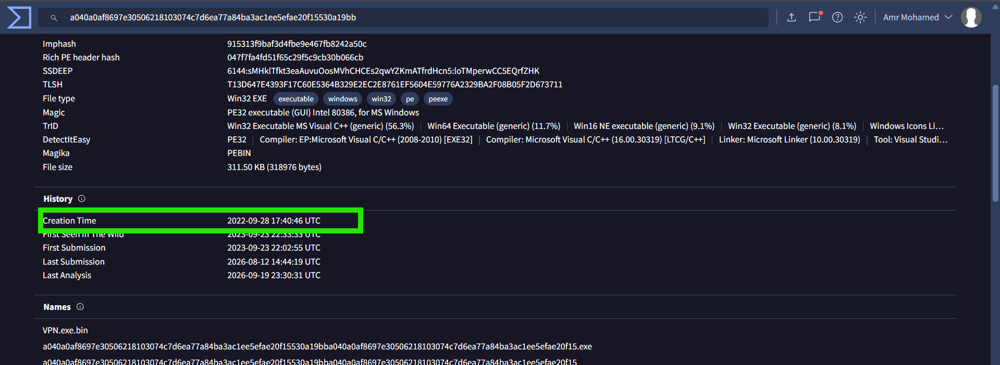
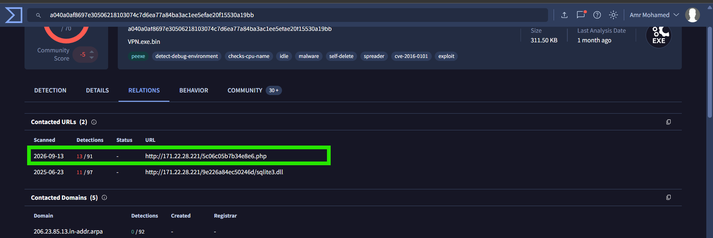
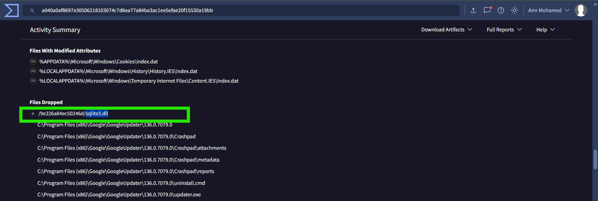
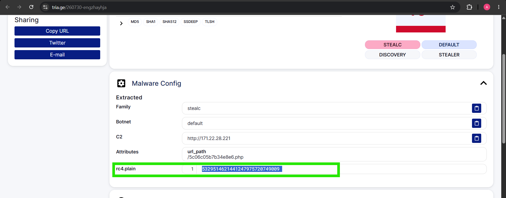
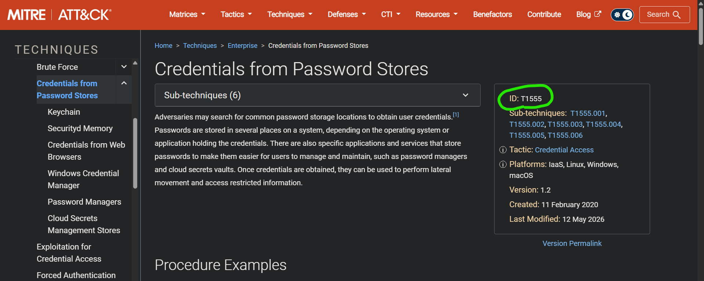
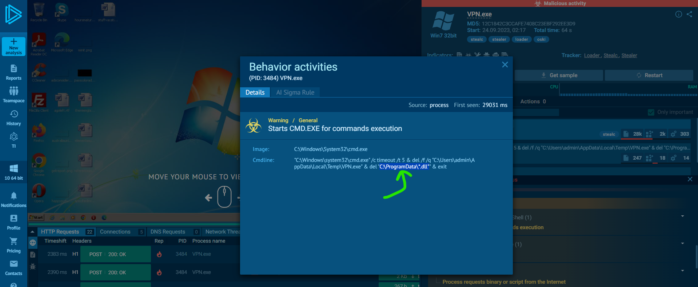
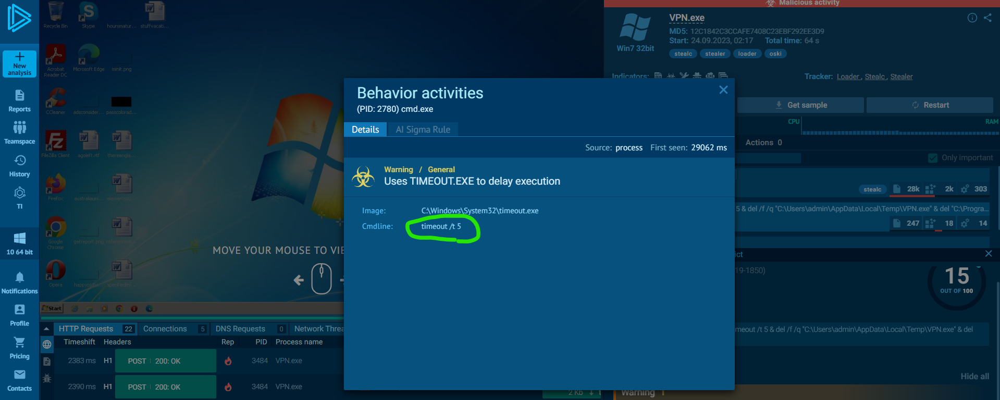

# Oski Lab – Stealc Malware Investigation

## Overview

This investigation focuses on analyzing a suspicious PowerPoint attachment received by an accountant through an email titled **"Urgent New Order"**. The attachment contained false order information, and shortly afterward, the organization's SIEM generated an alert related to the download of a potentially malicious file.

The investigation uses threat intelligence and sandbox analysis reports to examine the malware's metadata, Command and Control (C2) infrastructure, dropped files, encryption configuration, credential-theft techniques, and post-execution behavior.

The objective is to extract actionable findings that can support SOC analysts and Incident Response teams in understanding the malware's behavior and improving detection and response capabilities.

## Investigation Findings

### 1. Malware Creation Time

By examining the file's VirusTotal history, the malware's creation timestamp was identified as:

`2022-09-28 17:40:46 UTC`

For the purpose of the lab, the answer is:

`2022-09-28 17:40 UTC`

### 2. Command and Control (C2) Server

VirusTotal's contacted URLs section revealed the C2 URL associated with the malware:

`http://171.22.28.221/5c06c05b7b34e8e6.php`

This indicator can be used by security teams to investigate related network activity and identify potentially affected endpoints.

### 3. First Requested Library

The Recorded Future Triage report showed that the malware dropped the following library:

`sqlite3.dll`

This was identified as the first library requested by the malware after infection.

### 4. RC4 Decryption Key

By examining the malware configuration extracted in the Recorded Future Triage report, the RC4 key used to decrypt the Base64-encoded string was identified as:

`5329514621441247975720749009`

### 5. MITRE ATT&CK Technique – Credential Theft

The Any.Run sandbox report identified the following main MITRE ATT&CK technique associated with stealing user passwords:

- **T1555 – Credentials from Password Stores**

This technique describes how adversaries access credentials stored in password-management locations and other credential stores on a compromised system.

### 6. DLL Deletion Target Directory

Analysis of the child processes in the Any.Run report revealed a command targeting the following directory for the deletion of DLL files:

`C:\ProgramData`

The observed command included a wildcard DLL deletion operation targeting this directory.

### 7. Malware Self-Deletion

The sandbox report showed that the malware used `TIMEOUT.EXE` with the following argument:

`timeout /t 5`

The malware then proceeded with deletion commands targeting its executable and DLL files.

Therefore, the observed delay before the self-deletion operation was **5 seconds**.

## Indicators of Compromise (IOCs)

| Indicator | Value |
|---|---|
| Malware Family | Stealc |
| Malware Creation Time (UTC) | `2022-09-28 17:40:46` |
| C2 IP Address | `171.22.28.221` |
| C2 URL | `http://171.22.28.221/5c06c05b7b34e8e6.php` |
| Dropped Library | `sqlite3.dll` |
| RC4 Key | `5329514621441247975720749009` |
| DLL Deletion Target | `C:\ProgramData` |
| Self-Deletion Delay | `5 seconds` |

## MITRE ATT&CK Mapping

| Technique ID | Technique Name | Description |
|---|---|---|
| T1555 | Credentials from Password Stores | Stealing user credentials from password stores and other credential storage locations. |

## Conclusion

The investigation identified Stealc malware activity associated with a suspicious PowerPoint attachment received through a fraudulent order email.

The analysis revealed its C2 URL, the dropped `sqlite3.dll` library, and an RC4 key extracted from the malware configuration. The Any.Run sandbox report also highlighted credential theft through **T1555 – Credentials from Password Stores**, alongside post-execution cleanup behavior involving DLL deletion under `C:\ProgramData` and a self-deletion delay of five seconds.

These findings provide useful intelligence for SOC and Incident Response teams, particularly when investigating suspicious email attachments, monitoring C2 communication, detecting credential-theft behavior, and identifying malware cleanup activity.

The extracted indicators and observed behaviors can be used to enrich threat intelligence, support detection engineering, and guide further endpoint and network investigations.
