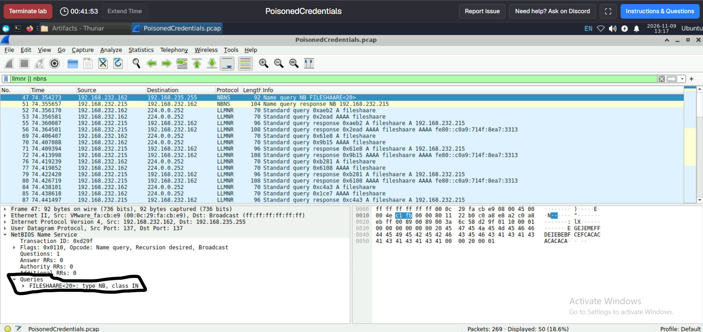
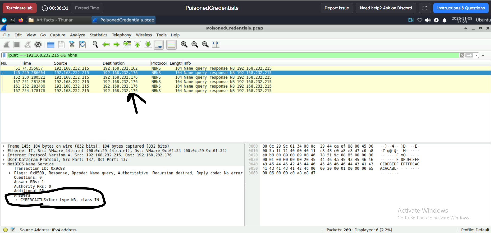
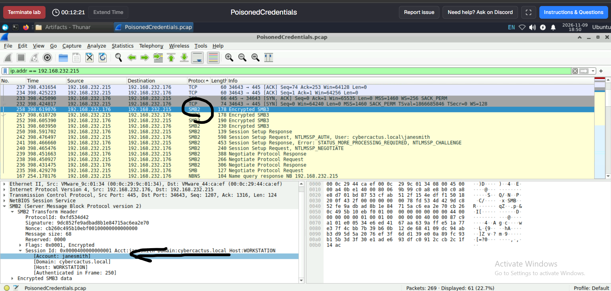
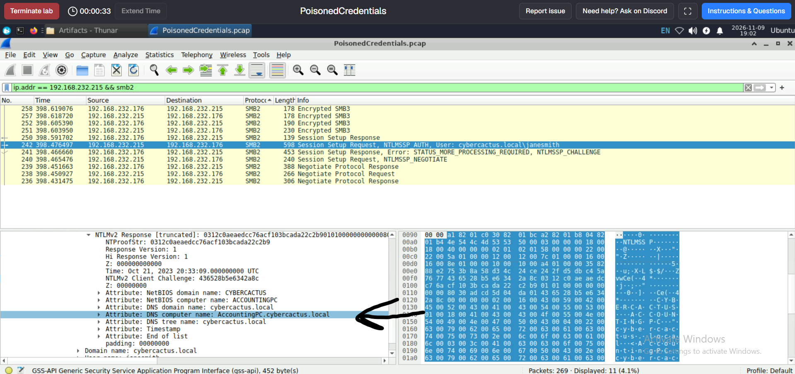

# PoisonedCredentials – CyberDefenders Write-up

## Lab Overview

- **Platform:** CyberDefenders
- **Lab:** PoisonedCredentials
- **Category:** Network Forensics
- **Tool:** Wireshark
- **Artifact:** `PoisonedCredentials.pcap`

## Scenario

The organization's security team detected suspicious network activity potentially related to LLMNR and NetBIOS Name Service (NBNS) poisoning.

The objective is to investigate the provided PCAP file, identify the rogue machine, determine which hosts received poisoned responses, and identify the account and system involved in the subsequent SMB authentication activity.

---

## Investigation

### Q1. Identify the specific mistyped query made by `192.168.232.162`.

**Answer: `fileshaare`**

**Analysis:**

I started by examining LLMNR and NBNS traffic generated by the host `192.168.232.162`.

Wireshark display filter:

```wireshark
llmnr || nbns
```

The captured traffic contains an NBNS name query for `FILESHARE<20>`, alongside LLMNR name-resolution activity for `fileshare`.

This investigation helped identify the mistyped resource name involved in the suspicious name-resolution activity: `fileshaare`.

### Q2. What is the IP address of the rogue machine?

**Answer: `192.168.232.215`**

**Analysis:**

While examining the same LLMNR and NBNS traffic, I identified responses originating from `192.168.232.215`.

The host responded to the name-resolution activity and resolved `fileshare` to its own IP address. This behavior, in the context of the investigation, identifies it as the suspected rogue machine involved in the poisoning activity.

**Evidence for Q1 and Q2:** `LLMNR-NBNS-filter.png`



### Q3. What is the IP address of the second machine that received poisoned responses from the rogue machine?

**Answer: `192.168.232.176`**

**Analysis:**

After identifying the rogue machine, I investigated its communication with other hosts to determine whether additional systems were affected.

The traffic revealed another host communicating with the rogue machine: `192.168.232.176`.

This indicates that the suspicious name-resolution activity was not limited to the initial host `192.168.232.162`.

**Evidence:** `second-victim.png`



### Q4. What is the username of the compromised account?

**Answer: `janesmith`**

**Analysis:**

To investigate potential credential exposure, I examined SMB2 traffic involving the suspected rogue machine.

Wireshark display filter:

```wireshark
ip.addr == 192.168.232.215 && smb2
```

The SMB2 Session Setup Request contains NTLMSSP authentication information, revealing the username:

```text
janesmith
```

This indicates that the account was involved in the authentication exchange with the rogue host.

**Evidence:** `Q4.png`



### Q5. What is the hostname of the machine that the attacker accessed via SMB?

**Answer: `ACCOUNTINGPC`**

**Analysis:**

I further inspected the NTLMv2 authentication response within the SMB2 Session Setup exchange.

The relevant information can be found under:

```text
SMB2
 └── Session Setup Request
      └── Security Blob
           └── GSS-API
                └── NTLM Security Support Provider
                     └── NTLM Response
                          └── NTLMv2 Response
                               └── Attribute: DNS computer name
```

The NTLMv2 response revealed the computer name:

```text
AccountingPC.cybercactus.local
```

Therefore, the hostname is `ACCOUNTINGPC`.

**Evidence:** `Q5.png`



---

## Final Answers

| Question | Answer |
|---|---|
| Q1 – Mistyped query | `fileshaare` |
| Q2 – Rogue machine | `192.168.232.215` |
| Q3 – Second affected machine | `192.168.232.176` |
| Q4 – Compromised username | `janesmith` |
| Q5 – SMB target hostname | `ACCOUNTINGPC` |

## Conclusion

The investigation identified suspicious LLMNR and NBNS name-resolution activity originating from a mistyped resource query. The rogue host `192.168.232.215` responded to the requests, and another affected system, `192.168.232.176`, was identified.

Further SMB and NTLMSSP analysis revealed the username `janesmith` and the hostname `ACCOUNTINGPC`, demonstrating how legacy name-resolution protocols can be abused to capture authentication material.

## Recommended Mitigations

- Disable LLMNR and NetBIOS Name Service where they are not required.
- Enforce SMB signing to help prevent SMB relay attacks.
- Monitor unexpected LLMNR and NBNS responses.
- Investigate NTLM authentication attempts to unauthorized hosts.
- Apply strong password policies and consider restricting NTLM authentication.
