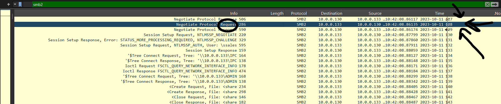
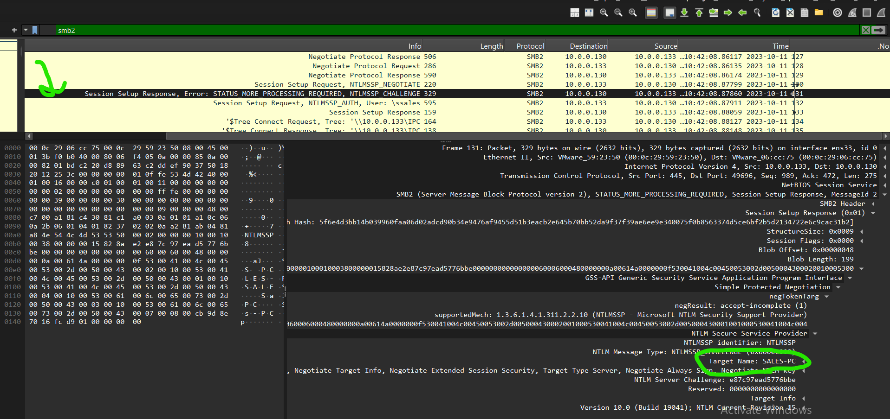
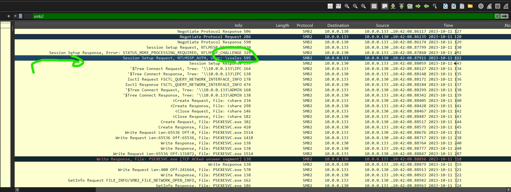
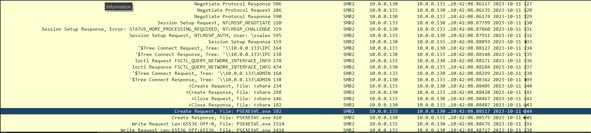
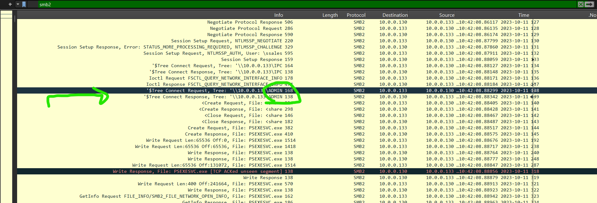
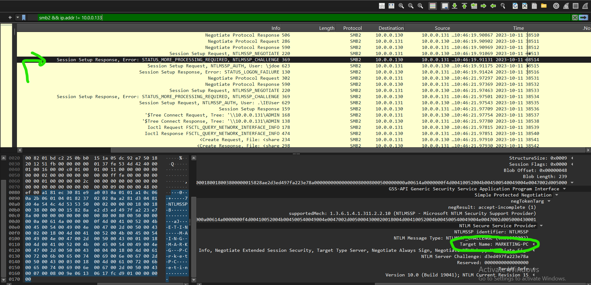

# PsExec Lateral Movement – Network Forensics Investigation

## 1. Lab Overview

- **Platform:** CyberDefenders
- **Category:** Network Forensics
- **Tool:** Wireshark
- **Artifact:** PCAP Network Capture
- **Primary Protocol:** SMB2
- **Attack Technique:** Lateral Movement using PsExec

## 2. Scenario

The security team identified suspicious activity within the internal network and initiated an investigation to trace the attacker's movements between machines.

The investigation focuses on SMB traffic to identify the attacker's initial machine, the first compromised target, the credentials used for authentication, and the artifacts associated with PsExec-based lateral movement.

## 3. Attack Background – Understanding PsExec

Before analyzing the captured traffic, it is important to understand how PsExec works and why it generates specific SMB packets.

PsExec is a legitimate remote administration utility included in the Microsoft Sysinternals Suite. It allows administrators to execute processes on remote Windows machines.

However, attackers can abuse this utility to perform lateral movement after obtaining valid credentials with sufficient privileges on another machine.

### How PsExec Works

**1. SMB Connection and Negotiation**

The attacker establishes an SMB connection to the remote machine, typically over TCP port 445.

The client and server exchange SMB negotiation messages to agree on the protocol version and supported capabilities.

**2. NTLM Authentication**

After negotiation, the client performs authentication using NTLMSSP.

The exchange consists of three main messages:

- `NTLMSSP_NEGOTIATE`: The client initiates authentication.
- `NTLMSSP_CHALLENGE`: The server responds with an authentication challenge.
- `NTLMSSP_AUTH`: The client sends its challenge-response material and account information.

During this exchange, Wireshark may display:

```text
STATUS_MORE_PROCESSING_REQUIRED
```

This is an expected intermediate status during NTLM authentication, not necessarily an authentication failure.

**3. Connecting to SMB Shares**

After authentication, PsExec uses two important SMB shares:

- `ADMIN$`: Provides access to the remote Windows directory and is used to transfer the PsExec service executable.
- `IPC$`: Supports inter-process communication, including communication with the remote Service Control Manager through named pipes.

**4. Uploading the Service Executable**

PsExec transfers an executable named:

```text
PSEXESVC.exe
```

The file is created and written to the remote machine through SMB operations.

**5. Creating and Starting the Service**

PsExec communicates with the remote Service Control Manager, typically through the `svcctl` named pipe over `IPC$`, to create and start the service.

**6. Remote Execution**

Once the service is running, PsExec can execute commands on the remote machine and return their output to the initiating host.

The expected workflow is:

```text
Attacker Machine
       |
       v
   SMB Negotiation
       |
       v
   NTLM Authentication
       |
       v
 Connect to ADMIN$ and IPC$
       |
       +----------------------+
       |                      |
       v                      v
  ADMIN$ Share            IPC$ Share
       |                      |
       v                      v
 Upload PSEXESVC.exe    Service Control Manager
       |                      |
       +-----------+----------+
                   |
                   v
           Create and Start
            Remote Service
                   |
                   v
           Remote Execution
```

## 4. Investigation and Findings

### Q1. Identify the IP address of the machine from which the attacker initially gained access.

**Answer: `10.0.0.130`**

**Analysis:**

I started by examining SMB2 traffic to identify the systems participating in the suspicious communication.

Wireshark display filter:

```wireshark
smb2
```

The SMB negotiation traffic shows communication initiated from `10.0.0.130` toward `10.0.0.133`.

The negotiation request is sent by `10.0.0.130`, identifying it as the machine from which the attacker initiated the observed SMB activity.

**Evidence:** `smb2-filter-negRequest.png`



### Q2. Determine the hostname of the machine to which the attacker first pivoted.

**Answer: `SALES-PC`**

**Analysis:**

After identifying the initial machine, I examined the NTLMSSP authentication exchange to identify the remote target.

The SMB2 Session Setup Response contains an NTLMSSP challenge.

By expanding the NTLM Security Provider details, I found the following field:

```text
Target Name: SALES-PC
```

This identifies the first target machine as `SALES-PC`.

**Evidence:** `Q2.png`



### Q3. Identify the username utilized by the attacker for authentication.

**Answer: `ssales`**

**Analysis:**

Next, I inspected the SMB2 Session Setup Request containing the NTLMSSP authentication information.

The packet details revealed the account name:

```text
User: ssales
```

This identifies the username used during the SMB authentication exchange.

**Evidence:** `Q3.png`



### Q4. Identify the service executable the attacker set up on the target machine.

**Answer: `PSEXESVC.exe`**

**Analysis:**

To identify the executable transferred during the lateral movement activity, I examined the SMB2 file operations following authentication.

Wireshark display filter:

```wireshark
smb2
```

The packet list contains file operations associated with:

```text
Create Request, File: PSEXESVC.exe
Create Response, File: PSEXESVC.exe
Write Request, File: PSEXESVC.exe
Write Response, File: PSEXESVC.exe
```

These operations indicate that the client created and transferred the PsExec service executable to the remote machine.

This is consistent with PsExec's normal deployment mechanism, where `PSEXESVC.exe` is used to create and manage the remote service.

**Evidence:** `sample.png`



### Q5. Identify the network share used by PsExec to install the service on the target machine.

**Answer: `ADMIN$`**

**Analysis:**

As explained earlier, PsExec uses the `ADMIN$` administrative share to access the remote Windows directory and deploy its service executable.

I examined the SMB2 Tree Connect Requests and identified the following connection:

```text
\\10.0.0.133\ADMIN$
```

This confirms that the `ADMIN$` share was accessed during the remote deployment process.

**Evidence:** `Q5.png`



### Q6. Identify the network share PsExec used for communication between the two machines.

**Answer: `IPC$`**

**Analysis:**

In addition to `ADMIN$`, PsExec uses the `IPC$` share for inter-process communication with the remote machine.

The SMB2 traffic contains the following Tree Connect Request:

```text
\\10.0.0.133\IPC$
```

This share supports named-pipe communication, including interaction with the remote Service Control Manager through the `svcctl` named pipe.

Therefore, the share used for communication is `IPC$`.

**Evidence:** `sample.png`


### Q7. Identify the hostname of the second machine the attacker targeted to pivot within the network.

**Answer: `MARKETING-PC`**

**Analysis:**

After identifying the first lateral movement activity, I continued examining SMB2 authentication traffic to determine whether the attacker targeted another machine.

The NTLMSSP challenge in the subsequent SMB session revealed the following field:

```text
Target Name: MARKETING-PC
```

This indicates that `MARKETING-PC` was the hostname of the second machine targeted during the observed activity.

**Evidence:** `Q7.png`



---

## 5. Final Answers

| Question | Finding |
|---|---|
| Q1 – Initial machine IP | `10.0.0.130` |
| Q2 – First target hostname | `SALES-PC` |
| Q3 – Authentication username | `ssales` |
| Q4 – Service executable | `PSEXESVC.exe` |
| Q5 – Deployment share | `ADMIN$` |
| Q6 – Communication share | `IPC$` |
| Q7 – Second target hostname | `MARKETING-PC` |

## 6. Conclusion

The investigation revealed SMB-based lateral movement activity consistent with the use of PsExec.

The attacker initiated SMB communication from `10.0.0.130` and first targeted `SALES-PC`, using the account `ssales` for authentication.

Further SMB analysis revealed the transfer of `PSEXESVC.exe`, along with connections to the `ADMIN$` and `IPC$` shares. These observations are consistent with PsExec's service deployment and remote communication mechanisms.

The investigation also identified `MARKETING-PC` as a second target, indicating additional lateral movement activity within the network.

## 7. Recommended Mitigations

- Restrict administrative SMB access to authorized management systems.
- Monitor unexpected SMB connections, especially between workstations.
- Audit the use of administrative shares such as `ADMIN$` and `IPC$`.
- Monitor the creation of unexpected Windows services, particularly those involving `PSEXESVC.exe`.
- Apply least-privilege principles to administrative accounts.
- Monitor NTLM authentication and consider restricting it where feasible.
- Investigate unusual remote service creation and PsExec execution activity.
