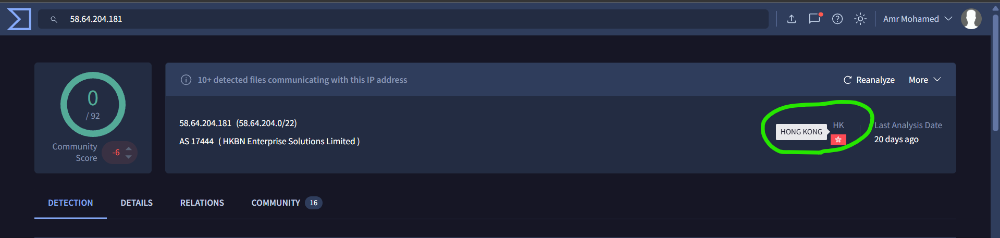
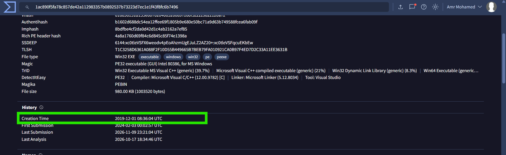
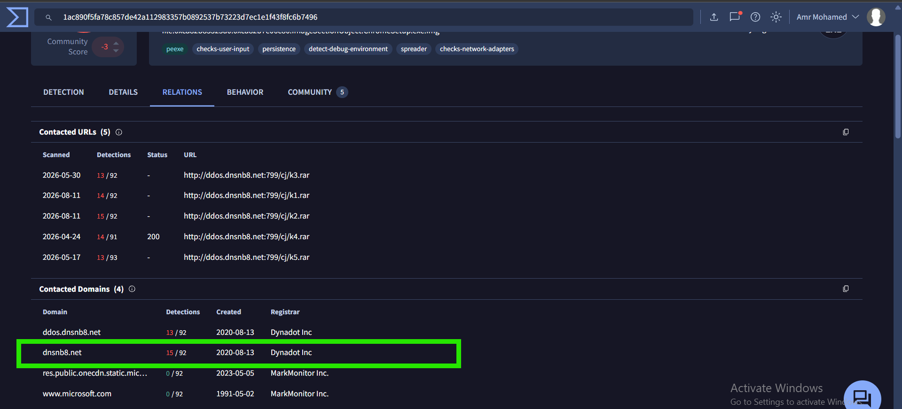

# Ramnit – Blue Team Lab

## Overview

This investigation focuses on analyzing a Windows memory dump using **Volatility 3** and **VirusTotal**.

The objective was to identify suspicious processes, investigate their network activity, extract the suspicious executable from memory, calculate its hash, and identify associated threat infrastructure.

During the investigation, a process named `ChromeSetup.exe` (PID `4628`) was identified. The process was associated with an outbound connection attempt to an external IP address, which led to further investigation of the executable.

## What is Volatility 3?

**Volatility 3** is an open-source memory forensics framework used to analyze RAM dumps. It allows investigators to extract valuable information from memory, including running processes, network connections, loaded DLLs, command-line arguments, and other forensic artifacts.

### Common Volatility 3 Plugins

| Plugin | Purpose |
|---|---|
| `windows.pslist` | Lists processes present in memory |
| `windows.pstree` | Displays processes as a tree, showing parent-child relationships |
| `windows.cmdline` | Displays command-line arguments used to launch processes |
| `windows.netscan` | Extracts network connections |
| `windows.dlllist` | Lists DLLs loaded by a process |
| `windows.malfind` | Searches memory regions that may indicate code injection |
| `windows.dumpfiles` | Extracts files from memory |
| `windows.handles` | Displays handles associated with processes |

## Investigation Findings

### Q1. What is the name of the process responsible for the suspicious activity?

**Answer: `ChromeSetup.exe`**

**Analysis:**

I first used the `windows.pstree` plugin to examine the process tree and identify processes running in the memory image.

The investigation identified a process named `ChromeSetup.exe` with PID `4628`, running from the user's Downloads directory.

I then examined the network connections using `windows.netscan` and found that this process was associated with an outbound connection attempt to the external IP address `58.64.204.181` over TCP port `5202`.

This network activity made `ChromeSetup.exe` the primary process of interest for further investigation.

**Command:**

```powershell
vol -f "C:\Users\AMR MOHAMED\Downloads\159-Ramnit\temp_extract_dir\memory.dmp" windows.pstree
```

### Q2. What is the exact path of the executable for the malicious process?

**Answer: `C:\Users\alex\Downloads\ChromeSetup.exe`**

**Analysis:**

I used the `windows.cmdline` plugin to examine the command-line arguments of running processes.

The output revealed the following command line for PID `4628`:

```text
"C:\Users\alex\Downloads\ChromeSetup.exe"
```

This provided the exact executable path associated with the suspicious process.

**Command:**

```powershell
vol -f "C:\Users\AMR MOHAMED\Downloads\159-Ramnit\temp_extract_dir\memory.dmp" windows.cmdline
```

**Evidence:**


### Q3. What IP address did the malware attempt to connect to?

**Answer: `58.64.204.181`**

**Analysis:**

I used the `windows.netscan` plugin to investigate network connections present in the memory dump.

The results associated PID `4628` (`ChromeSetup.exe`) with an outbound TCP connection attempt to:

```text
58.64.204.181:5202
```

The connection appeared with `CLOSED` and `SYN_SENT` states.

The `SYN_SENT` state indicates that the process attempted to initiate a TCP connection. However, the available evidence does not confirm that the TCP handshake completed.

**Command:**

```powershell
vol -f "C:\Users\AMR MOHAMED\Downloads\159-Ramnit\temp_extract_dir\memory.dmp" windows.netscan
```

**Evidence:**


### Q4. Which city is associated with the IP address the malware communicated with?

**Answer: `Hong Kong`**

**Analysis:**

I searched for the IP address `58.64.204.181` on VirusTotal.

The IP report displayed **Hong Kong** as its associated geographic location and identified the network as:

```text
AS17444 – HKBN Enterprise Solutions Limited
```

This information provides geographic context about the IP address, but does not establish the physical location of the attacker.

**Evidence:**



### Q5. What is the SHA1 hash of the malware executable?

**Answer: `280c9d36039f9432433893dee6126d72b9112ad2`**

**Analysis:**

To extract files associated with the suspicious process, I used the `windows.dumpfiles` plugin with PID `4628`.

**Command:**

```powershell
vol -f "C:\Users\AMR MOHAMED\Downloads\159-Ramnit\temp_extract_dir\memory.dmp" -o "C:\Tools\Volatility3" windows.dumpfiles --pid 4628
```

**Command breakdown:**

- `-f`: Specifies the memory dump to analyze.
- `-o`: Specifies the output directory where extracted files will be saved.
- `windows.dumpfiles`: Extracts file objects and file-backed data available in the memory image.
- `--pid 4628`: Filters the extraction to file objects associated with the specified process ID.

The command extracted several files, including DLLs and file objects associated with `ChromeSetup.exe`.

Among the extracted files, I identified the executable-related image:

```text
file.0xca82b85325a0.0xca82b7e06c80.ImageSectionObject.ChromeSetup.exe.img
```

The extracted file was then used to calculate its hash.

**SHA1 calculation:**

```powershell
Get-FileHash ".\file.0xca82b85325a0.0xca82b7e06c80.ImageSectionObject.ChromeSetup.exe.img" -Algorithm SHA1
```

**SHA256 calculation (additional file identification):**

```powershell
Get-FileHash ".\file.0xca82b85325a0.0xca82b7e06c80.ImageSectionObject.ChromeSetup.exe.img" -Algorithm SHA256
```

**Note:** SHA1 and SHA256 are different hashing algorithms. The lab specifically requests SHA1, so the SHA1 command must be used to verify the provided answer. The extracted memory image may also differ from the original on-disk executable if some file data was not present in memory.

**Evidence:**


### Q6. What is the compilation timestamp for the malware?

**Answer: `2019-12-01 08:36`**

**Analysis:**

I searched for the executable's hash on VirusTotal and examined the file's Details section.

Under the History section, the report displayed the following Creation Time:

```text
2019-12-01 08:36:04 UTC
```

This timestamp was used to answer the lab question.

**Evidence:**



### Q7. What domain is associated with the malware?

**Answer: `dnsnb8.net`**

**Analysis:**

I examined the Relations tab in the VirusTotal report to identify domains associated with the analyzed executable.

Under the Contacted Domains section, I identified:

```text
dnsnb8.net
```

The report also showed the related subdomain `ddos.dnsnb8.net`, along with contacted URLs associated with this infrastructure.

This domain was recorded as a threat-intelligence indicator for further investigation.

**Evidence:**



## Indicators of Compromise (IOCs)

| Indicator | Type | Description |
|---|---|---|
| `ChromeSetup.exe` | Process | Suspicious process identified in memory |
| `C:\Users\alex\Downloads\ChromeSetup.exe` | File Path | Executable path |
| `58.64.204.181` | IP Address | Remote IP associated with the connection attempt |
| `5202` | TCP Port | Destination port |
| `dnsnb8.net` | Domain | Domain identified in VirusTotal relations |
| `280c9d36039f9432433893dee6126d72b9112ad2` | SHA1 | Malware executable hash |

## Conclusion

The investigation identified `ChromeSetup.exe` (PID `4628`) as the suspicious process running from the user's Downloads directory.

Using Volatility 3, I examined the process tree, command-line arguments, and network connections. The investigation revealed an attempted outbound TCP connection to `58.64.204.181` over port `5202`.

I then used `windows.dumpfiles` to extract file objects associated with the suspicious process and identify the executable-related memory image.

VirusTotal was used to investigate the IP address and the extracted executable. The investigation identified Hong Kong as the IP's associated geographic location and revealed `dnsnb8.net` as a related domain.

The executable was associated with the SHA1 hash `280c9d36039f9432433893dee6126d72b9112ad2` and a reported Creation Time of `2019-12-01 08:36 UTC`.

This investigation demonstrates how memory forensics and threat intelligence can be combined to identify suspicious processes, investigate network activity, extract executable artifacts, and collect indicators for threat hunting.
