# Red Stealer Lab

## Overview

This investigation focuses on analyzing a suspicious executable identified on an organization's endpoint. As part of the Threat Intelligence team, the objective is to examine the file's hash using VirusTotal and other threat intelligence resources to identify its malware classification, associated indicators of compromise (IOCs), behavior, and related threat intelligence.

The findings are intended to support SOC analysts and the Incident Response team in understanding the threat and improving detection and response capabilities.

## Investigation Findings

### 1. Malware Classification

VirusTotal identified the malware under the **Trojan** category according to Microsoft's detection results.

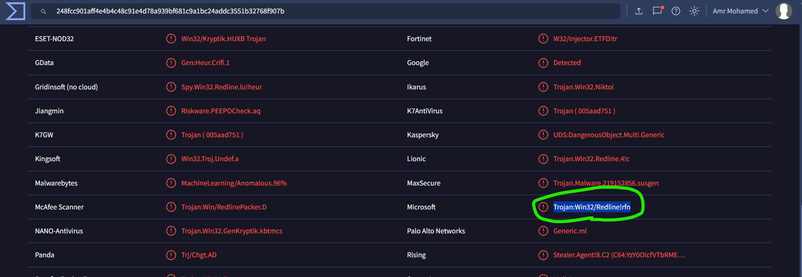

### 2. Malware File Name

The file associated with the identified malware was named:

`WEXTRACT`

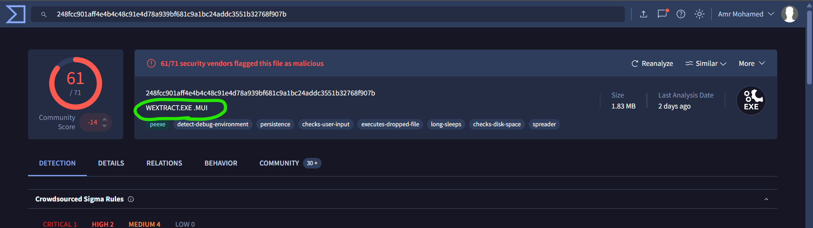

### 3. First Submission to VirusTotal

The malware was first submitted to VirusTotal at the following UTC timestamp:

`2023-10-06 04:41 UTC`

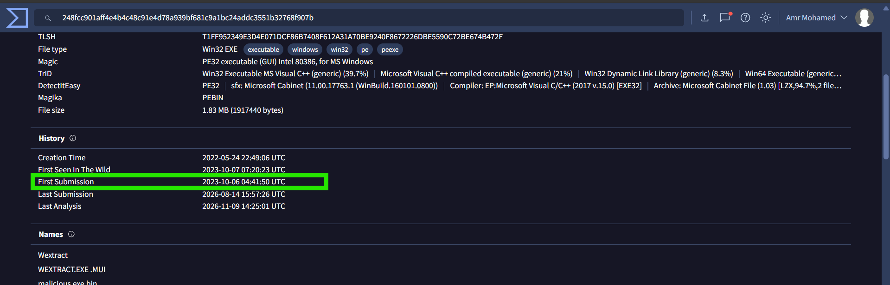

### 4. MITRE ATT&CK Technique

The malware was associated with the following technique for collecting data from the local system prior to exfiltration:

- **T1005 – Data from Local System**

This technique describes the collection of data from a compromised system before it is potentially exfiltrated.

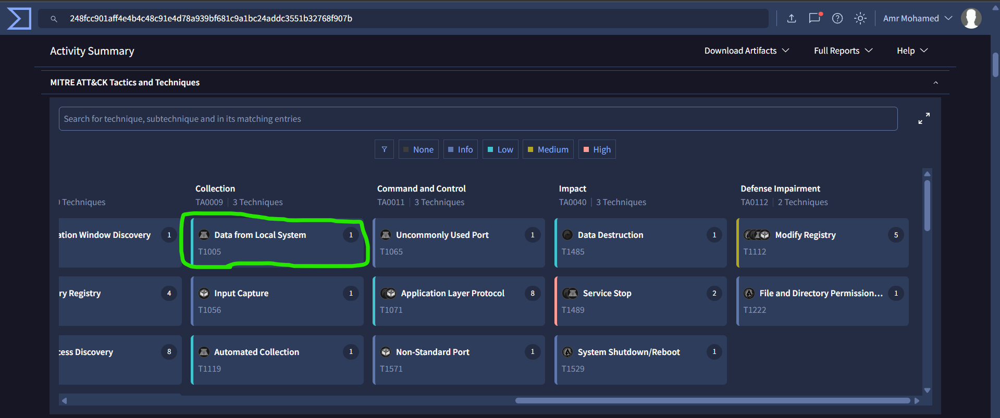

### 5. Connectivity Check Domain

Before communicating with its Command and Control (C2) infrastructure, the malware resolves the following domain as part of its connectivity check:

`facebook.com`

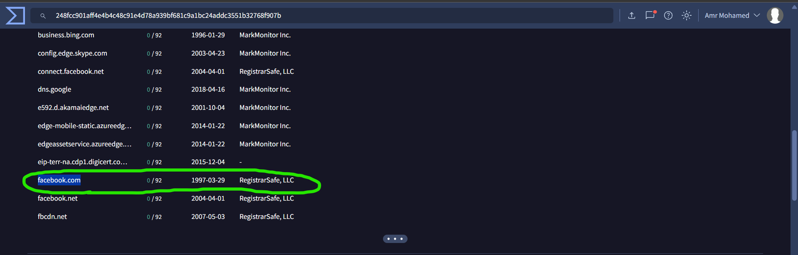

### 6. Command and Control Infrastructure

The investigation identified the following IP address and destination port associated with the malware's C2 communication:

- **IP Address:** `77.91.124.55`
- **Destination Port:** `19071`

**C2 Endpoint:** `77.91.124.55:19071`

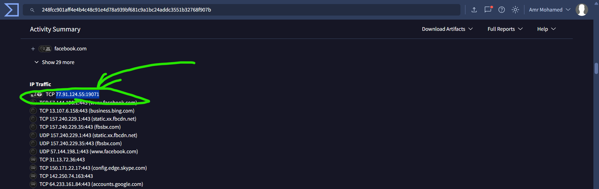

### 7. YARA Rule Identification

Using MalwareBazaar, the investigation identified a YARA rule created by **Varp0s** that detects the identified malware:

`detect_Redline_Stealer`

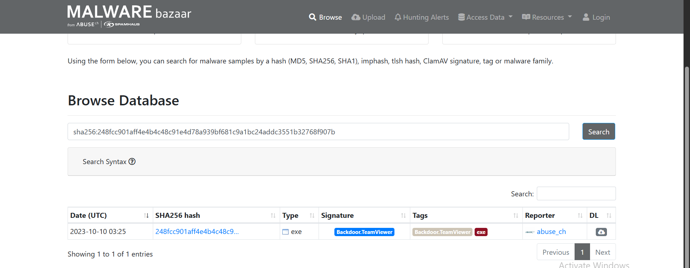

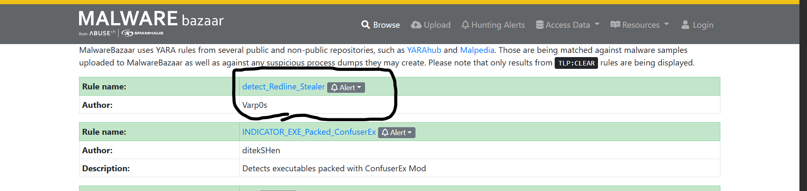

### 8. Malware Alias

According to Malpedia, another malware alias associated with the identified malicious IP address is:

`RECORDSTEALER`

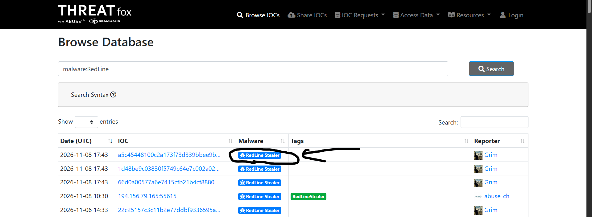

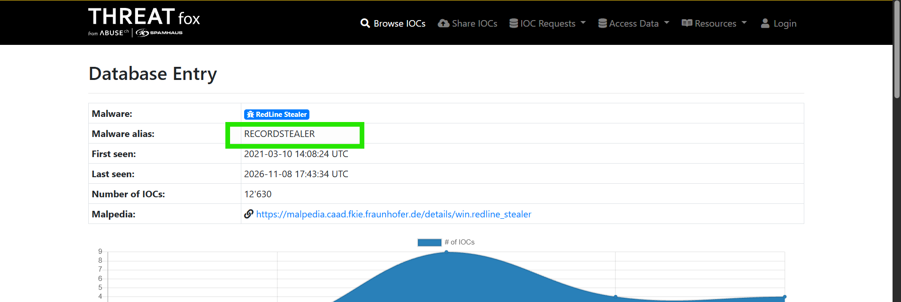

### 9. DLL Associated with Privilege Escalation

The investigation identified the following imported DLL as the one utilized by the malware for privilege escalation:

`ADVAPI32.dll`

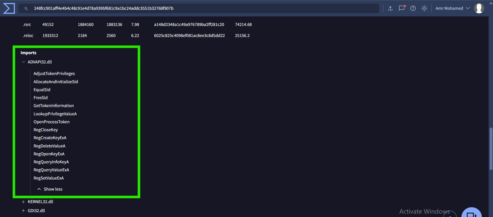

## Indicators of Compromise (IOCs)

| Indicator | Value |
|---|---|
| Malware File Name | `WEXTRACT` |
| Malware Category | Trojan |
| First Submission (UTC) | `2023-10-06 04:41` |
| Connectivity Check Domain | `facebook.com` |
| C2 IP Address | `77.91.124.55` |
| C2 Destination Port | `19071` |
| C2 Endpoint | `77.91.124.55:19071` |
| Malware Alias | `RECORDSTEALER` |
| YARA Rule | `detect_Redline_Stealer` |
| Associated DLL | `ADVAPI32.dll` |

## MITRE ATT&CK Mapping

| Technique ID | Technique Name | Description |
|---|---|---|
| T1005 | Data from Local System | Collecting data from the local system prior to exfiltration. |

## Conclusion

The investigation identified a Trojan-classified executable named `WEXTRACT` and gathered several useful threat intelligence indicators associated with its activity.

The findings include a connectivity check involving `facebook.com`, a C2 endpoint at `77.91.124.55:19071`, and the malware alias `RECORDSTEALER` according to Malpedia. The investigation also identified the YARA rule `detect_Redline_Stealer` on MalwareBazaar and `ADVAPI32.dll` as the DLL associated with privilege escalation.

These findings can help SOC and Incident Response teams enrich security alerts, investigate potentially affected endpoints, and develop detection and response measures based on the identified indicators.
