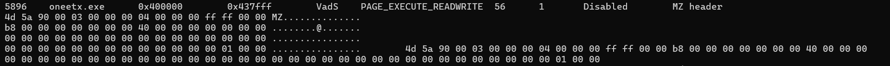
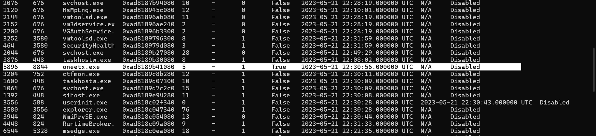
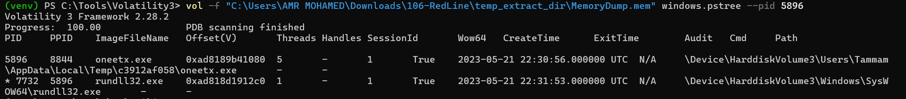
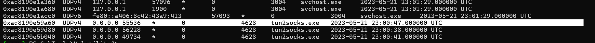
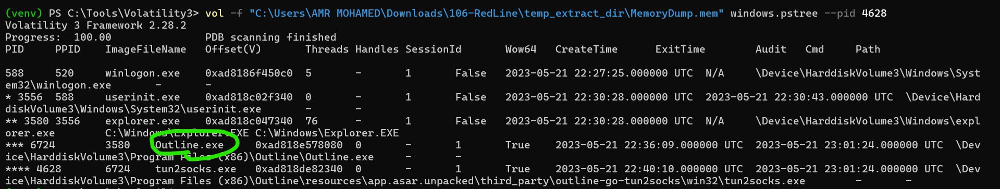

# RedLine — Memory Forensics Investigation

## Overview

This investigation focuses on analyzing a compromised Windows system through a memory dump using Volatility 3 and memory forensic techniques.

The objectives were to identify a suspicious process, examine its process relationships and memory permissions, investigate network connections, identify the VPN application running on the system, and recover attacker-related indicators of compromise (IOCs).

The investigation identified a suspicious executable named `oneetx.exe`, a related child process, and a remote IP address associated with the suspicious process's network activity.

## Investigation Details

| Field | Details |
|---|---|
| Lab | CyberDefenders — RedLine |
| Category | Memory Forensics / Malware Investigation |
| Tools | Volatility 3, Strings, Process Analysis |
| Evidence | MemoryDump.mem |
| Suspicious Process | `oneetx.exe` |
| Suspicious PID | `5896` |
| Child Process | `rundll32.exe` |
| Remote IP | `77.91.124.20` |
| VPN Application | `Outline.exe` |

---

## Q1 — What is the name of the suspicious process?

**Answer:** `oneetx.exe`

### Investigation

I started by analyzing suspicious memory regions using Volatility 3:

```powershell
vol -f "MemoryDump.mem" windows.malfind
```

The `malfind` plugin identified a suspicious memory region associated with `oneetx.exe`, PID `5896`.

The identified memory region contained an `MZ` header and had `PAGE_EXECUTE_READWRITE` permissions.

These characteristics warranted further investigation because writable and executable memory regions can be associated with malicious code execution or process injection. However, these indicators alone do not conclusively establish process injection.



To further investigate the process, I enumerated processes using:

```powershell
vol -f "MemoryDump.mem" windows.psscan
```

The `psscan` plugin scans memory for Windows process objects, including processes that may no longer appear in the active process list.

The results included `oneetx.exe`, confirming the presence of the suspicious process in the memory image.



### Finding

The suspicious process was identified as `oneetx.exe`, with PID `5896`.

---

## Q2 — What is the child process name of the suspicious process?

**Answer:** `rundll32.exe`

### Investigation

To examine the parent-child process relationships, I used the `pstree` plugin and filtered the output for PID `5896`:

```powershell
vol -f "MemoryDump.mem" windows.pstree --pid 5896
```

The process tree showed a child process associated with `oneetx.exe`. The identified child process was `rundll32.exe`.

`rundll32.exe` is a legitimate Windows utility used to execute functions exported from DLL files. Because attackers can abuse this utility to execute malicious DLL code, its relationship with a suspicious executable is worth investigating.

The process relationship alone does not establish that malicious DLL execution occurred.



### Finding

The child process was identified as `rundll32.exe`.

---

## Q3 — What is the memory protection applied to the suspicious process memory region?

**Answer:** `PAGE_EXECUTE_READWRITE`

### Investigation

The memory protection was identified using:

```powershell
vol -f "MemoryDump.mem" windows.malfind
```

The suspicious memory region associated with `oneetx.exe` had the following characteristics:

| Property | Value |
|---|---|
| Process | `oneetx.exe` |
| PID | `5896` |
| Start Address | `0x400000` |
| End Address | `0x437fff` |
| VAD Tag | `VadS` |
| Protection | `PAGE_EXECUTE_READWRITE` |
| Header | `MZ` |

The `PAGE_EXECUTE_READWRITE` permission allows memory to be read, modified, and executed.

This permission combination is relevant during memory forensics because malicious software may use writable and executable regions for dynamically generated code or injected payloads.

The `MZ` header indicates the presence of a DOS executable header signature, commonly found at the beginning of Windows PE files.

The combination of these observations makes the memory region an important investigation target, although it is not sufficient by itself to prove code injection.

**Evidence:** `screenshots/Q1-1.png`

### Finding

The memory protection was `PAGE_EXECUTE_READWRITE`.

---

## Q4 — What is the name of the process responsible for the VPN connection?

**Answer:** `Outline.exe`

### Investigation

I investigated network connections using:

```powershell
vol -f "MemoryDump.mem" windows.netscan
```

The results revealed a process named `tun2socks.exe`, which is associated with tunneling network traffic.


To determine which application launched this process, I investigated its process hierarchy:

```powershell
vol -f "MemoryDump.mem" windows.pstree --pid 4628
```

The process tree showed that `tun2socks.exe` was a child of `Outline.exe`.





### Analysis

Outline is a VPN application that can route network traffic through an encrypted connection.

The presence of `tun2socks.exe` as a child process supports the conclusion that Outline was responsible for the VPN-related network activity.

VPN tunneling can reduce the visibility of traffic contents to a NIDS that lacks access to decrypted traffic. However, identifying the VPN application alone does not prove that the attacker used it to bypass the NIDS.

### Finding

The process responsible for the VPN connection was `Outline.exe`.

---

## Q5 — What is the attacker's IP address?

**Answer:** `77.91.124.20`

### Investigation

I analyzed network connections using the Volatility `netscan` plugin:

```powershell
vol -f "MemoryDump.mem" windows.netscan
```

The results showed a network connection associated with the suspicious process `oneetx.exe`.

The remote IP address was:

```text
77.91.124.20
```

### Analysis

The association between the suspicious process and this remote IP address makes it an important network IOC.

The same IP address was subsequently found in a URL recovered from the memory dump, providing additional context for its role in the investigation.

### Finding

The attacker-associated IP address was `77.91.124.20`.

---

## Q6 — What is the full URL of the PHP file that the attacker visited?

**Answer:** `http://77.91.124.20/store/games/index.php`

### Investigation

To identify URLs and network artifacts embedded in the memory image, I searched for strings containing the suspicious IP address:

```bash
strings MemoryDump.mem | grep "77.91.124.20"
```

The results revealed the following URL:

```text
http://77.91.124.20/store/games/index.php
```

### Analysis

This URL provides a potential attacker-controlled web endpoint associated with the suspicious IP address.

Recovering the URL from memory establishes that the string was present in the memory image. It does not, by itself, confirm a successful HTTP request or establish the endpoint's exact function.

Further analysis of browser artifacts, process memory, or network captures would be necessary to determine whether the URL was accessed successfully and what data was exchanged.

### Finding

The recovered URL was `http://77.91.124.20/store/games/index.php`.

---

## Q7 — What is the full path of the malicious executable?

**Answer:** `C:\Users\Tammam\AppData\Local\Temp\c3912af058\oneetx.exe`

### Investigation

To determine the executable's location on the compromised machine, I searched the memory dump for references to the suspicious process name:

```bash
strings MemoryDump.mem | grep "oneetx.exe"
```

The results revealed the executable path:

```text
C:\Users\Tammam\AppData\Local\Temp\c3912af058\oneetx.exe
```

### Analysis

The executable was located inside the user's temporary application data directory.

Temporary directories are frequently used for extracting or staging executable files, including legitimate software installers and malicious payloads.

In this investigation, the location is particularly relevant when correlated with the suspicious memory permissions and network activity associated with `oneetx.exe`.

### Finding

The malicious executable path was:

`C:\Users\Tammam\AppData\Local\Temp\c3912af058\oneetx.exe`

---

## Indicators of Compromise (IOCs)

| Type | Indicator |
|---|---|
| Suspicious Process | `oneetx.exe` |
| Process ID | `5896` |
| Child Process | `rundll32.exe` |
| Remote IP | `77.91.124.20` |
| Suspicious URL | `http://77.91.124.20/store/games/index.php` |
| Executable Path | `C:\Users\Tammam\AppData\Local\Temp\c3912af058\oneetx.exe` |
| Memory Protection | `PAGE_EXECUTE_READWRITE` |

**Note:** `Outline.exe`, `tun2socks.exe`, and `rundll32.exe` are legitimate software components or utilities. Their presence alone should not be treated as evidence of compromise.

---

## Attack Analysis

Based on the recovered memory artifacts, the investigation established the following findings:

1. **Suspicious process identification:** `oneetx.exe` was identified using Volatility's `malfind` and `psscan` plugins.
2. **Process relationship analysis:** The process tree revealed `rundll32.exe` as a child process of the suspicious executable.
3. **Memory analysis:** A memory region associated with `oneetx.exe` had `PAGE_EXECUTE_READWRITE` protection and contained an `MZ` header.
4. **VPN identification:** `tun2socks.exe` was identified during network analysis, and its parent process was `Outline.exe`.
5. **Network investigation:** `oneetx.exe` was associated with the remote IP address `77.91.124.20`.
6. **URL extraction:** String analysis recovered `http://77.91.124.20/store/games/index.php`.
7. **Executable path recovery:** The suspicious executable was located under the user's temporary application data directory.

These findings describe the investigative workflow and relationships between artifacts. They do not establish the exact chronological order of attacker actions.

### NIDS Evasion Considerations

The presence of Outline VPN software suggests that tunneling was available on the compromised system.

Encrypted VPN traffic can limit the visibility of payload contents to a NIDS that lacks access to decrypted traffic.

However, the available evidence does not establish whether the attacker configured or used Outline, whether the suspicious process's traffic passed through the VPN, or whether the NIDS was actually bypassed.

These questions would require additional network or host evidence.

---

## Recommended Remediation

For a real-world incident involving these findings, the following actions would be appropriate:

1. Isolate the affected endpoint from the network while preserving forensic evidence.
2. Investigate and block confirmed malicious communications involving `77.91.124.20` and the associated URL.
3. Quarantine the suspicious executable after preserving a forensic copy and collecting its cryptographic hashes.
4. Inspect `rundll32.exe` command-line arguments and loaded DLLs to determine whether malicious DLL execution occurred.
5. Review persistence mechanisms, including scheduled tasks, services, registry Run keys, and startup folders.
6. Examine the Outline VPN configuration and network routing to determine whether tunneling was authorized or abused.
7. Perform a comprehensive endpoint scan and validate that malicious artifacts have been removed before restoring normal operations.

---

## Conclusion

This memory forensic investigation identified `oneetx.exe` as the suspicious process and recovered several relevant host and network artifacts using Volatility 3 and string analysis.

The investigation established a relationship between the suspicious executable and `rundll32.exe`, identified a writable and executable memory region, recovered an attacker-associated IP address and URL, and located the executable within the user's temporary directory.

Additionally, the analysis identified Outline as the VPN application associated with `tun2socks.exe`.

These findings provide a foundation for further malware analysis, incident containment, and investigation of potential network detection evasion.

## Tools Used

- **Volatility 3:** Process enumeration, process tree analysis, suspicious memory region identification, and network connection analysis.
- **Strings:** Extraction of readable executable paths, IP addresses, and URLs from the memory dump.
- **PowerShell:** Execution of forensic commands on the Windows analysis workstation.
