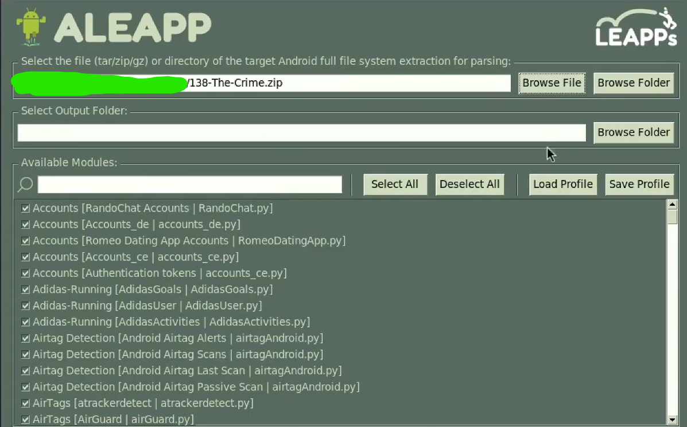
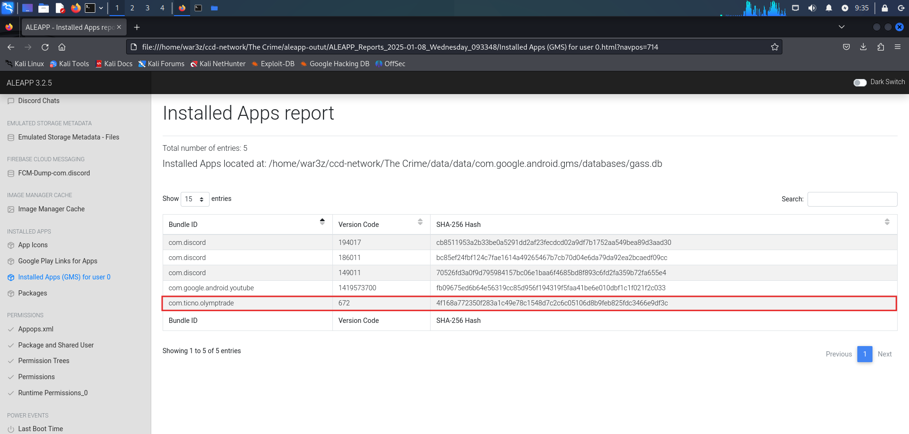
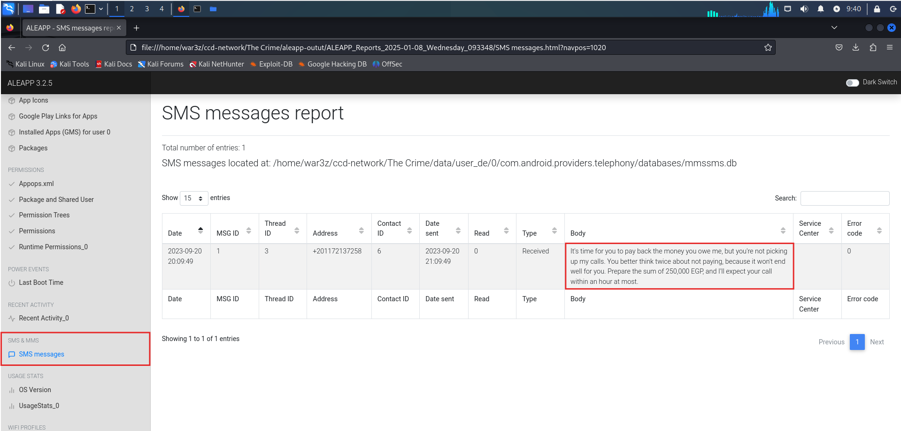
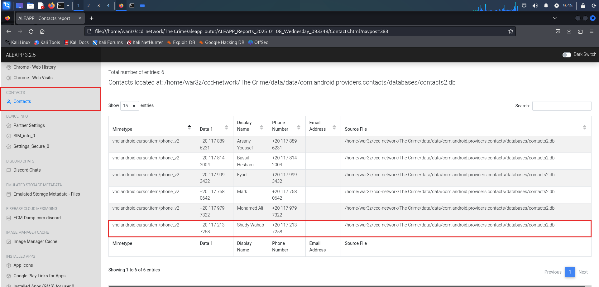
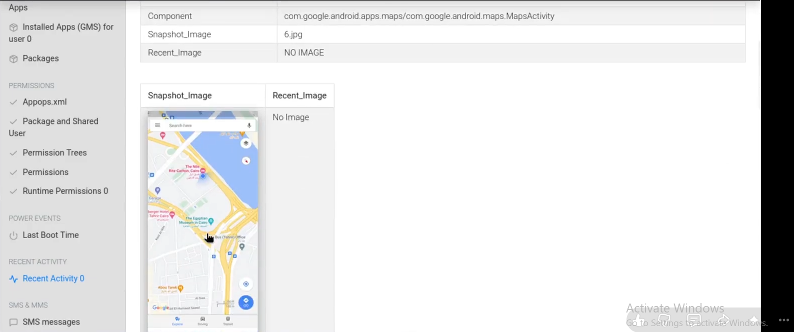
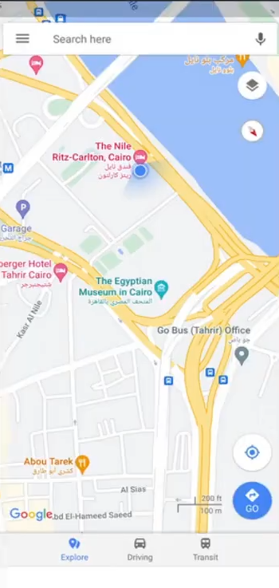
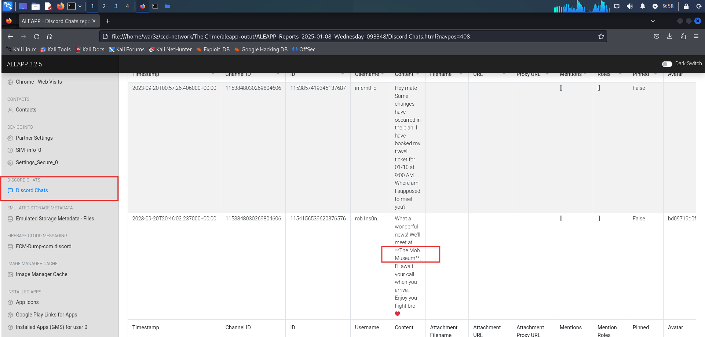
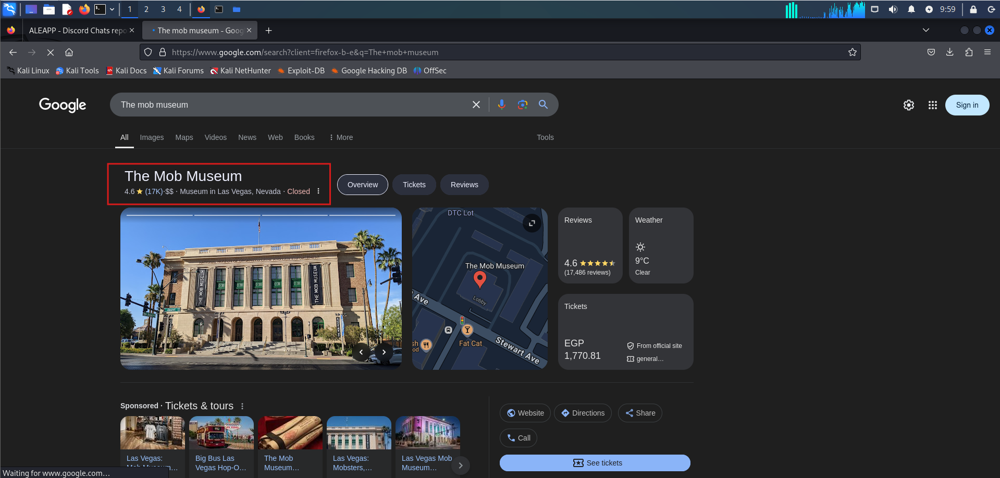

# The Crime – Android Mobile Forensics Investigation

## Lab Overview
This investigation examines an Android device to reconstruct the victim's financial situation, communications, and movements before the incident. **ALEAPP (Android Logs, Events, and Protobuf Parser)** was used to parse the provided Android file-system extraction and generate HTML reports.

## Tool Used
- **ALEAPP** – Android artifact extraction and analysis.

## Investigation Walkthrough

### 1. Preparing the Evidence with ALEAPP
I loaded the provided extraction archive (`138-The-Crime.zip`) into ALEAPP, selected the available modules, and generated HTML reports for examination.

### 2. Identifying the Trading Application SHA256
**Question:** Based on witness accounts, the victim was interested in trading, invested all his money, and acquired debt. What is the SHA256 of the trading application he primarily used?

**Answer:** `4f168a772350f283a1c49e78c1548d7c2c6c05106d8b9feb825fdc3466e9df3c`

**Analysis:** In the **Installed Apps (GMS) for user 0** report, I identified the trading application with package name `com.ticno.olymptrade`. The report provided its SHA-256 hash.

### 3. Determining the Amount of Money Owed
**Question:** According to the victim's best friend, the victim avoided calls from someone he owed money to. How much did he owe this person?

**Answer:** `250000 EGP`

**Analysis:** The **SMS messages** report contained a threatening message demanding repayment. The sender explicitly requested **250,000 EGP** and threatened further consequences if the victim did not pay.

### 4. Identifying the Person the Victim Owed Money To
**Question:** What is the name of the person to whom the victim owes money?

**Answer:** `Shady Wahab`

**Analysis:** After identifying the phone number associated with the threatening SMS, I reviewed the **Contacts** report. The corresponding number was saved under the name **Shady Wahab**.

### 5. Identifying the Victim's Location on September 20, 2023
**Question:** On September 20, 2023, the victim left his residence without telling anyone where he was going. Where was he located?

**Answer:** `The Nile Ritz-Carlton`

**Analysis:** I examined the **Recent Activity** artifacts and found Google Maps activity. The extracted snapshot showed the victim's location near **The Nile Ritz-Carlton** in Cairo.

### 6. Identifying the Victim's Intended Travel Destination
**Question:** The hotel lobby indicated that the victim had reserved a room for 10 days and had a flight scheduled afterward. Where did he intend to travel?

**Answer:** `Las Vegas`

**Analysis:** In the **Discord Chats** report, I found a conversation in which the victim mentioned booking a flight for **01/10 at 9:00 AM**. The conversation also referenced a planned meeting at **The Mob Museum**. A location lookup confirmed that the museum is in **Las Vegas, Nevada**, revealing the intended destination.

### 7. Identifying the Planned Meeting Location
**Question:** After examining the victim's Discord conversations, where was he supposed to meet his friend?

**Answer:** `The Mob Museum`

**Analysis:** The same Discord conversation explicitly mentioned **The Mob Museum** as the meeting place, with the other participant saying they would wait for the victim to arrive.

## Key Findings

| Finding | Result |
|---|---|
| Trading application | `com.ticno.olymptrade` |
| Trading application SHA256 | `4f168a772350f283a1c49e78c1548d7c2c6c05106d8b9feb825fdc3466e9df3c` |
| Outstanding debt | 250,000 EGP |
| Person demanding repayment | Shady Wahab |
| Victim's identified location | The Nile Ritz-Carlton, Cairo |
| Intended travel destination | Las Vegas, Nevada |
| Planned meeting location | The Mob Museum |

## Conclusion
The Android forensic examination uncovered important details about the victim's finances, communications, and movements. ALEAPP artifacts identified the Olymp Trade application and a threatening SMS demanding repayment of **250,000 EGP** from Shady Wahab. Google Maps activity placed the victim near **The Nile Ritz-Carlton** on September 20, 2023. Finally, Discord conversations revealed plans to travel to **Las Vegas** and meet someone at **The Mob Museum**.

By correlating installed-application data, SMS messages, contacts, location artifacts, and Discord conversations, the investigation reconstructed several key events and provided context surrounding the incident.
