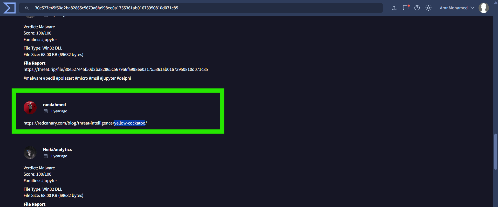
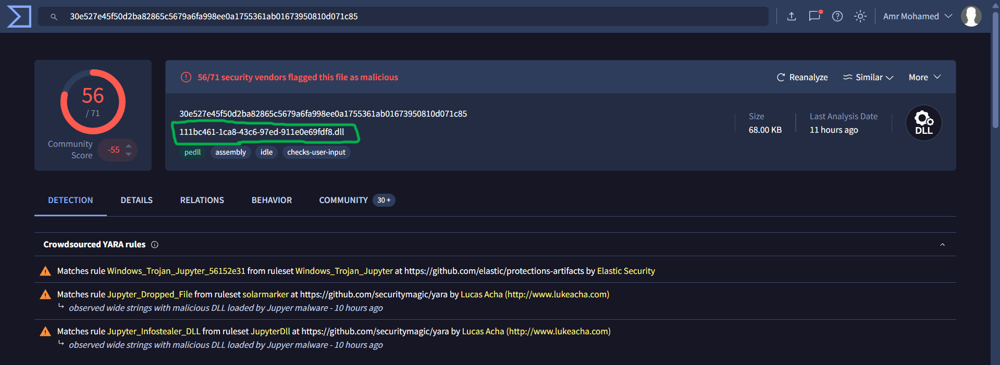
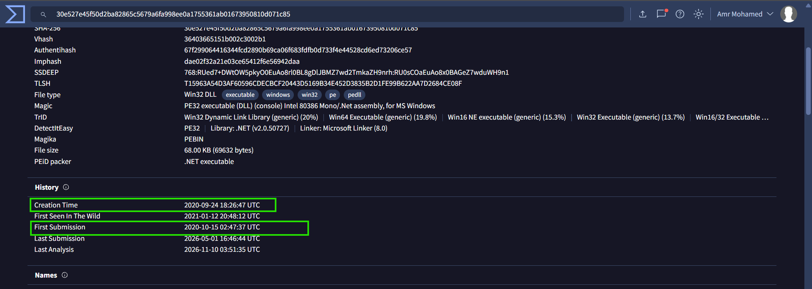
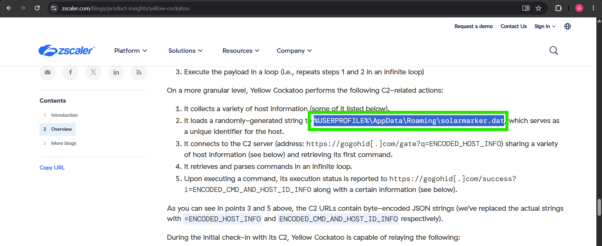
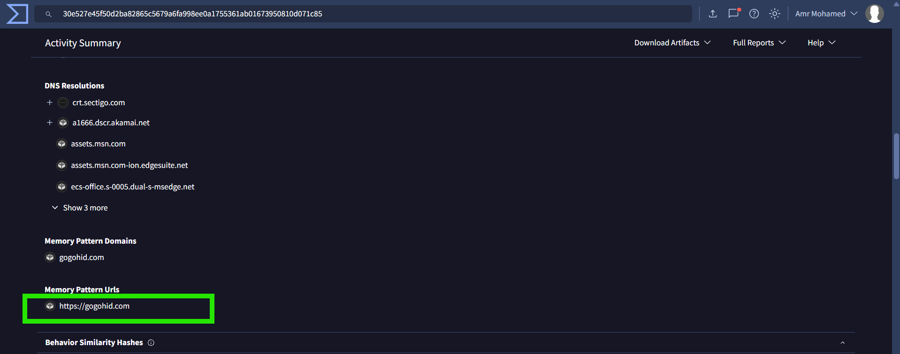

# Yellow Cockatoo Malware Investigation

## Overview

This investigation focuses on analyzing a malicious Windows DLL associated with the **Yellow Cockatoo** threat cluster.

The analysis involved reviewing VirusTotal intelligence, examining community-submitted information, identifying the malware's common filename, reviewing its timestamps, and extracting indicators related to dropped files and Command and Control (C2) infrastructure.

The objective was to identify useful indicators of compromise (IOCs) that could support threat hunting and incident response.

## Sample Information

| Attribute | Value |
|---|---|
| SHA256 | `30e527e45f50d2ba82865c5679a6fa998ee0a1755361ab01673950810d071c85` |
| File Type | Win32 DLL |
| File Size | 68 KB (69,632 bytes) |
| VirusTotal Detection | 56/71 security vendors |
| Malware Family | Jupyter |
| Threat Cluster | Yellow Cockatoo |

## Investigation Findings

### Q1. What name does Red Canary use for the threat cluster associated with the SHA256 in hash.txt?

**Answer: Yellow Cockatoo**

**Analysis:**

The VirusTotal Community tab contained a community reference associating the analyzed sample with Yellow Cockatoo. The associated Red Canary research link also references the Yellow Cockatoo threat cluster.

**Evidence:**



### Q2. What is the common filename associated with this malware?

**Answer: `111bc461-1ca8-43c6-97ed-911e0e69fdf8.dll`**

**Analysis:**

The VirusTotal report identifies this as the common filename associated with the analyzed SHA256 hash. This filename can be used as a search indicator when examining endpoints for potentially related samples.

**Evidence:**



### Q3. What compilation timestamp does VirusTotal show for this malware sample?

**Answer: `2020-09-24 18:26 UTC`**

**Analysis:**

The VirusTotal History section displays the sample's creation timestamp as `2020-09-24 18:26:47 UTC`. This is the timestamp reported by the file metadata; PE timestamps can be manipulated and should not be treated as definitive proof of the actual development date.

### Q4. When was the malware first submitted to VirusTotal?

**Answer: `2020-10-15 02:47 UTC`**

**Analysis:**

The VirusTotal History section shows the first submission timestamp as `2020-10-15 02:47:37 UTC`. This records when the sample was first submitted to VirusTotal, providing a reference point for its earliest known appearance in the platform's collection.

**Evidence for Q3 and Q4:**



### Q5. What is the name of the .dat file that the malware dropped in the AppData folder?

**Answer: `solarmarker.dat`**

**Analysis:**

The Yellow Cockatoo technical analysis identifies a randomly generated string stored under the victim's AppData directory. The observed path is:

```text
%USERPROFILE%\AppData\Roaming\solarmarker.dat
```

The malware uses this file as a unique identifier for the infected host. This filename is a useful endpoint hunting indicator.

**Evidence:**



### Q6. What is the C2 server that the malware is communicating with?

**Answer: `https://gogohid.com`**

**Analysis:**

VirusTotal behavior information identifies `gogohid.com` under Memory Pattern Domains and Memory Pattern URLs. The Yellow Cockatoo technical analysis also describes communication with this domain as part of the malware's C2 activity.

The malware communicates with its C2 infrastructure to transmit host information and retrieve commands.

**Evidence:**



## Indicators of Compromise (IOCs)

| Indicator | Type | Description |
|---|---|---|
| `30e527e45f50d2ba82865c5679a6fa998ee0a1755361ab01673950810d071c85` | SHA256 | Analyzed malicious DLL |
| `111bc461-1ca8-43c6-97ed-911e0e69fdf8.dll` | Filename | Common filename associated with the sample |
| `solarmarker.dat` | Filename | File identified under the AppData directory |
| `gogohid.com` | Domain | Identified C2 domain |
| `https://gogohid.com` | URL | C2-related URL |
| `Yellow Cockatoo` | Threat cluster | Associated threat cluster |

## Conclusion

The investigation identified a malicious Win32 DLL associated with the Yellow Cockatoo threat cluster. VirusTotal provided useful intelligence about the sample, including its common filename, detection ratio, and historical timestamps.

The investigation also identified `solarmarker.dat` as a file associated with the malware's activity and `gogohid.com` as a C2 domain.

These findings provide actionable indicators that can be used for endpoint hunting, threat intelligence enrichment, and network monitoring. The investigation demonstrates the importance of correlating file intelligence, community submissions, malware research, and behavioral indicators when analyzing suspicious samples.
