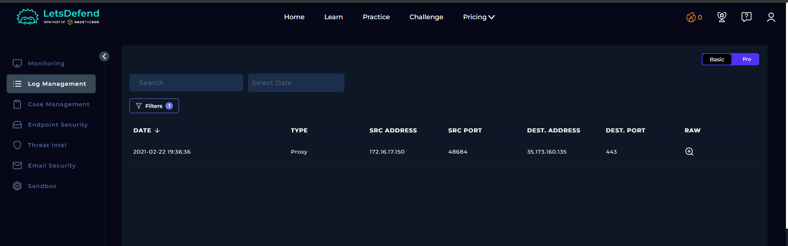
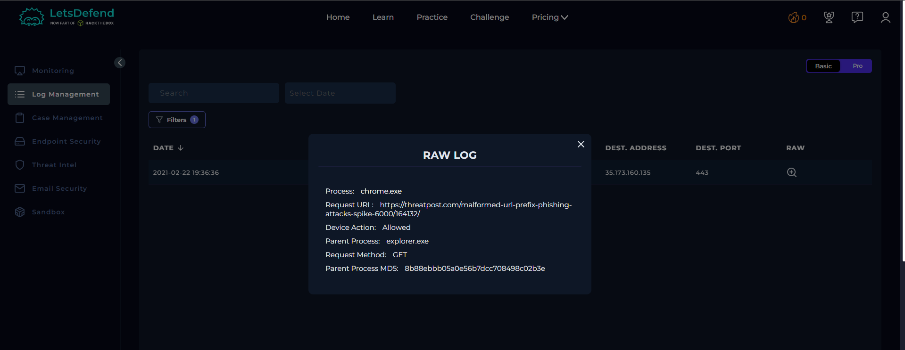
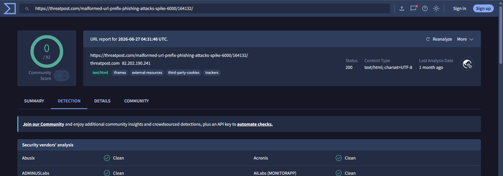
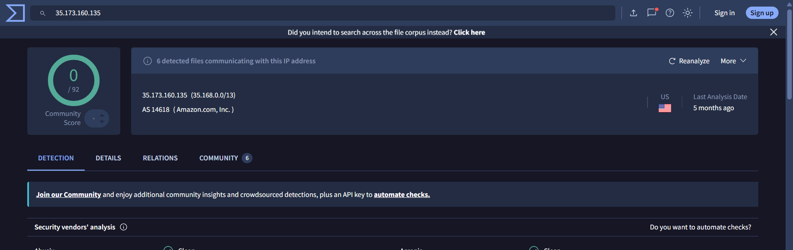

# SOC102 – Proxy: Suspicious URL Detected

## 1. Alert Overview

| Field | Details |
|---|---|
| Event ID | 66 |
| Alert Rule | SOC102 – Proxy - Suspicious URL Detected |
| Event Time | `2021-02-22 20:36:31 (UTC+03:00)` |
| Username | `Chan` |
| Source Host | `ChanProd` |
| Source IP | `172.16.17.150` |
| Destination | `threatpost.com` (`35.173.160.135`) |
| Process | `chrome.exe` |
| Parent Process | `explorer.exe` |
| Device Action | **Allowed** |
| Final Verdict | **False Positive** |

## 2. Investigation Findings

### 2.1. Proxy Log Analysis

The Proxy log recorded an HTTP `GET` request from `172.16.17.150` to the following URL:

`https://threatpost.com/malformed-url-prefix-phishing-attacks-spike-6000/164132/`

The request was initiated by `chrome.exe`, with `explorer.exe` as the parent process. The Proxy action was **Allowed**.

*Log Management record for the connection.*

*Raw log showing the requested URL, HTTP method, process, and device action.*

### 2.2. URL and IP Reputation

VirusTotal results showed the destination URL and IP address as **Clean**, according to the available reputation evidence.

*VirusTotal URL reputation.*

*VirusTotal IP address reputation.*

### 2.3. Endpoint Security

No related events were found in Endpoint Security to indicate additional suspicious activity associated with this alert.

## 3. Playbook Investigation

### Analyze URL Address

**Result: Non-malicious**

The URL was assessed as non-malicious in the playbook, and the available VirusTotal results showed clean URL and IP reputation.

## 4. Final Assessment

**Verdict: False Positive**

The alert was triggered by a URL visited through Chrome. The available reputation results were clean, and no related suspicious activity was identified in Endpoint Security. Based on the available evidence and the playbook result, the alert was classified as a **False Positive**.
