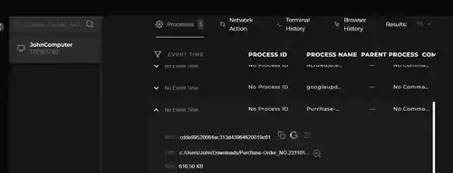

# SOC104 – Malware Detected — Event ID 31

## Alert Details

| Field | Value |
|---|---|
| Event ID / Time | `31` / `2020-10-29 19:55:40 +03:00` |
| Host / IP | `JohnComputer` / `172.16.17.82` |
| File | `Purchase-Order_NO.231101.exe` |
| Alert MD5 | `cdde99520664ac313d43964620019c61` |
| Size | `616.50 KB` |
| Device Action | **Allowed** |
| MITRE ATT&CK shown in alert | `T1204` |

## Investigation

### Process and file evidence

Endpoint Security showed `Purchase-Order_NO.231101.exe` under JohnComputer, in the user's Downloads folder. The process entry had no process ID, parent process, or command line in the provided record.

### Malware reputation

The supplied VirusTotal report showed **61/69 detections** for an executable named `VUVq.exe`, size **616.50 KB**, labelled `trojan.msil/agenttesla`. This supports a malicious classification. The alert's MD5 and the report's displayed SHA-256 are different hash formats, and the report uses a different filename; the screenshots do not independently prove these are identical file identifiers.

### Network indicator

Log Management showed a Firewall record from `172.16.17.82` to `208.91.199.223:587` at `2020-10-29 19:06:36`, earlier on the alert date.

The supplied VirusTotal IP report for `208.91.199.223` showed **1/92** vendors flagging the IP as malicious; the displayed vendors were not unanimous. The completed playbook recorded the C2-access check as **Accessed**, but the available screenshots do not independently show the exact relationship between this IP and the malware sample.

## Playbook Results

| Check | Result |
|---|---|
| Quarantined/cleaned | **Not Quarantined** |
| Malware analysis | **Malicious** |
| C2 access check | **Accessed** |

The initial alert action was **Allowed**. The playbook's C2 result is recorded as provided. No containment result was included in the supplied notes, so this report does not claim the endpoint was contained.

## Final Assessment

**True Positive – malicious executable alert**, supported by the alert's process/file context and the supplied VirusTotal report. Log Management also recorded outbound traffic from JohnComputer to `208.91.199.223:587`, and the playbook marked the C2 check as accessed.

The available evidence does not establish successful execution of the file or prove the external IP was the sample's C2 server independently. The specific C2 association and containment status remain unverified in the supplied records.
