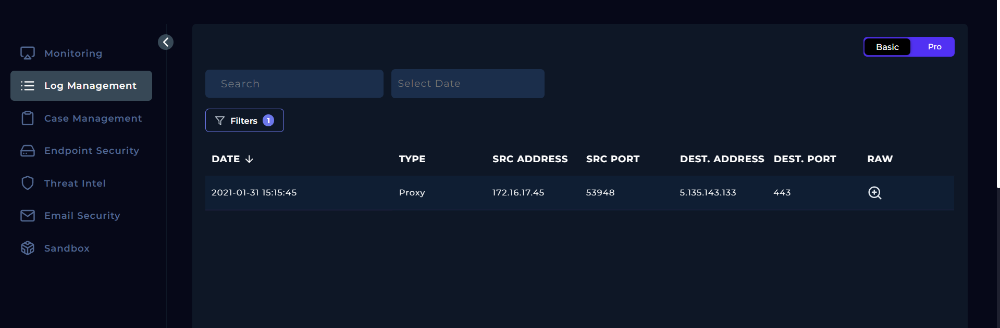
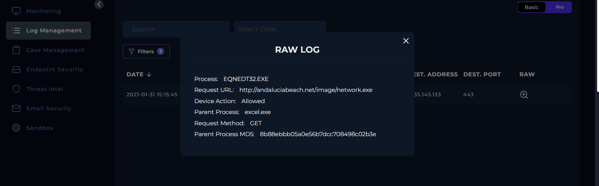
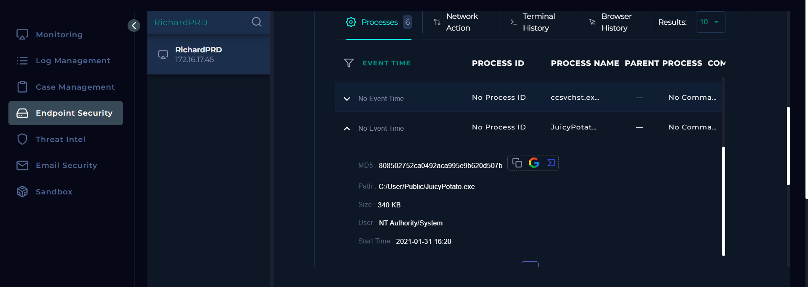
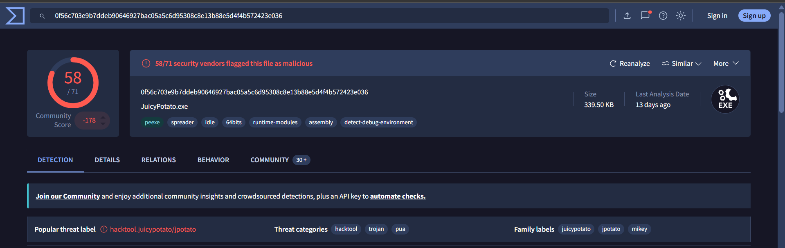
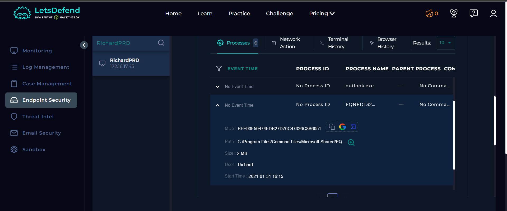
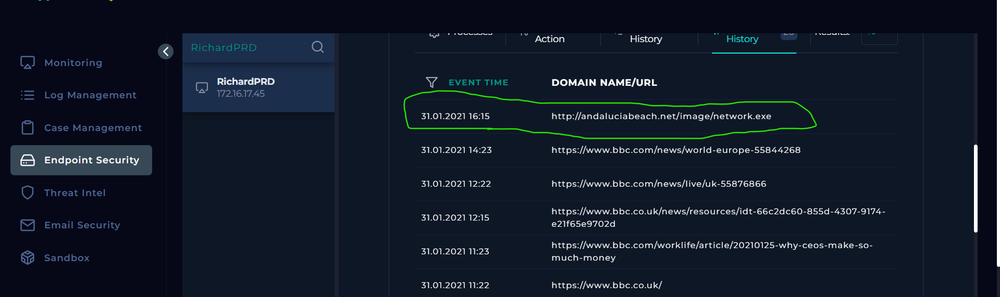
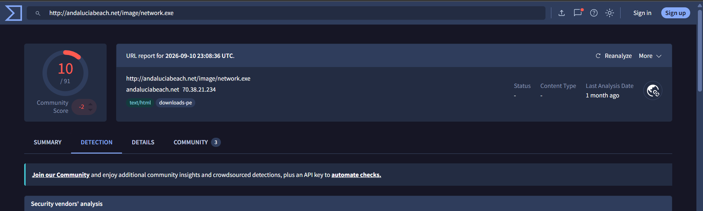

# SOC107 – Privilege Escalation Detected (JuicyPotato)

## Alert Overview

| Field | Value |
|---|---|
| Event ID | `48` |
| Alert Time | `2021-01-31 16:20:28 +03:00` |
| Host | `RichardPRD` |
| Source IP | `172.16.17.45` |
| File | `JuicyPotato.exe` |
| MD5 | `808502752ca0492aca995e9b620d507b` |
| File Size | `340 KB` |
| Device Action | **Allowed** |
| MITRE ATT&CK shown in alert | `T1598.001` |

## Playbook Investigation

### 1. Define Threat Indicator

**Answer: Unknown or unexpected outgoing internet traffic**

Log Management showed a Proxy request from `172.16.17.45` to `5.135.143.133:443`. The raw log associated the request with `EQNEDT32.EXE`, whose parent process was `excel.exe`.

The raw log recorded a GET request for `http://andaluciabeach.net/image/network.exe`; the request was allowed.

### 2. Check if the Malware Is Quarantined/Cleaned

**Answer: Not Quarantined**

The alert showed `Device Action: Allowed`, and Endpoint Security listed `JuicyPotato.exe` running as `NT Authority/System`.

### 3. Analyze Malware

**Answer: Malicious**

The VirusTotal report for `JuicyPotato.exe` showed **58/71 detections** and the label `hacktool.juicypotato/jpotato`.

### 4. Check If Someone Requested the C2

**Answer: Not Accessed**

The confirmed playbook answer is **Not Accessed**. The logs show a request to the download URL, but the available evidence does not confirm access to the malware's C2 address.

## Interesting Findings

- **Suspicious Office-related download:** `EQNEDT32.EXE` made the GET request for `network.exe` and had `excel.exe` as its parent process.
- **JuicyPotato running as SYSTEM:** Endpoint Security listed `JuicyPotato.exe` under `NT Authority/System` at `2021-01-31 16:20`, close to the alert time.
- **URL reputation:** VirusTotal showed **10/91 detections** for the URL and resolved `andaluciabeach.net` to `70.38.21.234`. This is a later lookup, not a reputation snapshot from the 2021 incident.
- **Timestamp discrepancy:** The Proxy log shows `15:15:45`, while Browser History shows `16:15` and the alert time is `16:20:28`. The available evidence does not explain this difference.

## Final Assessment

**Final Verdict: True Positive. Containment: Completed.**

The evidence is consistent with malicious activity involving a suspicious download and `JuicyPotato.exe` running as SYSTEM. The playbook marked the URL as accessed but the C2 as **Not Accessed**. The available records do not establish the complete execution chain or independently confirm C2 communication.
