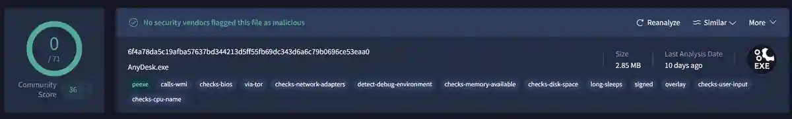
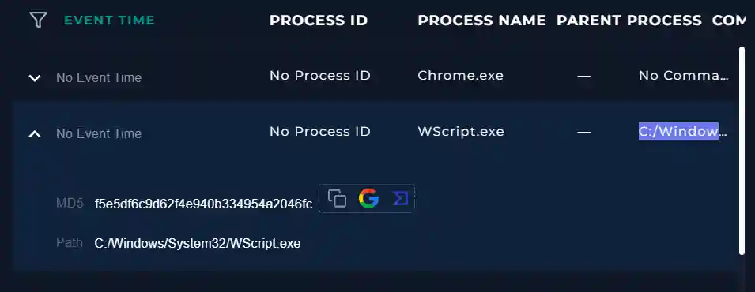

# SOC108 – Malicious Remote Access Software Detected

## 1. Alert Overview

| Field | Value |
|---|---|
| Alert | SOC108 – Malicious Remote Access Software Detected |
| Event ID | `38` |
| Event time | `2021-01-01 17:36:50 +03:00` |
| File | `AnyDesk.exe` |
| File size | `2.85 MB` |
| File hash (MD5) | `ff6bbddc34cbd33e2501872b97c4bacd` |
| Source host | `DanielPRD` |
| Source IP | `172.16.17.33` |
| Initial device action | `Allowed` |
| MITRE ATT&CK shown in alert | `T1566 – Phishing` |

## 2. File and Threat Intelligence Analysis

VirusTotal showed **0/71 security vendors** flagging the AnyDesk executable in the supplied report. LetsDefend Threat Intelligence TAP labelled the queried hash as `malware`, so the reputation sources were inconsistent.




The lab's third-party analysis step ultimately returned **Non-malicious**, and the final lab verdict was **False Positive**. The TAP label is recorded as a conflicting indicator, not treated as conclusive proof of malware.

## 3. Process Analysis

The process list contained the following entries:

| Process | Available detail | Assessment |
|---|---|---|
| `Chrome.exe` | No command line | Insufficient detail to assess |
| `WScript.exe` | `C:/Windows/System32/WScript.exe C:/Users/admin/AppData/Local/Temp/injector.vbs` | Suspicious script execution; relationship to the AnyDesk alert was not established |
| `AcroRd32.exe` | No command line | Insufficient detail to assess |
| `ccsvchst.exe` | No command line | Insufficient detail to assess from the provided record |
| `vmware-usbarbitrator64.exe` | No command line | Insufficient detail to assess from the provided record |

The command below launches a VBScript from the user's temporary directory:

```text
C:/Windows/System32/WScript.exe C:/Users/admin/AppData/Local/Temp/injector.vbs
```



The record did not include a PID, parent process, or clear timestamp linking `injector.vbs` to `AnyDesk.exe`. It is therefore documented as a suspicious process indicator, not proof that AnyDesk was malicious.

## 4. Network Analysis

Log Management recorded these connections from `172.16.17.33` on **2021-01-01**:

| Destination IP | Port | Domain | Request method |
|---|---:|---|---|
| `146.0.234.85` | 80 | `relay-61e0b722.net.anydesk.com` | GET |
| `134.119.217.177` | 443 | `boot-01.net.anydesk.com` | GET |


The domains are consistent with AnyDesk service infrastructure. These connections alone do not establish malicious command-and-control activity.

Additional connections to `209.216.230.240` and `3.223.203.39` were shown on **2021-01-31**, which does not match the alert date. They are not treated as confirmed evidence for the January 1 alert without stronger timeline correlation. Other January 31 connections to `105.103.253.204:2017` also lacked sufficient context to link them to this alert.

## 5. Endpoint and Persistence Checks

- Endpoint Security search for the hash and `AnyDesk.exe` returned a different host, `NodeServer` (`192.168.10.56`, Windows Server 2019), rather than the alert host `DanielPRD` (`172.16.17.33`). The hosts were not assumed to be related.
- Process entries on `NodeServer` did not provide useful command-line detail.
- The lab walkthrough's persistence check found no clear persistence indicators.
- DanielPRD's reviewed Terminal History did not show additional commands relevant to the alert.
- Browser History entries supplied for January 31 showed general Hacker News and Quora pages; no direct link to the January 1 alert was established.

## 6. Playbook Execution

1. **Threat indicator:** Unknown or unexpected outgoing internet traffic.
2. **Quarantine status:** **Not Quarantined.**
3. **Analyze malware:** **Non-malicious.**
4. **Final verdict:** **False Positive.**

## 7. Final Verdict

**False Positive.**

The lab's final result classified the file as non-malicious and the alert as a false positive. The AnyDesk-related network requests were consistent with the service's infrastructure. The `WScript.exe` command launching `injector.vbs` remains a suspicious process record, but the available evidence did not establish that it was related to the AnyDesk alert.

No quarantine was recorded. This write-up preserves unresolved indicators without claiming successful execution, confirmed persistence, or a link between the two hosts.
