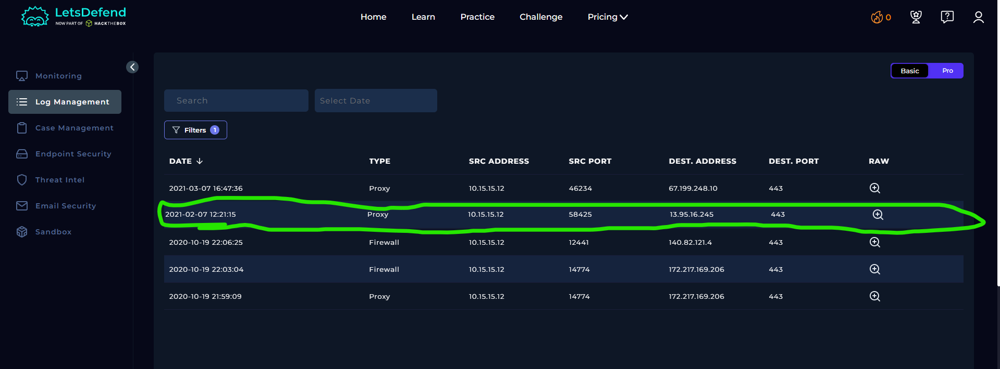
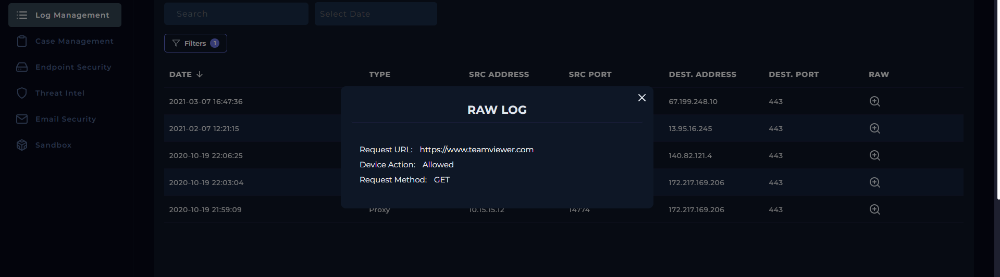
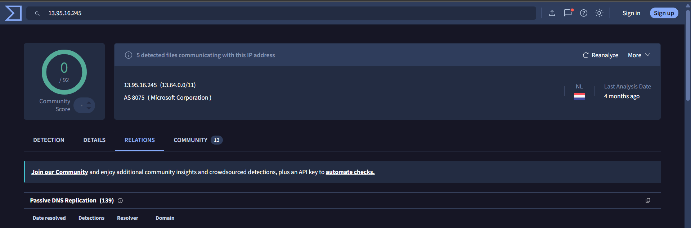

# SOC108 – Malicious Remote Access Software Detected — Event ID 54

## 1. Alert Overview

| Field | Details |
|---|---|
| Event ID | 54 |
| Alert Time | `2021-02-07 13:21:53 +03:00` |
| Alert | SOC108 – Malicious Remote Access Software Detected |
| Alert Type | Proxy |
| Username | `Mark` |
| Source Host | `MarksPhone` |
| Source IP | `10.15.15.12` |
| User Agent | Chrome - Mobile Agent |
| Requested URL | `https://www.teamviewer.com` |
| Destination IP | `13.95.16.245` |
| Device Action | Allowed |

## 2. Investigation Findings

### 2.1. Proxy Log Analysis

Log Management recorded a GET request from `MarksPhone` (`10.15.15.12`) to `https://www.teamviewer.com` over port 443. The Proxy action was `Allowed`.

The logged request shows that Mark's phone accessed the TeamViewer website. It does not show a request to download a remote-access executable or establish a remote-control session.

### 2.2. IP Reputation

The destination IP, `13.95.16.245`, was checked on VirusTotal and appeared clean in the investigation.

This is supporting evidence, not a standalone guarantee that all activity involving the IP is benign. The destination hostname and the actual request must be considered as well.

### 2.3. URL Assessment

The requested URL, `https://www.teamviewer.com`, is the official TeamViewer website. TeamViewer is legitimate remote-access and support software, but visiting its website does not by itself show that the application was downloaded, installed, or used to control a device.

The available Proxy record shows an allowed GET request to the website. No evidence supplied for this alert demonstrates a malicious download or an active remote-control session.

### 2.4. Timestamp Difference

The Proxy log time is `2021-02-07 12:21:15`, while the alert time is `13:21:53 (+03:00)`, an approximately one-hour difference. The available evidence does not establish the cause of this discrepancy.

## 3. Playbook Investigation

### Analyze URL Address

**Answer: Non-Malicious**

The requested URL points to the official TeamViewer website. The clean IP reputation is consistent with this assessment, and the supplied logs do not show a malicious file download or remote-control session.

## 4. Final Assessment

**Verdict: False Positive**

The alert was triggered by a permitted request to the TeamViewer website. The destination IP appeared clean in VirusTotal, and the available Proxy evidence shows a GET request rather than a download or remote-control connection.

The evidence supports a False Positive classification. It does not establish that TeamViewer was downloaded, installed, or used to access another device from Mark's phone.
