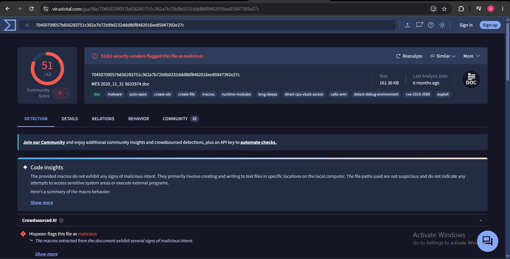
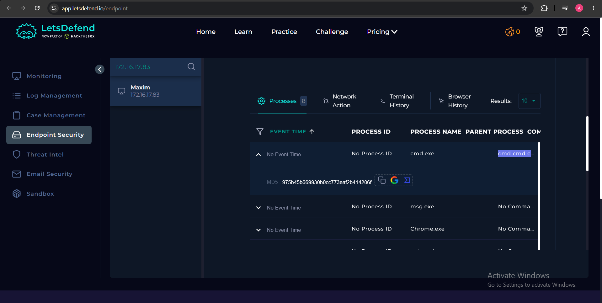
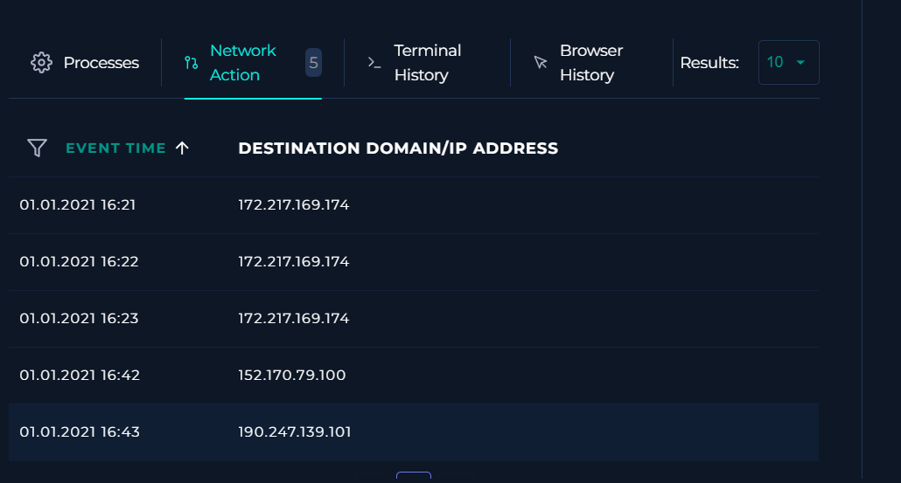
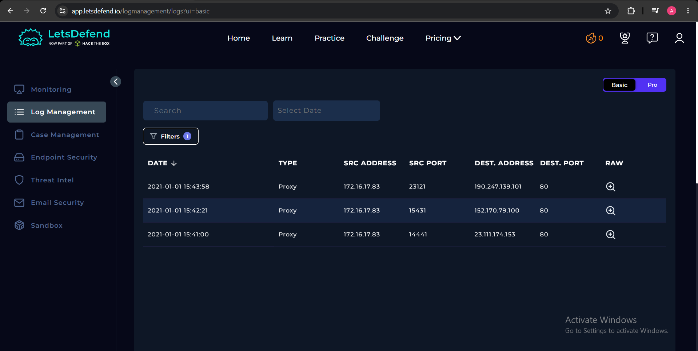
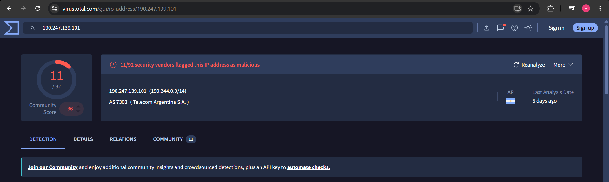

# SOC109 – Emotet Malware Detected — Event ID 39

## 1. Alert Information

- **Alert:** Emotet Malware Detected
- **Severity:** Medium
- **Affected host:** `172.16.17.83`
- **User:** Maxim
- **Event ID:** `39`
- **Initial device action:** `Allowed`

## 2. File Analysis

- **Filename:** `MES 2020_12_31 S632974.doc`
- **MD5:** `eee99e6d8ade9463dd206dfbad3485ea`
- **SHA-1:** `204f560829a6d70f93ef6ce396d74f61423c13d7`
- **SHA-256:** `70450709057b656283751c362a7b72b9b0232ddd86f8482016ee85947392e27c`

VirusTotal flagged the document as malicious, with **51/63 security vendors** detecting it.

## 3. Process Analysis

The document was associated with a suspicious command launched through `cmd.exe`. The command displayed a fake Word error message and launched PowerShell in hidden mode using `-w hidden -ENCOD`.

### Command decoding

The `-ENCOD` argument indicates that the PowerShell command was supplied in encoded form. The Base64 payload was decoded to reveal the PowerShell script. Decoding made the script readable, but did not remove its additional obfuscation.

### PowerShell deobfuscation

The decoded script was then analyzed for obfuscation patterns, including string concatenation, character codes, format operators, and mixed casing. Reconstructing these expressions revealed the script's intended behavior:

- Dynamically builds a directory path and external URLs.
- Sets `$ErrorActionPreference` to `SilentlyContinue`, suppressing many errors.
- Uses `System.Net.WebClient.DownloadFile` to **attempt** downloading a file.
- Checks whether the file is at least **39,163 bytes** before **attempting** execution through `rundll32.exe`.

The code indicates an intended download-and-execution chain. The available evidence does not prove that the download or execution completed successfully.

## 4. Network Analysis

Proxy logs recorded HTTP GET requests from `172.16.17.83` to:

- `190.247.139.101`
- `152.170.79.100`

Both IP addresses were reported as malicious by VirusTotal. The logs confirm that requests were made, but do not independently confirm successful downloads.

> **Evidence note:** The uploaded report did not include separate, readable screenshots of raw proxy GET requests or VirusTotal IP-reputation results. Add those only if you captured them during the lab. VirusTotal relation artifacts alone should not be treated as proof that this host contacted every listed destination.

## 5. Indicators of Compromise (IOCs)

| Type | Indicator |
|---|---|
| SHA-256 | `70450709057b656283751c362a7b72b9b0232ddd86f8482016ee85947392e27c` |
| IP address | `190.247.139.101` |
| IP address | `152.170.79.100` |
| Filename | `MES 2020_12_31 S632974.doc` |

## 6. Playbook Execution

1. **Threat indicator:** Unknown or unexpected outgoing internet traffic.
2. **Quarantine status:** **Not Quarantined.** The initial alert showed `Device Action: Allowed`.
3. **Malware analysis:** **Malicious.** Supported by VirusTotal detections and the decoded PowerShell behavior.
4. **C2 access check:** **Accessed.** Proxy logs recorded HTTP GET requests to the suspicious destinations above.
5. **Containment:** The playbook directed the analyst to contain the host through EDR. The final quarantine result was **Not Quarantined**, so successful containment is not confirmed.

## 7. Final Verdict

**True Positive – Emotet-related malicious activity.**

The malicious document, obfuscated PowerShell behavior, and suspicious outbound requests support the alert classification. The playbook result was **Not Quarantined**; therefore, containment must not be reported as successful.
