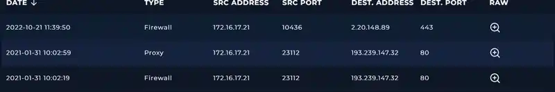

# SOC112 – Traffic to Blacklisted IP

## 1. Alert Overview

| Field | Value |
|---|---|
| Alert | SOC112 – Traffic to Blacklisted IP |
| Event ID | `43` |
| Alert time | `2021-01-31 11:02:28 +03:00` |
| Alert type | Proxy |
| Difficulty | Beginner |
| Username | `jack2021` |
| Source host | `Jack` |
| Source IP | `172.16.17.21` |
| Destination IP | `193.239.147.32` |
| Request URL | `http://193.239.147.32/OBBBOP.exe` |
| User-Agent | `Mozilla/5.0 (Windows NT 10.0; Microsoft Windows 10.0.15063; en-US) PowerShell/6.0.0` |
| Device action | **Allowed** |

## 2. Log Management Investigation

Log Management displayed related Proxy and Firewall records for the same source and destination:

| Log time | Type | Source IP | Source port | Destination IP | Destination port |
|---|---|---|---:|---|---:|
| `2021-01-31 10:02:59` | Proxy | `172.16.17.21` | `23112` | `193.239.147.32` | `80` |
| `2021-01-31 10:02:19` | Firewall | `172.16.17.21` | `23112` | `193.239.147.32` | `80` |



The Proxy record's raw details show the requested URL and HTTP method:

```text
URL: http://193.239.147.32/OBBBOP.exe
Request Method: GET
```


The GET request supports the playbook answer **Accessed**: the logs record a request for the URL from the identified host. The records do not independently prove that the file finished downloading or that it executed.

A separate Firewall record dated `2022-10-21` points to `2.20.148.89:443`. Because it is from a different date and destination, it was not treated as evidence for this January 2021 alert.

### Timestamp note

The alert shows `11:02:28 +03:00`, while the matching Log Management records display times around `10:02`. The available screenshots do not explain the one-hour difference, so the recorded timestamps are preserved as displayed rather than silently normalized.

## 3. URL Threat Intelligence

The submitted VirusTotal URL report for `http://193.239.147.32/OBBBOP.exe` showed **14/92 security vendors** flagging the URL.


The VirusTotal screenshot is a later lookup dated **2026-10-06 12:29:19 UTC**, not a reputation snapshot from the January 2021 alert time. The lab's URL-analysis playbook answer was **Malicious**. Together, the lab result and the supplied report support classifying the alert as a true positive for traffic to a malicious URL. The URL reputation result is evidence about the URL; it does not by itself prove successful download or execution of the executable.

## 4. User-Agent Context

The alert records this User-Agent:

```text
Mozilla/5.0 (Windows NT 10.0; Microsoft Windows 10.0.15063; en-US) PowerShell/6.0.0
```

The `PowerShell/6.0.0` substring indicates that the request identifies itself as using PowerShell as the HTTP client. PowerShell can be used for legitimate automation as well as malicious downloading, so this string is a useful investigation clue, not proof of malicious execution on its own. User-Agent values can also be modified or spoofed.

## 5. Playbook Results and Containment

The completed LetsDefend playbook reported:

| Playbook item | Result |
|---|---|
| Has Anyone Accessed IP/URL/Domain? | **Accessed** |
| Analyze URL Address | **Malicious** |
| Containment | Completed in the lab |
| Playbook score | **10/10 (100% success rate)** |
| Final verdict | **True Positive** |

The initial alert's `Device Action: Allowed` and the playbook's later containment step are distinct events. The alert indicates the traffic was allowed at the time of detection; containment was subsequently completed as part of the lab.

## 6. Indicators of Compromise (IOCs)

| Type | Indicator | Notes |
|---|---|---|
| Source IP | `172.16.17.21` | Internal source address associated with host `Jack` |
| Username | `jack2021` | User shown in the alert |
| Destination IP | `193.239.147.32` | Destination in alert and matching logs |
| URL | `http://193.239.147.32/OBBBOP.exe` | URL assessed as malicious by the lab |
| HTTP method | `GET` | Method shown in the Proxy raw log |
| User-Agent indicator | `PowerShell/6.0.0` | Substring from the alert's User-Agent |

## 7. Final Assessment

**True Positive – traffic from host `Jack` to a malicious URL was observed and allowed before the investigation and containment step.**

The alert details and Log Management evidence correlate on source IP `172.16.17.21`, destination IP `193.239.147.32`, and destination port `80`. The Proxy raw log records a GET request for `/OBBBOP.exe`, and the supplied VirusTotal URL report showed 14/92 detections. The completed playbook classified the URL as malicious, recorded the URL as accessed, reported successful lab completion of containment, and returned a True Positive verdict.

**Evidence limitation:** the available records show a request for the executable, not proof that the download completed or that the executable was run. No process-execution evidence was supplied for this alert.
