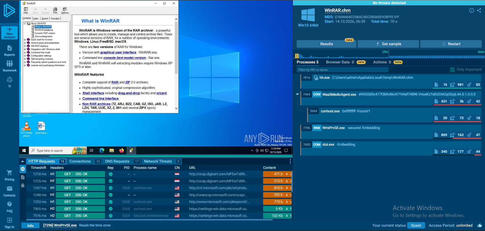
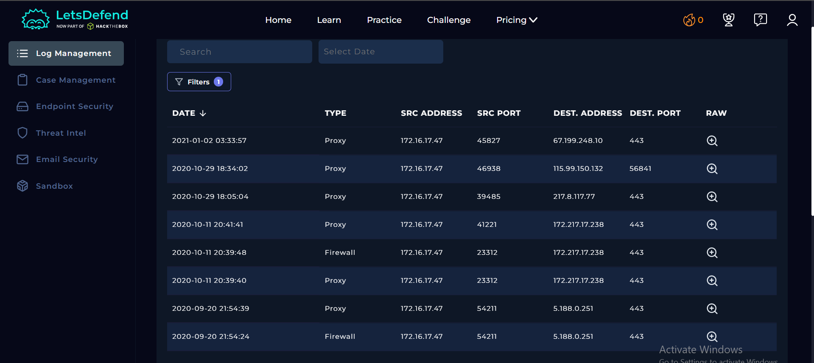

# SOC113 – Suspicious hh.exe Usage — Event ID 44

## 1. Alert Overview

| Field | Value |
|---|---|
| Event ID | `44` |
| Alert Time | `2021-01-31 16:59:42 +03:00` |
| Alert Rule | `SOC113 – Suspicious hh.exe Usage` |
| Alert Type | Malware |
| Hostname | `BillPRD` |
| Source IP | `172.16.17.47` |
| Flagged File | `WinRAR.chm` |
| File MD5 | `07694464c25bac4ecdb365e928ffe1ff` |
| File Size | `306 KB` |
| Device Action | **Allowed** |
| MITRE ATT&CK shown in alert | `T1204` |

## 2. Playbook Investigation

### 2.1 Define Threat Indicator

**Answer: Other**

The alert involved `hh.exe` opening `WinRAR.chm`.

`hh.exe` is the legitimate Windows HTML Help executable, used to open compiled HTML Help files (`.chm`). However, CHM files can be abused in malicious activity, making suspicious use of `hh.exe` a valid detection signal.

The alert prompted an investigation into whether the observed activity represented malicious execution or legitimate use of application documentation. The exact internal conditions of the detection rule were not available, so the investigation did not assume that every execution of `hh.exe` triggers an alert.

### 2.2 Check if the Malware Is Quarantined/Cleaned

**Answer: Not Quarantined**

The alert recorded `Device Action: Allowed`. The lab investigation confirmed that the file had not been quarantined.

This indicates that the observed activity was allowed and that no successful quarantine or cleanup was established. Quarantine status is separate from the malware verdict.

### 2.3 Analyze Malware

**Answer: Not Malicious**

The VirusTotal lookup for `WinRAR.chm` reported **0 detections** for the supplied file hash.

Additional analysis was performed using Hybrid Analysis and ANY.RUN. The results were reviewed to determine whether the sample behaved like a legitimate WinRAR help document.

The public ANY.RUN result should be interpreted carefully because its summary and detailed behavior findings were not entirely consistent. It was therefore treated as supporting evidence rather than conclusive proof that the file was harmless.



The investigation also checked the executable responsible for opening the CHM file:

| Field | Value |
|---|---|
| Process | `hh.exe` |
| Path | `C:\Windows\hh.exe` |
| MD5 | `1cecee8d02a8e9b19d3a1a65c7a2b249` |
| Reputation result | Reported as non-malicious |

**Hash distinction:** The hash of `WinRAR.chm` and the hash of `hh.exe` identify different files. The reputation result for `hh.exe` was not used as a substitute for analyzing the alerted CHM file.

## 3. Interesting Findings

### 3.1 Terminal History explains the observed behavior

**Evidence location:** `Endpoint Security → BillPRD → Terminal History`

Terminal History recorded this command on January 31, 2021, at **16:43**:

```cmd
hh.exe c:/program files/winrar/winrar.chm
```

The command explicitly invokes Windows HTML Help to open the WinRAR help file. It was recorded approximately **17 minutes before the alert**, which appeared at 16:59:42.

This provides a plausible benign explanation for the use of `hh.exe`: the program was opening application help documentation. Although this does not independently prove that every action was benign, it is consistent with the clean reputation results and the absence of corroborating malicious evidence.

### 3.2 Endpoint Security review

**Evidence location:** `Endpoint Security → BillPRD → Processes → hh.exe`

Endpoint Security listed `hh.exe` at:

```text
C:\Windows\hh.exe
```

The executable's path and reputation were consistent with the legitimate Windows HTML Help program. The process record did not include a Process ID or command line, limiting direct correlation with the Terminal History entry.

The investigation therefore relied on the Terminal History command as separate behavioral evidence rather than assuming the process record contained a confirmed execution chain.

### 3.3 Network logs did not correlate with the alert

Log Management contained historical Proxy and Firewall records associated with `172.16.17.47`. However, the supplied records ranged from September 2020 through January 2, 2021, all predating the January 31 alert.



The records did not establish a direct relationship between the historical connections and `WinRAR.chm` or the use of `hh.exe`. The walkthrough also reviewed Browser History and found no relevant entries from 2021.

Consequently, the historical network records were not treated as evidence of malicious activity associated with this alert.

### 3.4 Why the alert fired

The rule was named `Suspicious hh.exe Usage`. The observed command confirms that `hh.exe` was used to open a CHM file, a file type that can be involved in both legitimate documentation and malicious execution scenarios.

The behavior that attracted the rule's attention was therefore a reason to investigate, but not proof of malware by itself. The investigation found a plausible legitimate use, favorable reputation results, and no corroborating network evidence tied to the alert.

## 4. Final Assessment

**Final Verdict: False Positive.**

The evidence supports a legitimate-use explanation for the alert. Terminal History showed `hh.exe` opening `WinRAR.chm` approximately 17 minutes before the alert. VirusTotal reported zero detections for the CHM file, and additional analysis was consistent with a WinRAR help document, although the public ANY.RUN result had conflicting summary and detailed findings.

The reviewed network records predated the alert and did not establish a connection to the observed activity. No corroborating evidence of malicious execution was identified in the supplied investigation.

These findings support classifying the alert as a **False Positive**, rather than treating the use of `hh.exe` alone as proof of malware. This conclusion reflects the evidence available in the lab and does not imply that all CHM files or all uses of `hh.exe` are safe.
