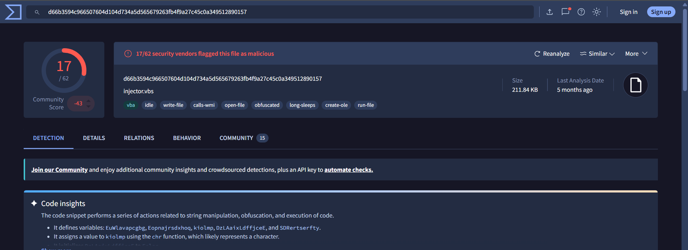
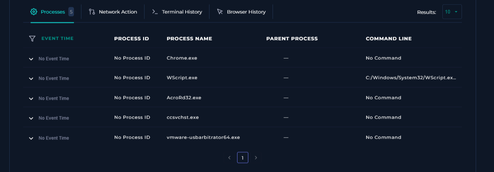
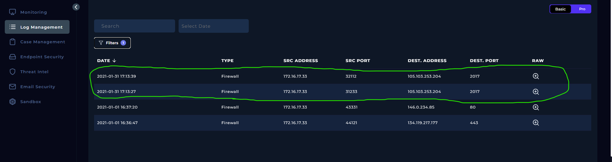
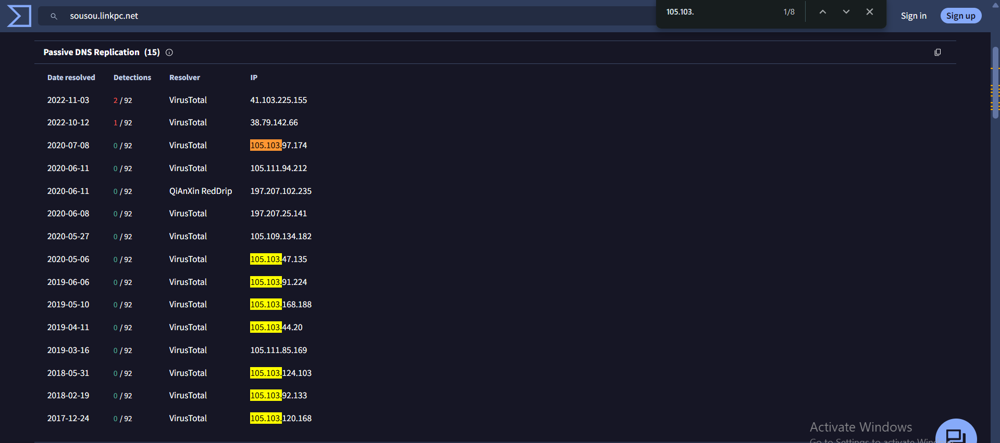
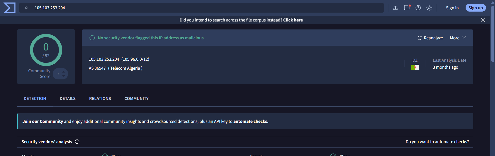

# SOC115 – Wscript.exe Usage as Dropper — Event ID 47

## 1. Alert Overview

| Field | Value |
|---|---|
| Event ID | `47` |
| Alert Time | `2021-01-31 18:14:06 +03:00` |
| Alert Rule | `SOC115 – Wscript.exe Usage as Dropper` |
| Alert Type | Malware |
| Hostname | `DanielPRD` |
| Source IP | `172.16.17.33` |
| Flagged File | `injector.vbs` |
| File MD5 | `1773cf37129003d9788c79b1a7bc155e` |
| File Size | `211.84 KB` |
| Device Action | **Allowed** |
| MITRE ATT&CK shown in alert | `T1112` |

## 2. Playbook Investigation

### 2.1 Define Threat Indicator

**Answer: Other**

The alert concerns `WScript.exe` being used to execute `injector.vbs`. `WScript.exe` is a legitimate Windows Script Host executable, but it can also be used to run malicious scripts. The investigation therefore focused on the script and its associated activity rather than treating the legitimate Windows executable itself as malicious.

### 2.2 Check if the Malware Is Quarantined/Cleaned

**Answer: Not Quarantined**

The alert shows `Device Action: Allowed`, and the Playbook result was **Not Quarantined**. The evidence supplied for this alert does not show a successful quarantine or cleanup action.

### 2.3 Analyze Malware

**Answer: Malicious**

The lab classified `injector.vbs` as malicious. The supplied VirusTotal screenshot showed **15/58 detections** at the time of the recorded investigation.



Endpoint Security showed the following command line on `DanielPRD`:

```text
C:/Windows/System32/WScript.exe C:/Users/admin/AppData/Local/Temp/injector.vbs
```



This indicates that Windows Script Host was used to execute the script from the user's temporary directory. The process record did not include a Process ID.

The separate MD5 `f5e5df6c9d62f4e940b334954a2046fc` belongs to `WScript.exe` and was reported as non-malicious. That reputation result applies to the Windows executable, not to `injector.vbs`.

### 2.4 Check If Someone Requested the C2

**Answer: Accessed**

Log Management recorded two outbound Firewall connections from `172.16.17.33` to `105.103.253.204:2017` on January 31, 2021.



The Playbook answer was **Accessed**. The Firewall records support that outbound connections to this destination were logged. However, the available rows do not include raw session data or an explicit action field, so they do not independently prove the contents of the traffic or the completion of a full C2 exchange.

## 3. Interesting Findings

### 3.1 Sandbox analysis of the script

A public ANY.RUN submission matching the `injector.vbs` MD5 identified malicious njRAT-related activity and showed the domain `sousou.linkpc.net` in its analysis.


The sandbox report provides additional context for the malicious verdict and the investigation of potential C2 activity. Sandbox behavior is evidence about the submitted sample in that analysis environment; it does not mean every observed action was independently confirmed on `DanielPRD`.

### 3.2 Passive DNS history for sousou.linkpc.net

VirusTotal Passive DNS showed that `sousou.linkpc.net` had resolved to multiple IP addresses over time, including `41.103.225.155` and several addresses in the `105.103.x.x` and `105.111.x.x` ranges.



These records demonstrate that the domain had multiple historical IP resolutions. The dates span several years, and the provided records do **not** directly show `sousou.linkpc.net` resolving to `105.103.253.204`.

### 3.3 Investigating the endpoint destination IP

The endpoint's Firewall logs show connections to `105.103.253.204:2017`. A separate VirusTotal lookup was also performed for this IP.



The ANY.RUN analysis showed a separate connection to `41.103.225.155:2017`. The two addresses are reported as belonging to AS36947 (Telecom Algeria), and both observations involve destination port `2017`.

The shared ASN and port are useful correlation points, but they do not independently prove that `105.103.253.204` is malicious or that it is the same C2 server identified by ANY.RUN. The direct relationship between the endpoint destination and `sousou.linkpc.net` remains unconfirmed.

### 3.4 Initial access remains unknown

The available Endpoint Security and Firewall evidence does not establish how `injector.vbs` arrived on `DanielPRD`. An earlier-stage executable was considered during the lab investigation, but the supplied records do not confirm the presence or execution of that initial file.

## 4. Final Assessment

**Final Verdict: True Positive.**

The lab classified `injector.vbs` as malicious, and Endpoint Security showed it being executed through `WScript.exe` from the user's temporary directory. The Playbook recorded the C2 check as **Accessed**, and Firewall logs showed outbound connections from `DanielPRD` to `105.103.253.204:2017`.

The public ANY.RUN analysis identified malicious njRAT-related activity involving `sousou.linkpc.net` and a separate connection to `41.103.225.155:2017`. VirusTotal Passive DNS showed multiple historical IP resolutions for the domain. These findings provide context for the investigation, but the evidence does not directly establish that `105.103.253.204` is the same C2 server or that the IP itself is conclusively malicious.

The initial device action was **Allowed**, and the script was **Not Quarantined**. The evidence supports the lab's True Positive verdict; the initial delivery mechanism and the precise nature of the connection to `105.103.253.204` remain unresolved.
