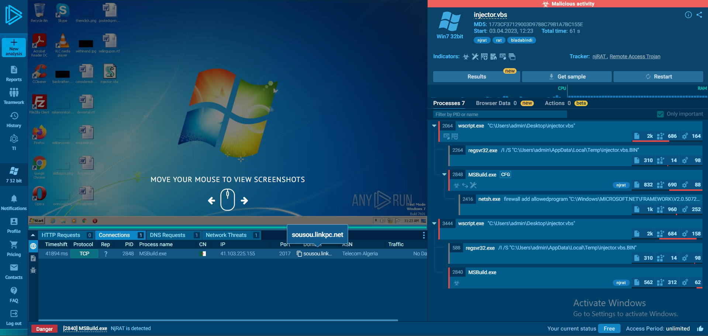

# SOC115 – Wscript.exe Usage as Dropper — Event ID 47

## Alert Overview

| Field | Value |
|---|---|
| Event ID | 47 |
| Alert Time | 2021-01-31 18:14:06 +03:00 |
| Host | DanielPRD |
| Source IP | 172.16.17.33 |
| File | injector.vbs |
| File MD5 | 1773cf37129003d9788c79b1a7bc155e |
| Device Action | Allowed |

## Playbook Investigation

- **Threat indicator:** Other
- **Quarantined/Cleaned:** Not Quarantined
- **Malware analysis:** Malicious
- **C2 access check:** Accessed

Endpoint Security showed WScript.exe executing injector.vbs from the user's temporary directory. The script was classified as malicious by the lab. A separate reputation lookup for WScript.exe was non-malicious; that result applies to the Windows executable, not to the script.

## Interesting Findings

### VirusTotal

VirusTotal classified injector.vbs as malicious.

### Process Evidence

### ANY.RUN and Passive DNS

The public ANY.RUN analysis for the same script hash identified malicious njRAT-related activity and showed a connection to 41.103.225.155:2017 associated with sousou.linkpc.net.

VirusTotal Passive DNS records show sousou.linkpc.net resolved to multiple IPs over time, including 41.103.225.155 and 105.103.97.174.

The endpoint Firewall logs recorded two outbound connections from 172.16.17.33 to 105.103.253.204:2017.

Both 105.103.253.204 and 41.103.225.155 belong to AS36947 (Telecom Algeria). The shared ASN and port provide context, but do not independently prove that 105.103.253.204 is malicious or is the same C2 server identified by ANY.RUN. The supplied Passive DNS records do not directly associate sousou.linkpc.net with 105.103.253.204.

The available evidence does not establish how injector.vbs arrived on DanielPRD.

## Final Assessment

**True Positive.** The Playbook classified injector.vbs as malicious and recorded the C2 check as Accessed. Endpoint Security showed the script being executed through WScript.exe, while Firewall logs recorded outbound connections to 105.103.253.204:2017. The initial device action was Allowed, and the script was Not Quarantined.

The evidence supports the lab's True Positive verdict. The exact relationship between 105.103.253.204 and the sandbox-identified C2, and the initial delivery mechanism, remain unconfirmed.
