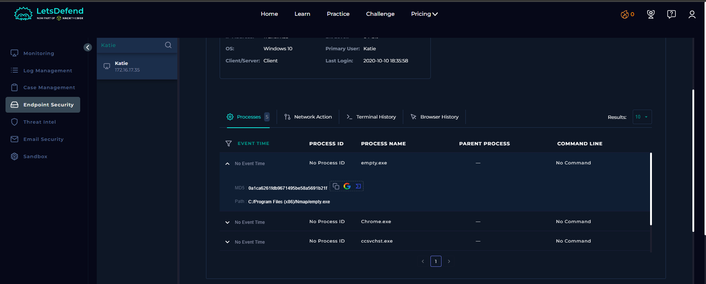
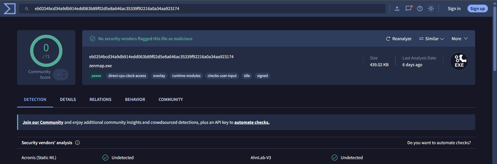
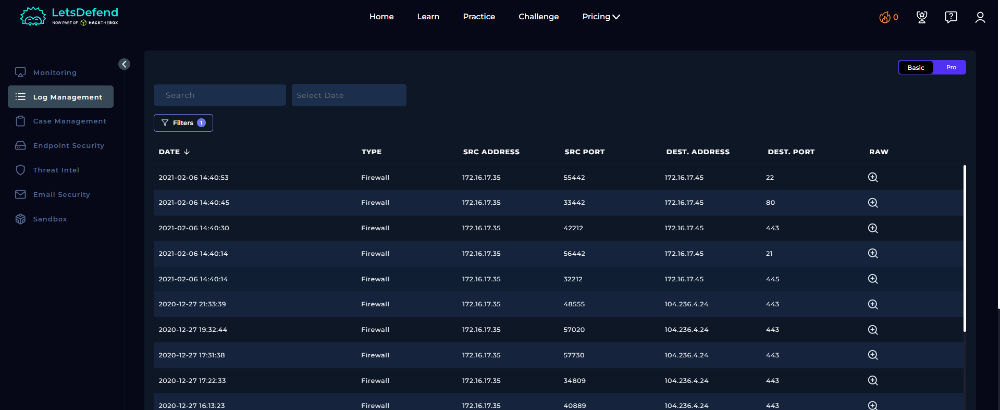

# SOC118 – Internal Port Scan Activity — Event ID 51

## 1. Alert Overview

| Field | Details |
|---|---|
| Event ID | 51 |
| Alert Time | `2021-02-06 15:40:41 +03:00` |
| Alert | SOC118 – Internal Port Scan Activity |
| Alert Type | Malware |
| Host | `Katie` |
| Source IP | `172.16.17.35` |
| File | `empty.exe` |
| MD5 | `0a1ca6261fdb9671495be58a5691b21f` |
| File Size | 440 KB |
| Device Action | Blocked |

## 2. Investigation Findings

### 2.1. File and Reputation Check

Endpoint Security lists `empty.exe` at:

```text
C:/Program Files (x86)/Nmap/empty.exe
```

The recorded process entry has no event time, Process ID, parent process, or command line, limiting the ability to reconstruct how the file was launched.

The MD5 was checked on VirusTotal. Reputation results should be interpreted alongside the host activity: the executable's location under the Nmap directory is consistent with a network-scanning tool, but that alone does not establish whether its use was authorized.





### 2.2. Internal Network Activity

Firewall logs show five connection attempts from Katie (`172.16.17.35`) to the internal host `172.16.17.45` within approximately 39 seconds.

| Time | Source Port | Destination Port | Typical Service | Firewall Result |
|---|---:|---:|---|---|
| 14:40:14 | 32212 | 445 | SMB | Blocked |
| 14:40:14 | 56442 | 21 | FTP | Blocked |
| 14:40:30 | 42212 | 443 | HTTPS | Blocked |
| 14:40:45 | 33442 | 80 | HTTP | Blocked |
| 14:40:53 | 55442 | 22 | SSH | Blocked |

The attempts target multiple services on the same internal host in a short period, which is consistent with port-scanning activity. All five listed connections were blocked, so these records do not demonstrate successful access to the destination services.



### 2.3. Historical External Connections

The same Log Management view contains older Firewall records from December 25–27, 2020, showing HTTPS connections from `172.16.17.35` to `104.236.4.24:443`. Their Raw fields are empty, and the events predate the alert by several weeks.

With no raw details or additional correlation, these older connections cannot be confidently linked to the February 6 port scan.

### 2.4. Timeline Difference

The five Firewall events occurred around 14:40, while the alert time is 15:40:41 (+03:00), an approximately one-hour difference. The available records do not establish the cause, so the discrepancy is noted rather than assuming a specific time-zone or logging issue.

## 3. Playbook Investigation

### 3.1. Define Threat Indicator

**Answer: Other**

The alert concerns internal port-scanning activity from `172.16.17.35` to multiple service ports on `172.16.17.45`.

### 3.2. Check Whether the Malware Was Quarantined/Cleaned

**Expected Playbook answer: Quarantined**

The alert's recorded Device Action is `Blocked`. This documents a block action; the available evidence does not separately show a later cleanup operation.

### 3.3. Analyze Malware

**Expected Playbook answer: Malicious**

This is the expected answer for the lab's Playbook. The technical finding supported directly by the supplied logs is that the endpoint attempted connections to multiple internal service ports. The process record alone does not prove that the executable's file contents are malicious, and the Nmap path should be considered during the assessment.

### 3.4. Check Whether the C2 Was Accessed

**Answer: Not Accessed**

The five connections related to the alert targeted an internal host and were blocked. The older external HTTPS records have empty Raw fields and cannot be linked to this incident from the available evidence.

## 4. Final Assessment

**Verdict: True Positive — Internal Port Scan Activity**

Five connection attempts from `172.16.17.35` to different ports on `172.16.17.45` occurred within a short time window and were all blocked by the Firewall. This supports the alert for attempted internal port scanning.

The alert confirms suspicious scanning activity, but the available evidence does not show successful access to the target services. The older connections to `104.236.4.24:443` remain uncorrelated with this event, and the incomplete process record limits conclusions about how `empty.exe` was launched.
