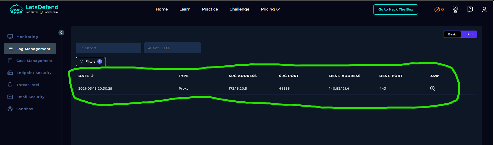
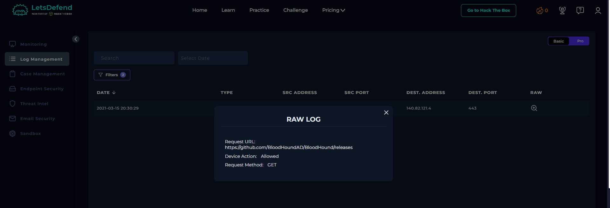
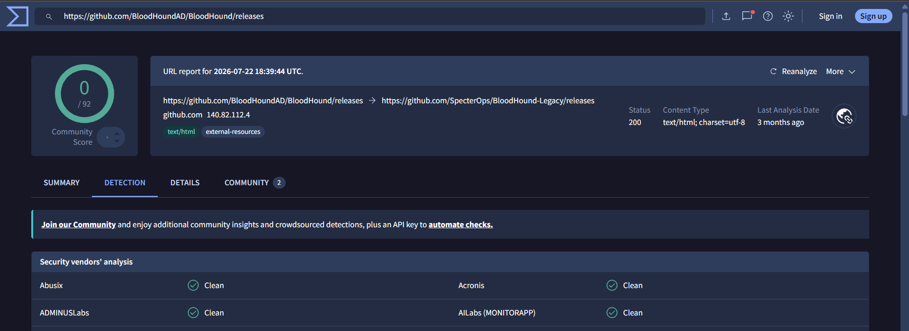

# SOC119 – Proxy: Malicious Executable File Detected

## 1. Alert Overview

| Field | Details |
|---|---|
| Event ID | 79 |
| Event Time | 2021-03-15 21:30:02 UTC+03:00 |
| Alert Rule | SOC119 – Proxy: Malicious Executable File Detected |
| Alert Type | Proxy |
| Difficulty | Easy |
| Username | `kali` |
| Source IP | `172.16.20.5` |
| Source Hostname | `PentestMachine` |
| Request URL | `https://github.com/BloodHoundAD/BloodHound/releases` |
| Destination IP | `140.82.121.4` |
| Destination Hostname | `github.com` |
| User-Agent | `Penetration Test - Do not Contain` |
| Device Action | Allowed |
| MITRE ATT&CK | T1078 – Valid Accounts |
| Final Verdict | False Positive |

## 2. Log Management Investigation

The logs confirmed that the penetration-testing machine, `172.16.20.5`, accessed the BloodHound releases page on GitHub.

The request was allowed by the device. The User-Agent value was `Penetration Test - Do not Contain`, suggesting that the activity may have originated from a penetration-testing environment. However, this value alone does not prove that the activity was authorized.

## 3. URL Reputation Analysis

The reputation checks described in the walkthrough did not identify clear evidence that the GitHub releases page was malicious.

BloodHound is a legitimate dual-use security tool used by both penetration testers and defenders to analyze relationships and potential attack paths within Active Directory environments. It can also be misused by attackers for reconnaissance.

Accessing its official GitHub releases page does not, by itself, establish malicious activity.

## 4. Containment

The Playbook requested containment of the source device. The walkthrough raised concerns about whether the activity was authorized, but did not establish definitive confirmation of an approved penetration test during the alert window.

## 5. Playbook Results

| Playbook Question | Answer | Findings |
|---|---|---|
| Analyze URL Address | Malicious | The Playbook classified the URL as malicious, although the reputation checks described in the walkthrough did not identify clear signs that the GitHub page itself was malicious. |
| Has Anyone Accessed IP/URL/Domain? | Accessed | The Proxy alert confirmed that the request to the GitHub releases page was allowed. |
| Containment | Contain the device | The Playbook instructed the analyst to contain the source device. |
| Final Verdict | False Positive | The lab's final verdict classified the alert as a false positive in the context of the suspected penetration-testing activity. |

## 6. Final Assessment

The investigation confirmed access from `PentestMachine` to the BloodHound releases page on GitHub. The destination reputation checks did not provide clear evidence that the URL itself was malicious.

The source hostname, username, and custom User-Agent were consistent with a possible penetration-testing context, although the User-Agent alone could not verify authorization.

The lab's final verdict was **False Positive**, reflecting its interpretation of the activity as non-malicious. In a real SOC investigation, authorization should be confirmed with the penetration-testing team before closing the alert as benign.

**Final Verdict: False Positive.**
