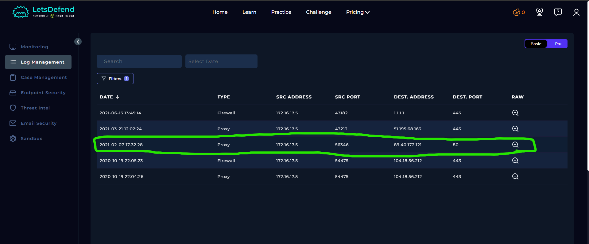
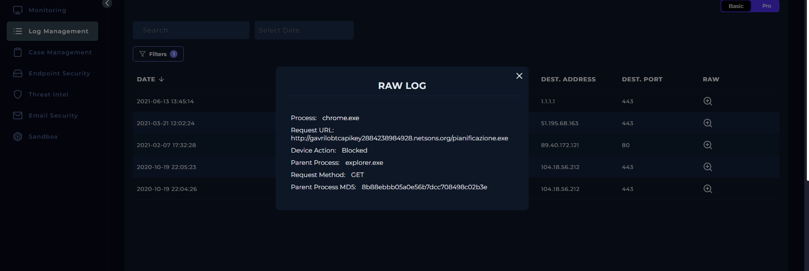
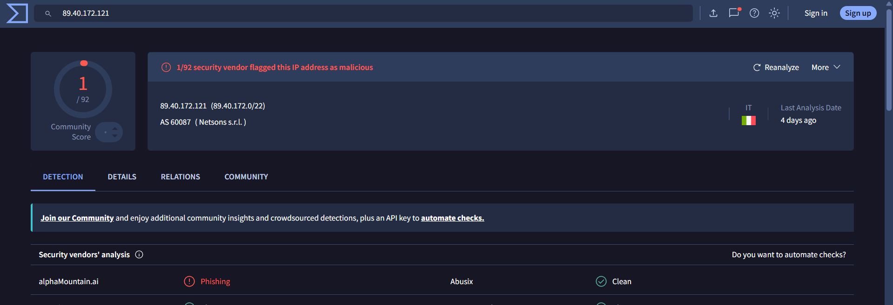
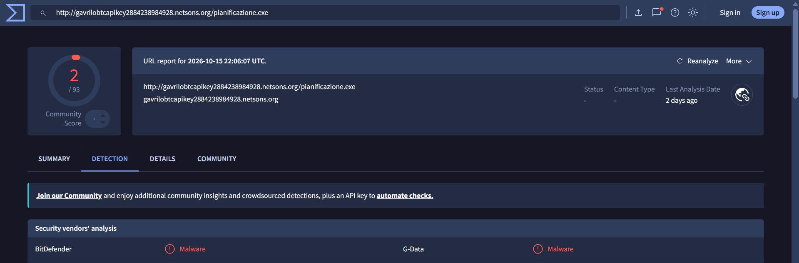
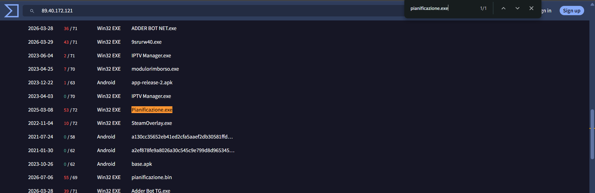
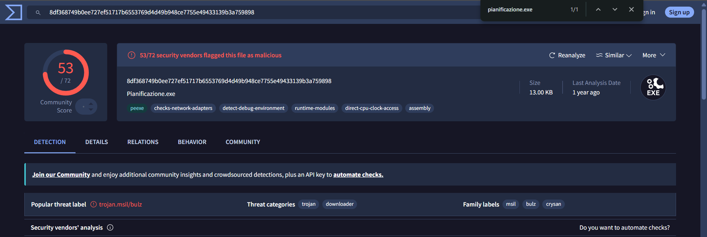

# SOC121 – Proxy: Malicious Executable File Detected (Event ID 53)

## 1. Alert Overview

| Field | Details |
|---|---|
| Event ID | 53 |
| Alert Time | `2021-02-07 12:19:41 +03:00` |
| Alert | SOC121 – Proxy - Malicious Executable File Detected |
| Alert Type | Proxy |
| Username | `Susie` |
| Host | `SusieHost` |
| User Agent | Chrome on Windows |
| Source IP | `172.16.17.5` |
| Destination IP | `89.40.172.121` |
| Requested File | `pianificazione.exe` |
| Device Action | **Blocked** |

## 2. Investigation Findings

### 2.1. Proxy Log Analysis

Log Management recorded a request from `172.16.17.5` to download the executable from:

`http://gavrilobtcapikey2884238984928.netsons.org/pianificazione.exe`

The destination was `89.40.172.121`, and the Proxy action was **Blocked**. This confirms that the request was detected and blocked; the available logs do not confirm a successful download or execution on `SusieHost`.

### 2.2. IP and URL Reputation

The IP address, domain, and full URL were checked separately. IP reputation provides context about the destination infrastructure, while URL reputation concerns the specific resource requested.

The URL was listed in [URLhaus](https://urlhaus.abuse.ch/url/992209/) as malicious and was associated in the published investigation with AsyncRAT distribution. This provides a stronger basis for classifying the requested URL than relying on the IP reputation alone.

### 2.3. File Correlation and Reputation

VirusTotal's IP relationship details listed `pianificazione.exe` under the IP's **Communicating Files**. This is a useful relationship for the investigation, but it does not by itself prove the file was hosted at that IP or successfully downloaded by Susie.

The file-reputation investigation classified the executable as malicious. A public [ANY.RUN analysis of pianificazione.exe](https://any.run/report/a487a9e3d3b6e246445818eef1ccfa3398c63b3a2195325431fd54adc35ea6d1/9271fe31-3a79-4259-82f1-a47a28d6ab79) reported suspicious behavior, including an attempt to download another executable named `Runtime Broker.exe` and registry activity consistent with persistence.

These sandbox findings describe the analyzed sample in that environment; they do not prove that the file executed on `SusieHost`.

## 3. Playbook Investigation

### 3.1. Analyze URL Address

**Answer: Malicious**

External threat intelligence identified the requested URL as malicious. The URL was associated with the delivery of AsyncRAT in the published investigation.

### 3.2. Has Anyone Accessed the IP/URL/Domain?

**Answer: Not Accessed**

The Proxy log records a request to the URL, but the request was **Blocked**. The available evidence does not establish successful access or a completed download. This answer refers to successful access, not the existence of the blocked request itself.

## 4. Final Assessment

**Verdict: True Positive**

The alert is supported by a logged request for a malicious executable, the blocked Proxy action, malicious URL intelligence, and additional file-reputation and sandbox evidence.

The evidence confirms that Susie's device attempted to request the executable and that the Proxy blocked the request. It does not establish that `pianificazione.exe` was successfully downloaded or executed on `SusieHost`.
