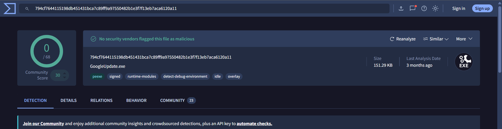
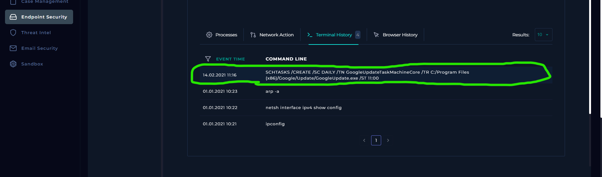

# SOC124 – Scheduled Task Created (Event ID 57)

## 1. Alert Overview

| Field | Details |
|---|---|
| Event ID | 57 |
| Alert Rule | SOC124 – Scheduled Task Created |
| Event Time | `2021-02-14 11:17:18 UTC+03:00` |
| Alert Type | Malware |
| Difficulty | Easy |
| Hostname | `Maxim` |
| Source IP | `172.16.17.83` |
| File Name | `GoogleUpdate.exe` |
| File Size | `151.29 KB` |
| File Hash | `82f657b0aee67a6a560321cf0927f9f7` |
| Device Action | **Blocked** |
| MITRE ATT&CK | T1204 (as provided by the alert) |
| Final Verdict | **False Positive** |

## 2. Investigation Findings

### 2.1. File Reputation Analysis

The file associated with the alert was `GoogleUpdate.exe`, with the reported hash `82f657b0aee67a6a560321cf0927f9f7`.

The hash reputation lookup returned a **clean** result. This finding was recorded as part of the initial file investigation.



### 2.2. Endpoint Terminal History

The endpoint terminal history recorded the following command:

```cmd
SCHTASKS /CREATE /SC DAILY /TN GoogleUpdateTaskMachineCore /TR C:/Program Files (x86)/Google/Update/GoogleUpdate.exe /ST 11:00
```

The command uses `schtasks` to create a scheduled task with the following configuration:

| Parameter | Meaning |
|---|---|
| `/CREATE` | Creates a scheduled task |
| `/SC DAILY` | Sets the task to run daily |
| `/TN GoogleUpdateTaskMachineCore` | Specifies the task name |
| `/TR` | Specifies the program or command to run |
| `/ST 11:00` | Sets the scheduled start time to 11:00 |

The task name is `GoogleUpdateTaskMachineCore`, and the configured executable path is `C:/Program Files (x86)/Google/Update/GoogleUpdate.exe`.



### 2.3. Log Management Review

The Log Management records reviewed during the investigation were dated around January 1, 2021, which was well before the alert time on February 14, 2021.

The available records did not provide relevant information connecting the historical network activity to the scheduled-task event.

## 3. Playbook Investigation

### 3.1. Define Threat Indicator

**Playbook answer:** Unknown or unexpected services and applications configured to launch automatically.

This indicator focuses on services or applications configured to start automatically, which may warrant investigation when their purpose or origin is unexpected.

### 3.2. Check if the Malware Is Quarantined/Cleaned

**Answer: Quarantined**

This is the result recorded in the lab playbook. The alert's device action was separately listed as **Blocked**.

### 3.3. Analyze Malware

**Answer: Non-Malicious**

The playbook's malware-analysis result classified the file as non-malicious.

## 4. Final Assessment

**Verdict: False Positive**

The alert was triggered by the creation of a daily scheduled task named `GoogleUpdateTaskMachineCore`, configured to launch `GoogleUpdate.exe` from a Google Update directory.

The investigation found a clean hash reputation result, and the terminal history showed the scheduled-task creation command. The available historical Log Management records did not provide relevant evidence connecting the event to suspicious network activity. In the lab playbook, the malware-analysis result was **Non-Malicious**.

Based on the evidence and playbook results available in the lab, the alert is classified as a **False Positive**.
