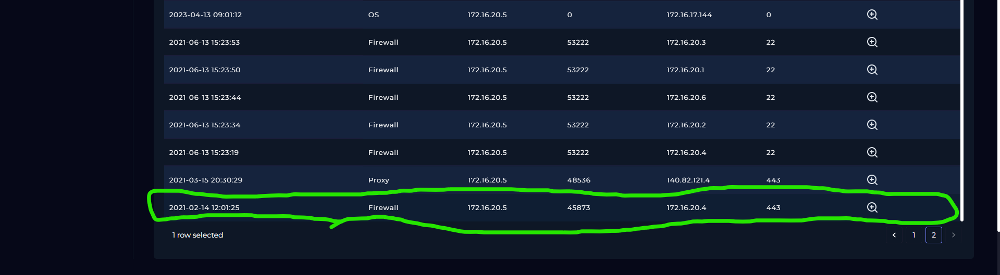
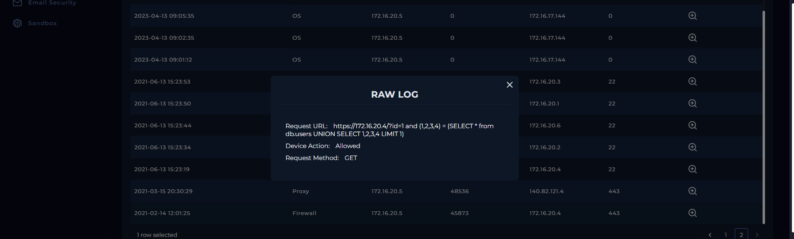

# SOC127 - SQL Injection Detected

## Alert Overview
- **Event ID:** 60
- **Event Time:** 2021-02-14 13:05:12 (UTC+3)
- **Alert Type:** Proxy
- **Source IP:** `172.16.20.5` (`PentestMachine`)
- **Destination IP:** `172.16.20.4` (`gitServer`)
- **Username:** `kali`
- **Device Action:** Allowed

## Investigation

The proxy detected an HTTP GET request containing a SQL injection payload in the `id` parameter.

**SQL Injection Payload:**
```sql
?id=1 and (1,2,3,4) = (SELECT * from db.users UNION SELECT 1,2,3,4 LIMIT 1)
```

The payload uses `UNION SELECT` and references the `db.users` table, indicating a SQL injection attempt.

### Playbook Analysis

**1. Analyze URL Address**
- **Result:** Malicious
- The URL contains a SQL injection payload.

**2. Has Anyone Accessed IP/URL/Domain?**
- **Result:** Accessed
- The proxy allowed the request.

### Evidence



*Log management records the network connection from the source to the destination over port 443.*



*Raw log showing the HTTP GET request, SQL injection payload, and the proxy's Allowed action.*

No suspicious activity was found in endpoint security logs.

## Conclusion

**Verdict: False Positive**

The `PentestMachine` hostname and `Penetration Test - Do not Contain` User-Agent suggest that the activity is related to penetration testing. No additional suspicious endpoint activity was identified.
