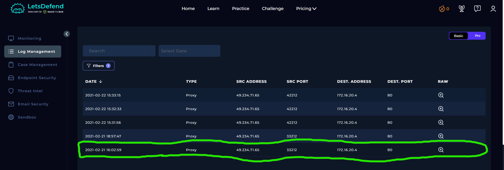
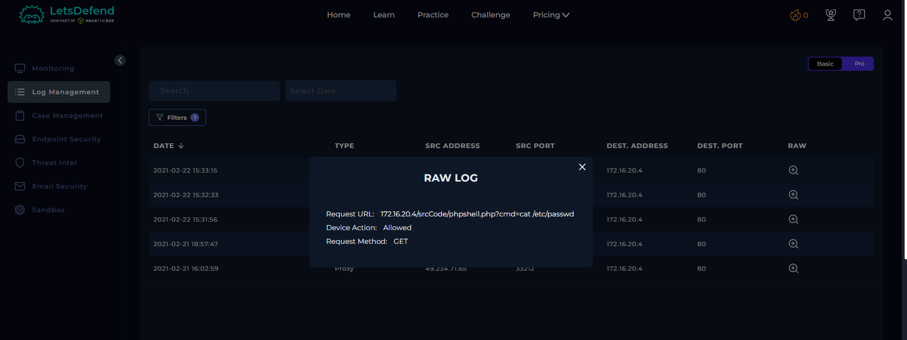
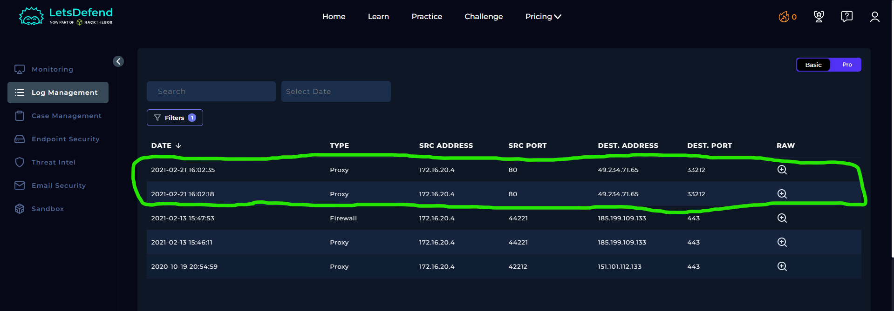

# SOC129 - Successful Local File Inclusion

## Alert Overview

| Field | Details |
|---|---|
| Event ID | 63 |
| Alert Rule | SOC129 - Successful Local File Inclusion |
| Event Time | `2021-02-21 17:02:33 (UTC+03:00)` |
| Role | Security Analyst |
| Alert Type | Proxy |
| Difficulty | Beginner |
| Username | `www-data` |
| Source IP | `49.234.71.65` |
| Source Hostname | `unknown` |
| Destination IP | `172.16.20.4` (`gitServer`) |
| User-Agent | `Mozilla/5.0 (Macintosh; Intel Mac OS X 10_14_4) AppleWebKit/605.1.15 (KHTML, like Gecko)` |
| Device Action | **Allowed** |
| Final Verdict | **True Positive** |

## 1. Investigation

### 1.1. Request Analysis

The Proxy alert identified an HTTP GET request attempting Local File Inclusion (LFI) through a path traversal payload.

**Request URL:**

```text
http://172.16.20.4/srcCode/show.php?page=../../../../../../../etc/passwd
```

The `../` sequences attempt to move outside the application's intended directory and access the Linux `/etc/passwd` file, which contains local account information.

The Proxy action was **Allowed**, meaning the request was permitted by the Proxy. This does not by itself confirm that the file was successfully retrieved.

### 1.2. Proxy Log Analysis

The available Log Management records show requests between external IP `49.234.71.65` and internal server `172.16.20.4` on port `80`.

Two raw log entries returned HTTP `404` responses:

| Log Time | Response Code |
|---|---:|
| `2021-02-21 16:02:18` | `404` |
| `2021-02-21 16:02:35` | `404` |

A raw log entry at `16:02:59` recorded the LFI request using the `GET` method. No response code was provided for that specific entry in the available details.

The `404` responses indicate that the requested resource was not found. The provided evidence does not show the contents of `/etc/passwd` being returned to the requester.

The log entries are shown with timestamps around 16:02, while the alert time is 17:02:33 (UTC+03:00). The available details do not clarify whether this difference reflects timezone handling or separate events, so direct timestamp correlation cannot be confirmed from these records alone.



*Log Management evidence for external traffic targeting the internal server.*



*Raw Proxy log showing the request details and the recorded response information.*



*Additional Log Management view provided for the investigation.*

### 1.3. Endpoint Security

No endpoint security events were identified within the close time range of the alert.

## 2. Playbook Investigation

### 2.1. Analyze URL Address

**Result: Malicious**

The URL contains a path traversal payload targeting `/etc/passwd`, indicating an LFI attempt.

### 2.2. Has Anyone Accessed IP/URL/Domain?

**Result: Not Accessed**

Although the Proxy allowed the request, the available evidence does not confirm successful retrieval of the targeted file. The observed `404` responses do not show the contents of `/etc/passwd` being returned.

## 3. Final Assessment

**Verdict: True Positive**

The alert correctly identified a malicious LFI attempt targeting the internal `gitServer`. The Proxy allowed the request, but successful exploitation was not confirmed by the available evidence. The Playbook result for successful access was **Not Accessed**.
