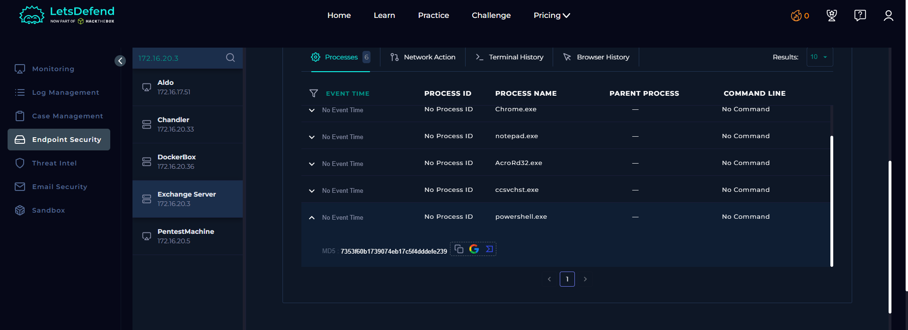
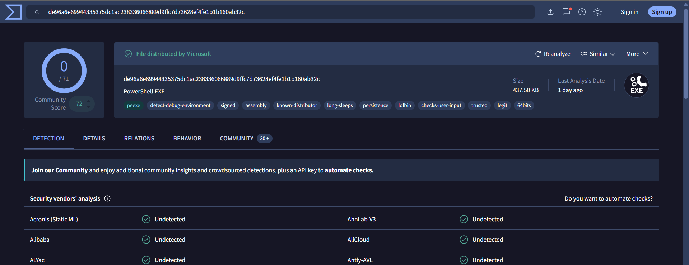

# SOC130 - Event Log Cleared

## Alert Overview

| Field | Details |
|---|---|
| Event ID | 64 |
| Alert Rule | SOC130 - Event Log Cleared |
| Event Time | `2021-02-21 19:23:10 (UTC+03:00)` |
| Alert Type | Malware |
| Difficulty | Easy |
| MITRE ATT&CK | T1204 - User Execution |
| Source Host | `Exchange Server` |
| Source IP | `172.16.20.3` |
| File Name | `powershell.exe` |
| File Size | 437.50 KB |
| MD5 | `7353f60b1739074eb17c5f4dddefe239` |
| Device Action | Allowed |
| Final Verdict | **False Positive** |

## 1. Investigation

### 1.1. Log Management

No Log Management events were found around the alert time, so there was no nearby network or log-clearing activity to correlate with the alert.

### 1.2. Endpoint Security

Endpoint Security showed a `powershell.exe` process on `Exchange Server`, but no command line was available.



Without the command line, the available evidence does not establish that PowerShell was used to clear Windows Event Logs. Examples of commands that can be used to clear event logs include:

```powershell
Clear-EventLog -LogName Security
```

```cmd
wevtutil cl Security
```

These are examples only; the alert did not provide evidence that either command was executed.

### 1.3. VirusTotal File Reputation

The file's MD5 hash was checked on VirusTotal and was not flagged as malicious at the time of investigation.



### 1.4. ANY.RUN Public Report

The [ANY.RUN public report for the same file hash](https://any.run/report/de96a6e69944335375dc1ac238336066889d9ffc7d73628ef4fe1b1b160ab32c/9ba16773-16ac-4ad2-bb97-787e82427f85) displayed an overall `Malicious activity` classification. However, the report's Behavior Activities section showed suspicious indicators rather than explicit malicious indicators, including:

- Running PowerShell from an unusual location under the user's `Temp` directory.
- Reading Internet Explorer security settings and Windows trust settings.
- Checking the PowerShell history file.
- Dropping a Windows executable.

These behaviors are worth investigating, but they do not by themselves prove that the file is malicious or that Windows Event Logs were cleared. The report also showed no detected network threats.

## 2. Playbook Investigation

### 2.1. Define Threat Indicator

**Answer:** Other

### 2.2. Check if the Malware Is Quarantined/Cleaned

**Answer:** Quarantined

The playbook indicates `Quarantined`, although the alert's Device Action is recorded as `Allowed`.

### 2.3. Analyze Malware

**Answer:** Not Malicious

VirusTotal did not flag the hash as malicious, and the available ANY.RUN behavior indicators were suspicious rather than conclusive evidence of malicious activity.

## 3. Final Assessment

**Verdict: False Positive**

No relevant Log Management events were found around the alert time, and the Endpoint Security record contained no command line showing that PowerShell cleared Windows Event Logs. Although ANY.RUN reported suspicious behaviors, the available evidence did not establish that the file was malicious or that Event Logs had been cleared.
