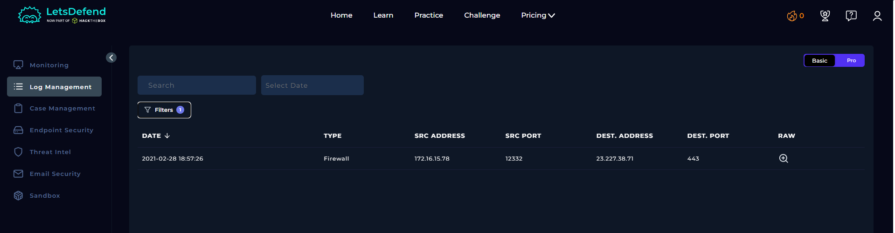
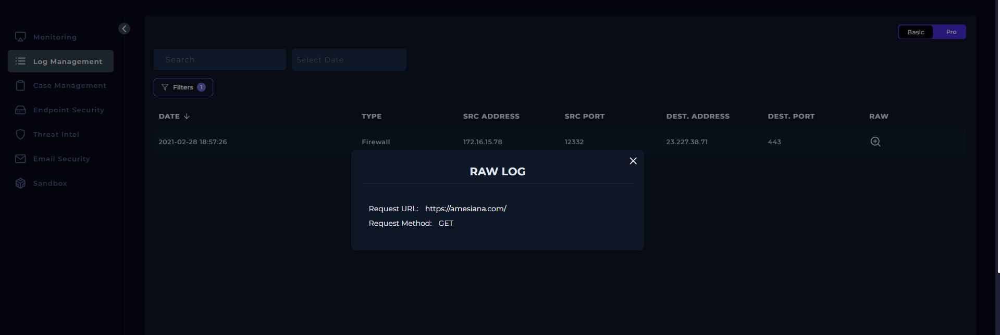
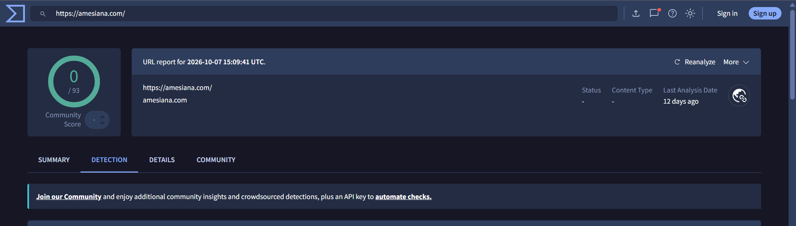
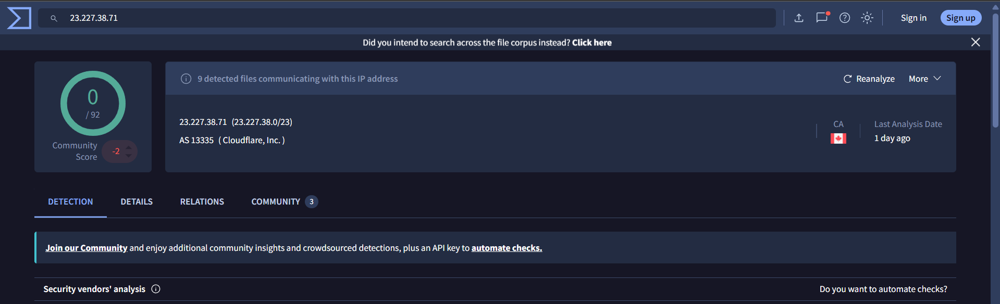
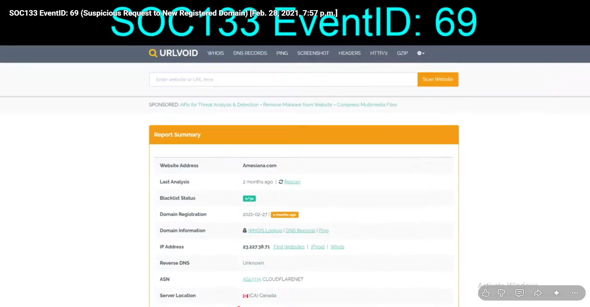

# SOC133 – Suspicious Request to New Registered Domain

## 1. Alert Overview

| Field | Details |
|---|---|
| Event ID | 69 |
| Alert Rule | SOC133 – Suspicious Request to New Registered Domain |
| Event Time | `2021-02-28 19:57:51 (UTC+03:00)` |
| Alert Type | Proxy |
| Username | `Leo` |
| Source Host | `KatharinePRD` |
| Source IP | `172.16.15.78` |
| Destination Domain | `amesiana.com` |
| Destination IP | `23.227.38.71` |
| Request Method | `GET` |
| Device Action | **Allowed** |
| Final Verdict | **False Positive** |

## 2. Investigation Findings

### 2.1. Log Management Analysis

Log Management recorded a Firewall connection from `172.16.15.78` to `23.227.38.71` over port `443`.

The raw log contained the following request:

```http
GET https://amesiana.com/
```



*Log Management record showing the connection to the destination IP.*



*Raw log showing the requested URL and HTTP method.*

The request targeted the website's root page, and the device action was **Allowed**. The available log does not contain a malicious payload or other explicit evidence of malicious activity.

### 2.2. URL and IP Reputation

The destination URL and IP address were checked using VirusTotal. Both returned **Clean** results according to the available reputation reports.



*VirusTotal URL reputation results.*



*VirusTotal IP address reputation results.*

No related events were found in Endpoint Security to indicate additional suspicious activity associated with this alert.

## 3. Playbook Investigation

### Analyze URL Address

**Result: Non-malicious**

The URL was assessed as non-malicious in the playbook. The available VirusTotal results for the URL and IP were clean, and the investigation did not identify additional evidence confirming malicious activity.

## 4. Final Assessment

**Verdict: False Positive**

The alert was triggered by a request to `amesiana.com`, a newly registered domain. The available logs showed a request to the site's root page, VirusTotal returned clean results for the URL and IP, and no related suspicious activity was found in Endpoint Security.

Based on the available evidence and the playbook result, the URL was assessed as **Non-malicious**, and the alert was classified as a **False Positive**.

## 5. Additional Note – Domain Registration

The WHOIS lookup shown in the referenced investigation indicated that `amesiana.com` was registered on **February 27, 2021**, one day before this alert occurred.



*WHOIS registration information shown in the referenced video.*

A domain's recent registration may have been the reason this alert was triggered, as the detection rule focuses on requests to newly registered domains. However, a recent registration alone does not establish that the domain is malicious.

**Credit:** Shout-out to Bret Witt for sharing his investigation and highlighting the domain registration date.

[Watch the original SOC133 walkthrough on YouTube](https://www.youtube.com/watch?v=E2_Ko0Oe3zc).
