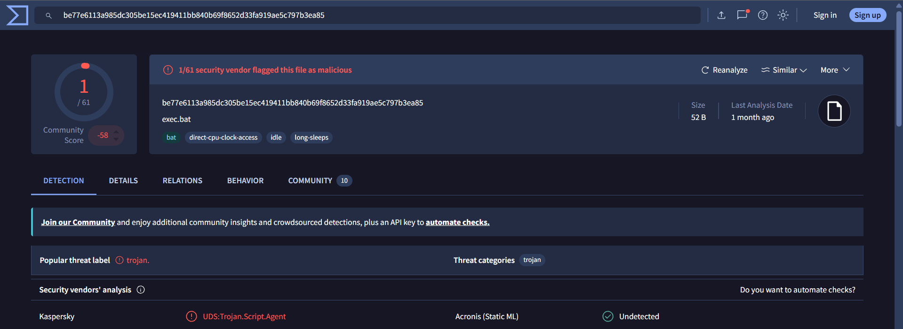
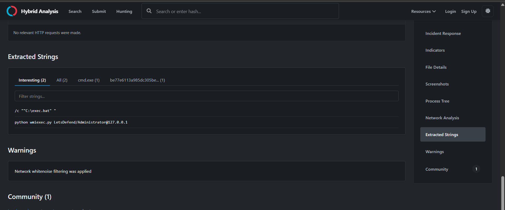
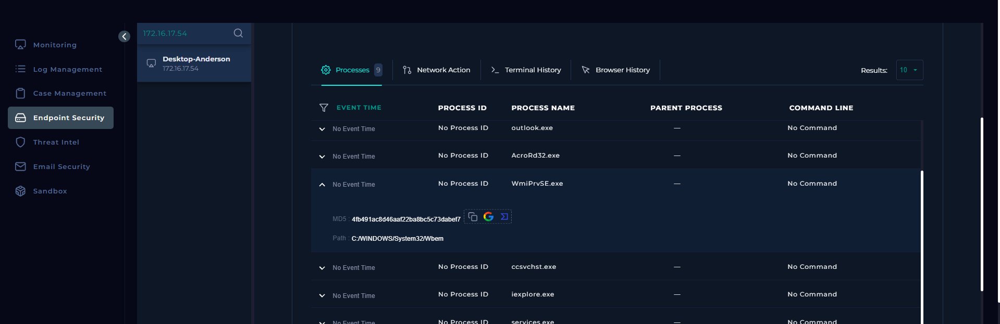
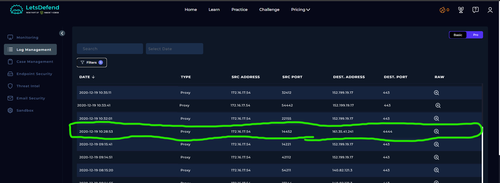
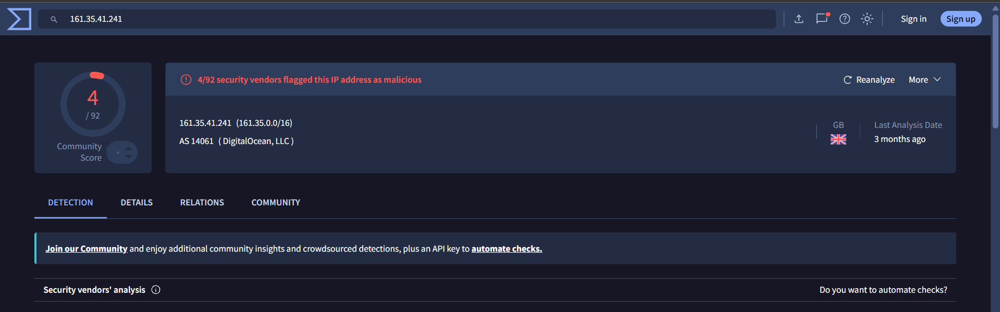

# SOC134 – Suspicious WMI Activity

## 1. Alert Overview

| Field | Details |
|---|---|
| Event ID | 71 |
| Event Time | 2021-03-07 16:50:43 UTC+03:00 |
| Alert Rule | SOC134 – Suspicious WMI Activity |
| Alert Type | Malware |
| Difficulty | Medium |
| Hostname | Desktop-Anderson |
| Source IP | `172.16.17.54` |
| File Name | `exec.bat` |
| File MD5 | `50459310eded4c520ab5c9e3626a9300` |
| File Size | 52 bytes |
| Device Action | Allowed |
| MITRE ATT&CK (alert metadata) | T1204 – User Execution |
| Final Verdict | True Positive |

## 2. Understanding WMI: Legitimate Usage and Potential Abuse

### What Is Windows Management Instrumentation (WMI)?

Windows Management Instrumentation (WMI) is a Windows management technology that allows administrators and applications to retrieve system information and perform administrative operations. Depending on configuration and permissions, it can be used locally or remotely.

Legitimate uses of WMI include:

- Retrieving operating system and hardware information.
- Querying running processes and Windows services.
- Monitoring system health and troubleshooting issues.
- Automating administrative tasks across managed computers.

For example, an administrator can use PowerShell to retrieve operating system information:

```powershell
Get-CimInstance Win32_OperatingSystem
```

WMI is not inherently malicious. It is a legitimate Windows technology used for system administration and monitoring.

### How Can Attackers Abuse WMI?

Attackers can abuse WMI to execute commands, gather system information, and potentially move laterally to other computers when the required access and permissions are available. WMI can also be abused for persistence through WMI event subscriptions.

The important distinction is that **WMI itself is legitimate; its context, the commands executed, the account used, and the target system help determine whether its use is suspicious**.

## 3. Hybrid Analysis Investigation

The `exec.bat` sample was examined using [Hybrid Analysis](https://hybrid-analysis.com/sample/be77e6113a985dc305be15ec419411bb840b69f8652d33fa919ae5c797b3ea85/6881d20d958b0c258e07c23a).



The extracted strings revealed the following command:

```text
python wmiexec.py LetsDefend/Administrator@127.0.0.1
```



### Command Analysis

- `python`: Invokes the Python interpreter to run a Python script.
- `wmiexec.py`: An Impacket utility that provides command execution through Windows Management Instrumentation (WMI).
- `LetsDefend/Administrator`: Specifies the domain and username in the target argument format.
- `127.0.0.1`: The loopback address, which refers to the local machine rather than a separate remote host.

The command appears intended to invoke WMI-based command execution using an Administrator account. However, the use of `127.0.0.1` means the command alone does not establish lateral movement to another computer.

The presence of this command is suspicious in the context of the alert, but it must be evaluated alongside endpoint and network evidence.

## 4. Log Management Investigation

The Log Management section was reviewed for records associated with the alert time.

No relevant logs were available for the alert's time window. Consequently, the available Log Management data did not establish what initiated the batch file or whether its execution resulted in a successful WMI operation.

The absence of relevant records limits the ability to reconstruct the activity, but it does not by itself prove that logs were deleted or that an attacker successfully executed commands.

## 5. Endpoint Security Investigation

The Endpoint Security process information showed the following process:



| Field | Observed Value |
|---|---|
| Process Name | `WmiPrvSE.exe` |
| Process Path | `C:\WINDOWS\System32\Wbem` |
| Process MD5 | `4fb491ac8d46aaf22ba8bc5c73dabef7` |
| Process ID | Not available |
| Command Line | Not available |

`WmiPrvSE.exe` is the Windows Management Instrumentation Provider Host, a legitimate Windows process involved in hosting WMI providers.

Its presence is consistent with WMI-related activity, but the process is not malicious by itself. Since the process ID and command line were unavailable, the available evidence does not establish a direct parent-child relationship between `exec.bat` and this process.

The process information should therefore be treated as supporting context rather than conclusive proof of malicious execution.

## 6. Playbook Results

| Playbook Question | Answer | Investigation Notes |
|---|---|---|
| Define Threat Indicator | Other | The investigation focused on suspicious WMI-related command execution. |
| Check if the malware is quarantined/cleaned | Not Quarantined | The available case evidence indicated that the file had not been quarantined. |
| Analyze Malware | Malicious | The `wmiexec.py` invocation was considered suspicious in the context of this alert. |
| Check If Someone Requested the C2 | Accessed (expected by LetsDefend) | See the C2 analysis below. |
| Final Verdict | True Positive | The suspicious WMI-related command was sufficient to treat the alert as a true positive in the lab. |

### C2 Playbook Analysis





I initially selected **Not Accessed** because no C2 connection was confirmed in the available evidence for the alert's time window. The Log Management section contained no relevant records for the alert time, and the Hybrid Analysis results did not establish that the sample successfully connected to a C2 server.

However, the historical Proxy log, dated approximately three months before the alert, showed network activity from the same source host, `172.16.17.54`, toward the potential C2 address `161.35.41.241` over port `4444`.

This historical communication may explain why LetsDefend expects **Accessed**: the lab may consider the previous communication from the same host to the potential C2 destination sufficient evidence that the destination had been accessed.

There is an important limitation: the historical connection predates the March 7, 2021 alert. The available evidence does not establish that `exec.bat` caused that connection or that the same communication occurred during the current alert.

Therefore, **Accessed is the expected lab answer, while Not Accessed was my initial assessment based on the lack of evidence of a C2 connection during the alert's time window**. The historical log supports the possibility of prior communication, but it does not independently prove that the current execution contacted the C2.

## 7. Final Assessment

The investigation identified a suspicious batch-file command invoking `wmiexec.py`, an Impacket utility capable of WMI-based command execution. This behavior warranted investigation because WMI can be abused to execute commands and, in suitable circumstances, facilitate lateral movement.

The available endpoint data showed `WmiPrvSE.exe`, a legitimate Windows WMI process, but lacked the process ID and command line required to link it directly to the batch file. Log Management contained no relevant records for the alert time.

Historical Proxy evidence showed that the host had previously communicated with a potential C2 address. This may account for LetsDefend's expected `Accessed` answer, although the older connection could not be directly attributed to the current alert.

**Final Verdict: True Positive.**

The verdict reflects the suspicious activity identified during the investigation. It does not mean every suspected action, including successful WMI execution or a C2 connection during the alert, was independently confirmed.
