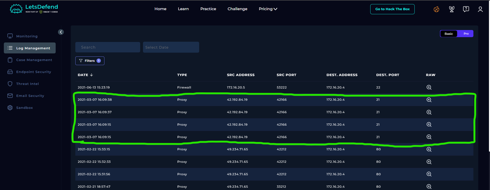

# SOC135 – Multiple FTP Connection Attempt

## 1. Alert Overview

| Field | Details |
|---|---|
| Event ID | 72 |
| Event Time | 2021-03-07 17:09:50 UTC+03:00 |
| Alert Rule | SOC135 – Multiple FTP Connection Attempt |
| Alert Type | Proxy |
| Difficulty | Beginner |
| Username | `www-data` |
| Source IP | `42.192.84.19` |
| Source Hostname | Anonymous |
| Destination IP | `172.16.20.4` |
| Destination Hostname | `gitServer` |
| Request URL | `http://172.16.20.4/ftp/webUI.php` |
| Device Action | Allowed |
| Final Verdict | True Positive |

## 2. Log Management Investigation

The Proxy logs showed four FTP authentication attempts from `42.192.84.19` to `172.16.20.4` over port `21`. The attempts targeted the `admin` account using common passwords: `root`, `password`, `admin`, and `123456`.

All four attempts were **rejected**, indicating unsuccessful authentication in the available logs. This pattern is consistent with password guessing against the FTP service.

## 3. Endpoint Security Investigation

No relevant Endpoint Security events were available for this alert.

## 4. Playbook Results

| Playbook Question | Answer | Findings |
|---|---|---|
| Analyze URL Address | Malicious | The alert was associated with suspicious FTP connection attempts and repeated password guessing. |
| Final Verdict | True Positive | Proxy logs confirmed multiple rejected FTP authentication attempts using common passwords. |

## 5. Final Assessment

The investigation identified repeated FTP authentication attempts from `42.192.84.19` against the internal server `172.16.20.4`. The source attempted to authenticate as `admin` using several common passwords, and all recorded attempts were rejected.

The behavior is consistent with an FTP password-guessing attempt. However, the available evidence does not indicate that authentication succeeded or that the server was compromised.

**Final Verdict: True Positive.**
