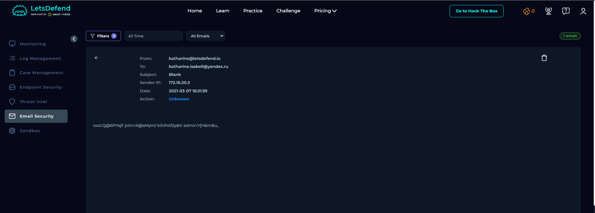

# SOC136 – Data Leak via Mailbox Forwarding Detected

## 1. Alert Overview

| Field | Details |
|---|---|
| Event ID | 74 |
| Event Time | 2021-03-07 17:31:39 UTC+03:00 |
| Alert Rule | SOC136 – Data Leak via Mailbox Forwarding Detected |
| Alert Type | Exchange |
| Difficulty | Beginner |
| SMTP Server | `172.16.20.3` |
| Sender | `katharine@letsdefend.io` |
| Recipient | `katharine.isabell@yandex.ru` |
| Email Subject | Blank |
| Device Action | Blocked |
| Final Verdict | True Positive |

## 2. Email Security Investigation

The Email Security record showed an email sent from `katharine@letsdefend.io` to the external address `katharine.isabell@yandex.ru`. The subject was blank, and the message contained multiple username-and-password-like entries.

The presence of credential-like information in an email addressed to an external mailbox is consistent with potential disclosure of sensitive information. The Playbook indicated that the email contained no attachments or URLs.

The alert recorded the device action as **Blocked**, while the Email Security record showed the action as **Unknown**. The available evidence does not resolve this discrepancy or independently confirm whether the message was delivered.

## 3. Playbook Results

| Playbook Question | Answer | Findings |
|---|---|---|
| Are there attachments or URLs in the email? | No | No attachments or URLs were identified in the investigation. |
| Final Verdict | True Positive | The email contained credential-like information addressed to an external mailbox, consistent with the data-leak alert. |

## 4. Threat Intelligence Context

A [Securelist report on Key Group ransomware](https://securelist.com/key-group-ransomware-samples-and-telegram-schemes/114025/) discusses Yandex email addresses in the context of Key Group activity. This provides background threat-intelligence context only.

The available evidence does **not** establish that the recipient in this alert was associated with Key Group. A `yandex.ru` address alone is not sufficient to attribute the recipient or this incident to a ransomware group.

## 5. Final Assessment

The investigation identified an email sent from an internal mailbox to an external Yandex address containing multiple credential-like entries. This behavior is consistent with a potential data leak.

The alert's device action was recorded as Blocked, but the Email Security action was Unknown. Therefore, the evidence supports a **True Positive** verdict for the suspicious data-disclosure activity, while successful delivery and subsequent use of the credentials remain unconfirmed.

**Final Verdict: True Positive.**
