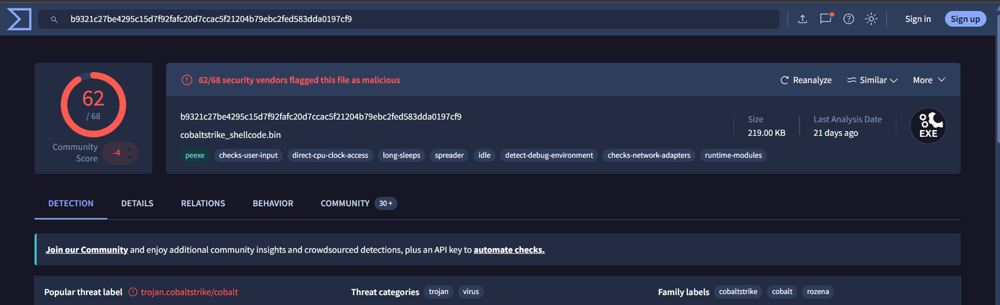
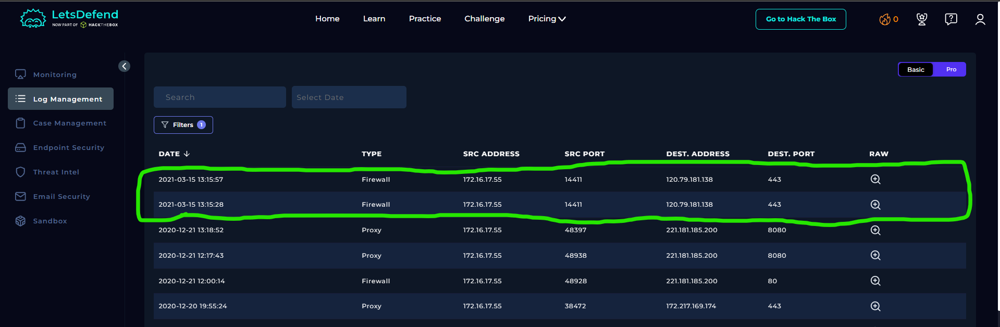
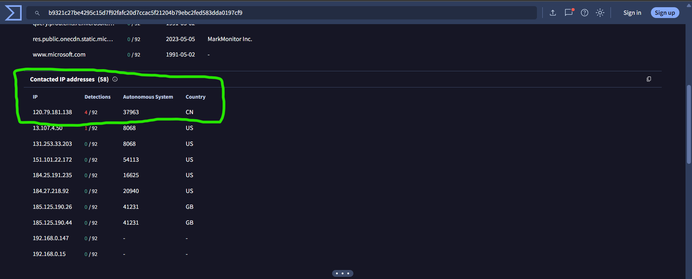

# SOC139 – Meterpreter or Empire Activity

## 1. Alert Overview

| Field | Details |
|---|---|
| Event ID | 78 |
| Event Time | 2021-03-15 14:15:01 UTC+03:00 |
| Alert Rule | SOC139 – Meterpreter or Empire Activity |
| Alert Type | Malware |
| Difficulty | Medium |
| Hostname | Alex - HP |
| Source IP | `172.16.17.55` |
| File Name | `cobaltstrike_shellcode.exe` |
| File MD5 | `24d99ba5654cdf31141c66fd9417b7e0` |
| File Size | 219 KB |
| Device Action | Allowed |
| MITRE ATT&CK | T1112 |
| Final Verdict | True Positive |

## 2. File Reputation Analysis

The file reputation results from VirusTotal identified `cobaltstrike_shellcode.exe` as malicious. The filename and associated analysis indicate that the sample is related to Cobalt Strike activity.

The file was allowed by the device, and the available evidence indicated that it had not been quarantined or cleaned.

## 3. Firewall Log Investigation

The Firewall logs recorded two outgoing connections from `172.16.17.55` to `120.79.181.138` over destination port `443`.

| Source IP | Destination IP | Destination Port |
|---|---|---|
| `172.16.17.55` | `120.79.181.138` | `443` |

This traffic is relevant because the destination IP was also identified during the malware investigation. The logs support that outgoing traffic to the suspected C2 address was recorded from the affected host.

## 4. IP Address Investigation

The IP address `120.79.181.138` appeared under the file's **Relations → Contacted IPs** section.

This finding supports the association between the sample and the destination IP. Combined with the Firewall logs showing traffic from the affected host to the same address, it supports the Playbook conclusion that the C2 was accessed.

## 5. Endpoint Security Investigation

No relevant Endpoint Security events were available for this alert. Therefore, the investigation did not establish additional endpoint activity beyond the evidence provided by the file analysis and Firewall logs.

## 6. Playbook Results

| Playbook Question | Answer | Findings |
|---|---|---|
| Define Threat Indicator | Unknown or unexpected outgoing internet traffic | The host generated outgoing traffic to a suspicious external IP. |
| Check if the malware is quarantined/cleaned | Not Quarantined | The available case evidence indicated that the file had not been quarantined. |
| Analyze Malware | Malicious | VirusTotal identified the file as malicious. |
| Check If Someone Requested the C2 | Accessed | Firewall logs recorded outgoing traffic to `120.79.181.138:443`, which also appeared in the file's contacted IP relations. |
| Final Verdict | True Positive | The malicious file and related outgoing network activity support the alert. |

## 7. Final Assessment

The investigation identified a malicious file, `cobaltstrike_shellcode.exe`, on the host `172.16.17.55`. Firewall logs recorded outgoing traffic to `120.79.181.138` over port `443`, and the same IP appeared in the file's contacted IP relations.

These findings support the conclusion that the alert represents suspicious activity involving a malicious file and communication with a potential C2 destination. No additional Endpoint Security events were available.

**Final Verdict: True Positive.**
