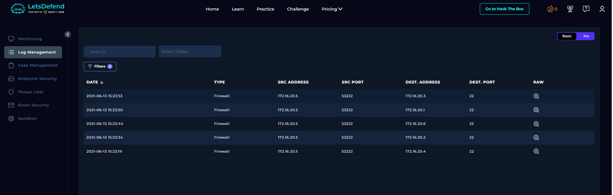
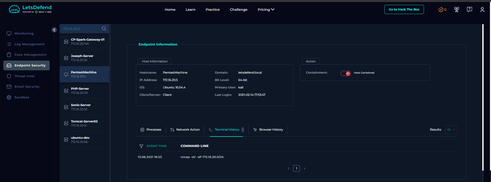
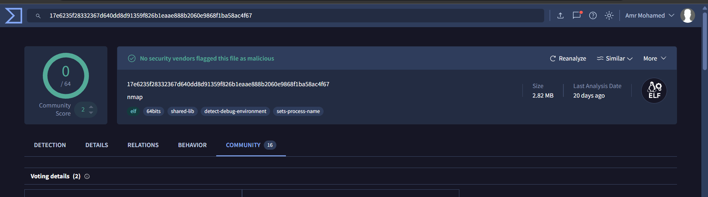
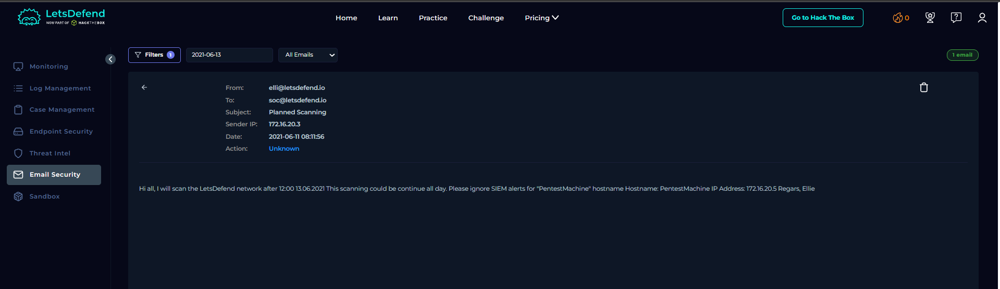

# SOC147 - SSH Scan Activity

## 1. Alert Overview

- **Event ID:** 94
- **Alert Name:** SOC147 - SSH Scan Activity
- **Severity:** Medium
- **Timestamp:** 2021-06-13 16:23:27 (UTC+03:00)
- **Source IP:** `172.16.20.5`
- **Source Hostname:** `PentestMachine`
- **File Name:** `nmap`
- **File Size:** 2.82 MB
- **File Hash:** `3361bf0051cc657ba90b46be53fe5b36`
- **Device Action:** Allowed
- **MITRE ATT&CK:** T1204 - User Execution (as listed in the alert)

The alert reported SSH scanning activity originating from PentestMachine. The investigation correlated firewall records, endpoint terminal history, file reputation, and an email announcing planned network scanning.

## 2. Investigation Findings

### 2.1. Review Firewall Logs

Log Management recorded connections from `172.16.20.5` to several internal hosts on TCP port 22:

| Timestamp shown in logs | Source | Destination | Destination port |
|---|---|---|---:|
| 2021-06-13 15:23:53 | `172.16.20.5:53222` | `172.16.20.3` | 22 |
| 2021-06-13 15:23:50 | `172.16.20.5:53222` | `172.16.20.1` | 22 |
| 2021-06-13 15:23:44 | `172.16.20.5:53222` | `172.16.20.6` | 22 |
| 2021-06-13 15:23:34 | `172.16.20.5:53222` | `172.16.20.2` | 22 |
| 2021-06-13 15:23:19 | `172.16.20.5:53222` | `172.16.20.4` | 22 |

The repeated connections from one source to SSH port 22 on multiple internal hosts are consistent with network scanning. These records show connection attempts; by themselves, they do not prove successful SSH authentication or access.



### 2.2. Review Endpoint Terminal History

Endpoint Security recorded the following command on PentestMachine:

```bash
nmap -sV -sP 172.16.20.0/24
```

- `nmap` is a legitimate network discovery and security auditing utility that can also be used for reconnaissance.
- `-sP` is a legacy host-discovery option, now commonly represented by `-sn`.
- `-sV` requests service/version detection.
- `172.16.20.0/24` specifies the internal subnet being scanned.

The command and firewall events support the conclusion that PentestMachine was scanning the internal network. The command alone does not establish that SSH logins succeeded.



### 2.3. Check File Reputation

The file was identified as `nmap`, with a size of 2.82 MB and hash `3361bf0051cc657ba90b46be53fe5b36`. The provided reputation check was reported as clean.

A clean reputation result is useful context but does not, by itself, prove that every use of the file is benign. In this case, the observed command is consistent with Nmap-based network scanning, and the email evidence below provides context for why the scan was performed.



### 2.4. Correlate with the Planned-Scanning Email

Email Security contained an email with these details:

- **From:** `elli@letsdefend.io`
- **To:** `soc@letsdefend.io`
- **Subject:** `Planned Scanning`
- **Sender IP:** `172.16.20.3`
- **Date:** 2021-06-11 08:11:56
- **Referenced host:** `PentestMachine`
- **Referenced IP:** `172.16.20.5`

The email stated that the LetsDefend network would be scanned after 12:00 on 13 June 2021 and that the activity could continue throughout the day. It specifically asked recipients to ignore SIEM alerts for PentestMachine.

This announcement predates the observed scan and identifies the same hostname and IP address as the alert source. It strongly supports the interpretation that the activity was planned rather than an unexpected scan. The email's action field was listed as **Unknown**, so the evidence does not independently establish any further email-processing outcome.



## 3. Playbook Execution

### Step 1: Check Whether the File Was Quarantined or Cleaned

The playbook's correct result was **Not Quarantined**. The alert showed the device action as `Allowed`; no evidence provided here confirms that the file was quarantined or cleaned.

**Outcome:** Not Quarantined.

### Step 2: Analyze the File

The playbook's correct result was **Malicious**, while the provided file-reputation result was reported as clean and the file was identified as Nmap. These are conflicting signals in the lab evidence. A clean hash reputation alone does not establish that the observed activity was authorized, while the planned-scanning email and matching endpoint/network evidence support an authorized-scan explanation.

**Outcome:** The playbook marked the file as Malicious; the broader evidence supports treating the alert as a false positive for unauthorized SSH scanning.

## 4. Final Verdict

**False Positive — Planned internal network scanning.**

The firewall logs show connections from PentestMachine to multiple internal hosts on TCP port 22, and endpoint history records an Nmap scan of `172.16.20.0/24`. Most importantly, the earlier email explicitly announces planned scanning and names the same source host and IP address. Together, these findings support the conclusion that the alert was triggered by planned scanning activity rather than an unauthorized SSH scan.

The available evidence confirms scanning behavior, but does not prove successful SSH authentication or access to the destination hosts.
