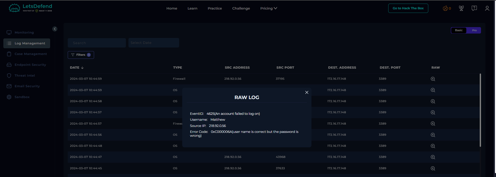
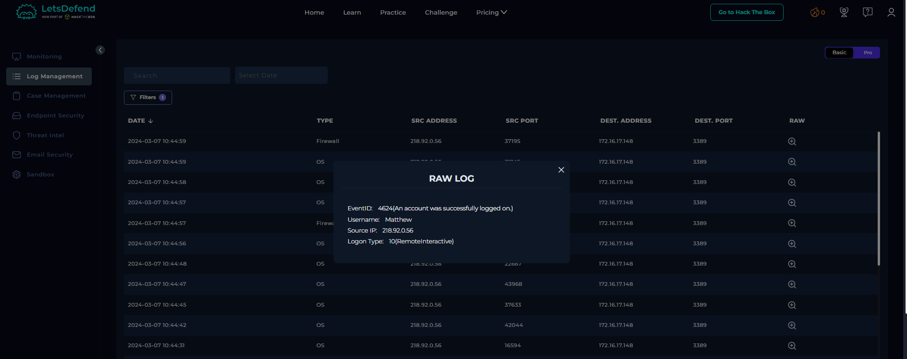
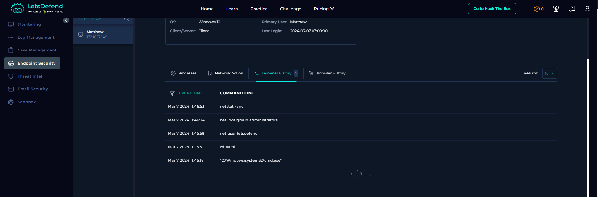

# SOC176 - RDP Brute Force Detected

## 1. Alert Overview

| Field | Details |
|---|---|
| Alert ID | SOC176 |
| Alert Name | RDP Brute Force Detected |
| Severity | Medium |
| Event ID | 234 |
| Protocol | RDP |
| Source IP | `218.92.0.56` |
| Destination Host | `Matthew` |
| Destination IP | `172.16.17.148` |
| Destination Port | `3389` |
| Final Verdict | True Positive |

## 2. Investigation Findings

### Step 1: Source IP Enrichment

The source IP address `218.92.0.56` was identified as external and flagged as suspicious by the IP reputation check.

**Evidence:** [IP reputation screenshot](screenshots/ip-repu.png)

### Step 2: RDP Connection Attempts

Log Management showed repeated connection attempts from `218.92.0.56` to the target host `Matthew` (`172.16.17.148`) over RDP port `3389`.

The Windows security logs recorded multiple failed logon attempts using different usernames, including `admin`, `sysadmin`, and `guest`. These attempts indicate account guessing against the target host.

**Evidence:** [Log Management screenshot](screenshots/log-management.png)

### Step 3: Failed Authentication

Windows Security Event ID `4625` recorded failed logon attempts against the target.

One recorded attempt used the username `Matthew` and returned error code `0xC000006A`, indicating that the username was valid but the password was incorrect.

### Step 4: Successful RDP Logon

A subsequent Windows Security Event ID `4624` recorded a successful logon for `Matthew` from `218.92.0.56`. The logon type was `10` (`RemoteInteractive`), consistent with a remote interactive session such as RDP.

This confirms that the attacker successfully authenticated to the target host after the failed attempts.

### Step 5: Post-Login Activity

The terminal history showed commands executed after the successful remote logon:

| Command | Purpose |
|---|---|
| `whoami` | Identify the current user context. |
| `net user letsdefend` | Inspect the specified local user account. |
| `net localgroup administrators` | Enumerate members of the local Administrators group. |
| `netstat -ano` | Inspect network connections and listening ports, including associated process IDs. |

These commands indicate host and account discovery following the successful RDP session.

## 3. Playbook Execution

| Playbook Question | Answer |
|---|---|
| Is the source IP internal or external? | External |
| Is the attacker IP suspicious? | Yes |
| Is there a request from the attacker IP to the target's SSH/RDP port? | Yes |
| Does the attacker target multiple servers or clients? | No |
| Was the brute-force attack successful? | Yes |
| Should the device be isolated? | Yes |

**Playbook Outcome:** True Positive.

The source IP `218.92.0.56` is external and suspicious. The attacker attempted RDP authentication using multiple usernames against the single target host `Matthew` (`172.16.17.148`). A successful logon was recorded, followed by host and account discovery commands. Device isolation is required as a containment measure.

## 4. Investigation Assessment

The investigation identified an external suspicious IP address making repeated RDP authentication attempts against one internal host. Multiple attempts failed, followed by a successful remote logon to `Matthew`. The subsequent execution of account and network discovery commands indicates post-login reconnaissance.

The combination of suspicious source reputation, repeated authentication failures, a successful RDP logon, and post-login discovery activity supports classifying this alert as a **True Positive**.

## 5. Final Verdict

**True Positive — Successful RDP brute-force activity followed by host reconnaissance.**

The target host should be isolated, and the incident should be escalated for further investigation of the compromised account, subsequent activity, and any persistence or lateral movement.
