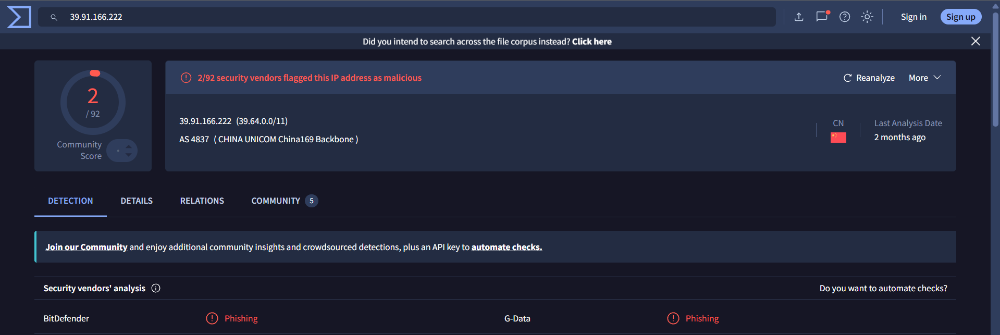
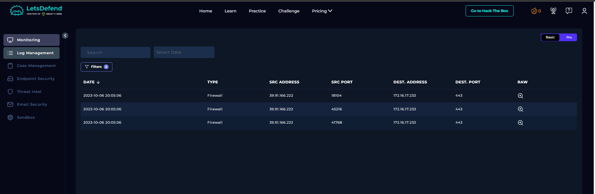
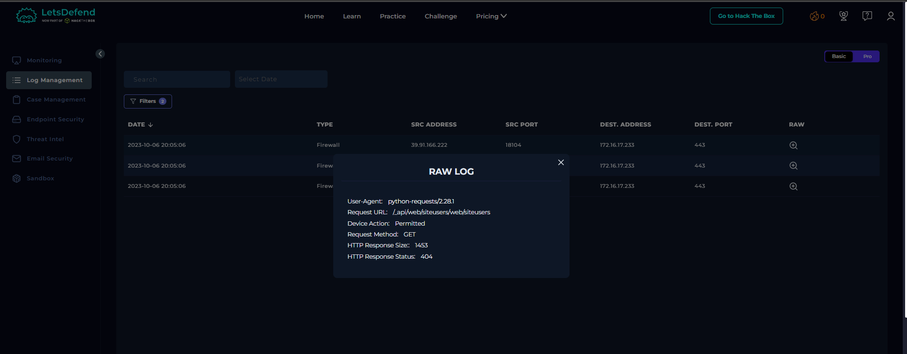
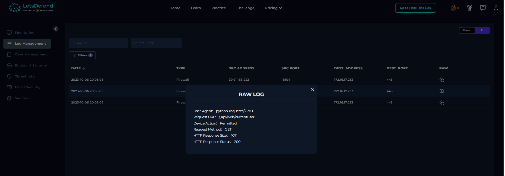
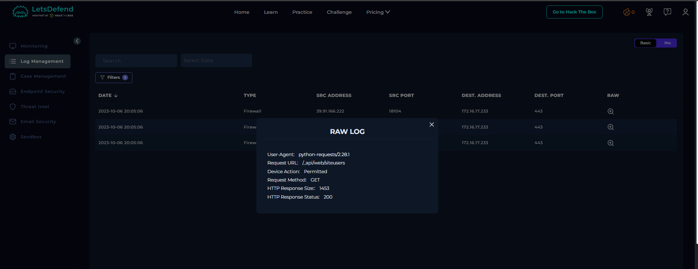

# SOC227 - Microsoft SharePoint Server Elevation of Privilege - Possible CVE-2023-29357 Exploitation

## 1. Vulnerability Overview

CVE-2023-29357 is a critical Microsoft SharePoint Server vulnerability with a CVSS score of 9.8. It involves improper validation of authentication tokens, which may allow an unauthenticated attacker to bypass authentication and gain the privileges of an authenticated user. When chained with another vulnerability, it may also contribute to remote code execution (RCE).

## 2. Alert Overview

| Field | Value |
|---|---|
| Event ID | 189 |
| Event Time | Oct 06, 2023, 08:05 PM |
| Rule | SOC227 - Microsoft SharePoint Server Elevation of Privilege - Possible CVE-2023-29357 Exploitation |
| Level | Security Analyst |
| Hostname | MS-SharePointServer |
| Destination IP Address | 172.16.17.233 |
| Source IP Address | 39.91.166.222 |
| HTTP Request Method | GET |
| Requested URL | `/_api/web/siteusers` |
| User-Agent | `python-requests/2.28.1` |
| Device Action | Allowed |
| Alert Trigger Reason | This activity may be indicative of an attempt to exploit CVE-2023-29357, potentially leading to unauthorized access and privilege escalation within the SharePoint server. |

## 3. Investigation Findings

### Step 1: Investigate Source IP Reputation

The source IP address `39.91.166.222` was checked using VirusTotal. The reputation results indicated suspicious activity associated with the address, supporting further investigation of its requests to the internal SharePoint server.

**Evidence — VirusTotal IP reputation:**

### Step 2: Review Log Management

The firewall logs showed three HTTP GET requests from the external source `39.91.166.222` to the internal SharePoint server `172.16.17.233` over port 443. All three requests used the User-Agent `python-requests/2.28.1`, indicating that they were generated using Python's Requests HTTP library.

The recorded requests were:

| Requested URL | HTTP Status | Response Size |
|---|---:|---:|
| `/_api/web/siteusers/web/siteusers` | 404 | 1453 bytes |
| `/_api/web/currentuser` | 200 | 1071 bytes |
| `/_api/web/siteusers` | 200 | 1453 bytes |

The first request returned HTTP 404, while the other two returned HTTP 200. The requests targeted SharePoint API endpoints associated with current-user information and site-user information.

The combination of an external source, automated HTTP requests, and requests to these endpoints was considered suspicious in the context of a possible authentication-bypass vulnerability.

The `Allowed` and `Permitted` actions indicate that the firewall allowed the requests through. The successful HTTP responses were consistent with the playbook's assessment that the attack was successful.

**Evidence — Log Management:**

**Raw firewall logs:**

### Step 3: Review Endpoint Security

Endpoint Security was checked for additional evidence of suspicious activity on the affected SharePoint server. No relevant findings were available in this section of the lab.

### Step 4: Review Email Security

Email Security was reviewed for information indicating whether the activity was part of a planned security test. No relevant findings were identified, and the activity was treated as unplanned.

## 4. Playbook Investigation

### Is Traffic Malicious?

**Answer: Yes.**

The suspicious source IP reputation and automated requests to SharePoint user-related API endpoints supported classifying the traffic as malicious.

### What Is the Attack Type?

**Answer: Other.**

The activity was associated with a possible authentication-bypass and privilege-escalation attempt involving CVE-2023-29357.

### Check If It Is a Planned Test

**Answer: No.**

No relevant information was found in Email Security to indicate that the activity was part of a planned test.

### What Is the Direction of Traffic?

**Answer: Internet → Company Network.**

The external source `39.91.166.222` sent requests to the internal SharePoint server `172.16.17.233`.

### Was the Attack Successful?

**Answer: Yes.**

The playbook classified the attack as successful. The investigation identified HTTP 200 responses to requests targeting SharePoint user-related endpoints, alongside suspicious source activity.

### Do You Need Tier 2 Escalation?

**Answer: Yes.**

The alert involves a critical SharePoint vulnerability and suspected successful exploitation. Tier 2 escalation is required for further incident investigation and response.

## 5. Final Verdict

**True Positive — Successful CVE-2023-29357 exploitation.**

The external source IP, suspicious HTTP requests, and successful responses from SharePoint supported the lab's malicious-activity assessment. The playbook classified the attack as successful and recommended Tier 2 escalation.

The case was therefore classified as a True Positive, with escalation required for further investigation and response.
