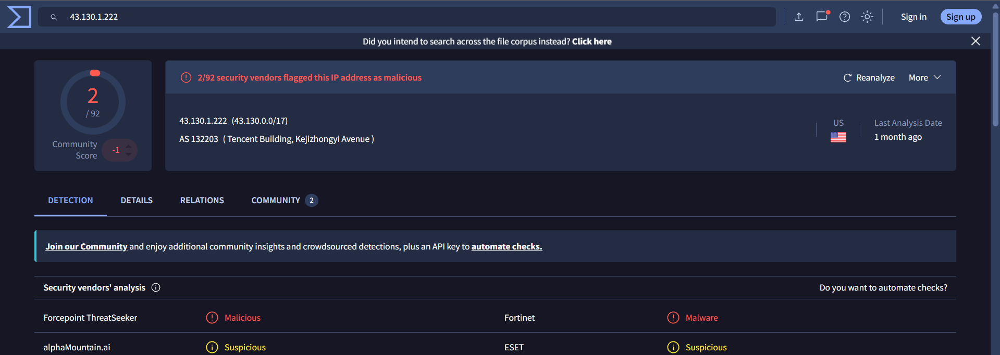
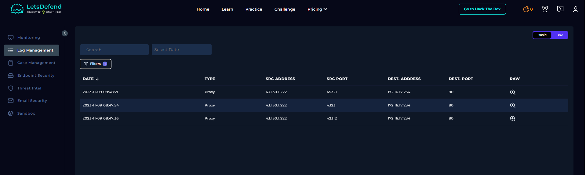
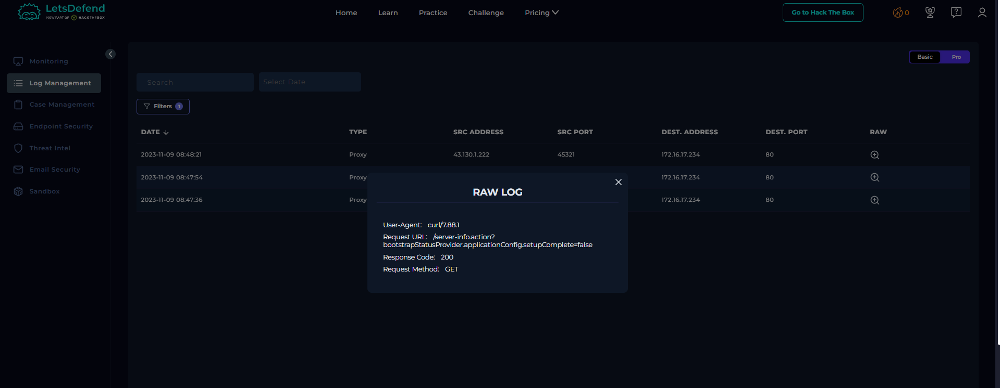
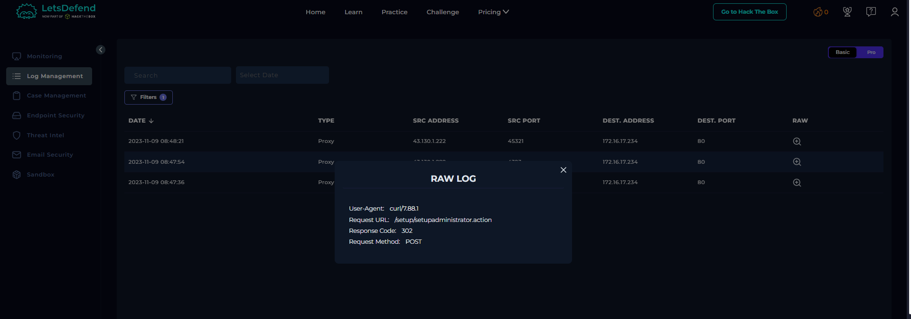
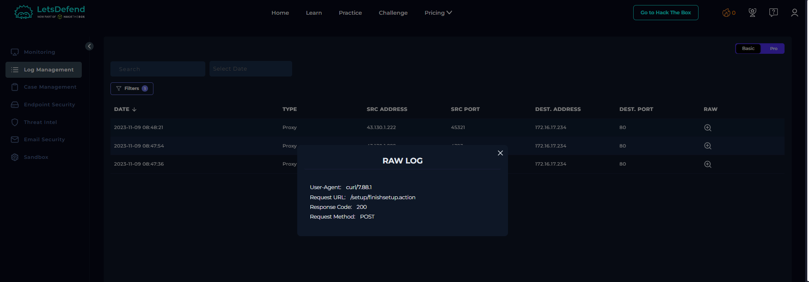

# SOC235 - Atlassian Confluence Broken Access Control 0-Day CVE-2023-22515

## Alert Overview

| Field | Details |
|---|---|
| Event ID | 197 |
| Event Time | 2023-11-09 09:47:59 +03:00 |
| Severity | High |
| Alert Type | Web Attack |
| Hostname | Confluence Data Center |
| Source IP | `43.130.1.222` |
| Destination IP | `172.16.17.234` |
| User-Agent | `curl/7.88.1` |
| Initial Request | `/server-info.action?bootstrapStatusProvider.applicationConfig.setupComplete=false` |
| HTTP Method | GET |
| Device Action | Allowed |

The alert was triggered by activity potentially exploiting CVE-2023-22515, a broken access control vulnerability affecting certain versions of Atlassian Confluence Data Center and Server. The vulnerability can allow an unauthenticated attacker to create an unauthorized administrator account.

## Vulnerability Overview

CVE-2023-22515 is a critical broken access control vulnerability in Confluence. The observed request sequence is consistent with an attempt to abuse Confluence's setup flow to reach the administrator-creation step.

The key point is the sequence of requests, not any single HTTP status code. A successful HTTP response does not, by itself, prove that an administrator account was created.

## Investigation Findings

### 1. Source IP Reputation

The source IP `43.130.1.222` was reported as malicious by VirusTotal in the lab investigation.



### 2. Proxy Log Correlation

Log Management recorded three requests from `43.130.1.222` to the Confluence server `172.16.17.234` over destination port 80. All used the User-Agent `curl/7.88.1`.



#### Request 1 — Inspecting the Setup State

**Time:** 2023-11-09 08:47:36  
**Method:** GET  
**URL:**
```http
/server-info.action?bootstrapStatusProvider.applicationConfig.setupComplete=false
```
**Response:** HTTP 200

To understand this request, separate the URL into two parts:

- **`/server-info.action`**: The endpoint being requested on the Confluence server. The `.action` suffix is used by Confluence's web application to route requests to application actions.
- **`bootstrapStatusProvider.applicationConfig.setupComplete=false`**: A query parameter that references the application's setup-completion status and supplies the value `false`.

The important detail is that the request explicitly references the setup state and sets the parameter to `false`. In the context of CVE-2023-22515, this is consistent with an attempt to interact with Confluence's setup mechanism in a way that could expose setup functionality that should not be available to an unauthenticated attacker.

However, **the URL alone does not prove that the server's configuration was changed**. The `false` value is part of the request sent by the client; it does not automatically mean that the server accepted it or changed its actual setup state.

The HTTP `200 OK` response means the server returned a successful HTTP response. It does not independently confirm that the vulnerability was exploited.



#### Request 2 — Administrator Account Setup

**Time:** 2023-11-09 08:47:54  
**Method:** POST  
**URL:**
```http
/setup/setupadministrator.action
```
**Response:** HTTP 302

This request targets the `setupadministrator.action` endpoint under the `/setup/` path.

- **`/setup/`** indicates that the requested action belongs to Confluence's setup flow.
- **`setupadministrator.action`** identifies the action associated with configuring the administrator account during setup.
- **`POST`** indicates that the client is submitting data to the server, rather than simply requesting a resource with GET. The available log does not show the POST body, so we cannot identify the submitted username, password, or other account details from this record alone.

This request is significant because unauthorized administrator-account creation is the key impact associated with CVE-2023-22515. Its position after the setup-state request makes the sequence consistent with an attempt to reach the administrator-creation stage.

The response `302 Found` indicates that the server returned a redirect response. Applications commonly use redirects to move a client to another page or step. **A 302 response does not, by itself, confirm that an administrator account was successfully created.**



#### Request 3 — Finishing Setup

**Time:** 2023-11-09 08:48:21  
**Method:** POST  
**URL:**
```http
/setup/finishsetup.action
```
**Response:** HTTP 200

This request targets `finishsetup.action`, another endpoint in Confluence's setup flow.

- **`/setup/`** identifies the setup-related path.
- **`finishsetup.action`** indicates an action associated with finishing the setup process.
- **`POST`** means the client submitted a request to perform that action.

The sequence matters here: the same source IP first requested the setup-state endpoint, then the administrator setup endpoint, and finally the setup-completion endpoint. Taken together, these requests are consistent with an attempt to move through Confluence's setup flow and finish it after reaching the administrator-creation stage.

The HTTP `200 OK` response confirms that the server returned a successful HTTP response to the final request. It does not independently prove that the setup was successfully completed or that the attacker obtained administrative access.



### 3. Endpoint Security

No relevant findings were available in Endpoint Security for this alert. This does not negate the proxy evidence; the observed activity is primarily web/application-layer activity.

## Investigation Assessment

| Question | Answer | Evidence / rationale |
|---|---|---|
| Is the traffic malicious? | Yes | The source IP was reported as malicious by VirusTotal, and the request sequence is consistent with attempted exploitation of CVE-2023-22515. |
| Attack type | Other | The activity concerns attempted exploitation of a Confluence web application vulnerability. |
| Was this a planned test? | No | No related evidence was found in Email Security, and the source IP was reported as malicious by VirusTotal. |
| Traffic direction | Internet → Company | External source `43.130.1.222` to internal Confluence server `172.16.17.234`. |
| Was the attack successful? | Yes | Investigation outcome. |
| Tier 2 escalation required? | Yes | The potential creation of an unauthorized administrator account warrants further investigation. |

## Final Verdict

**True Positive — CVE-2023-22515 exploitation activity.**

The malicious source-IP reputation and the sequence of requests to `server-info.action`, `setupadministrator.action`, and `finishsetup.action` support classifying this alert as a true positive. The investigation outcome for attack success is **Yes**, and **Tier 2 escalation is required**.
