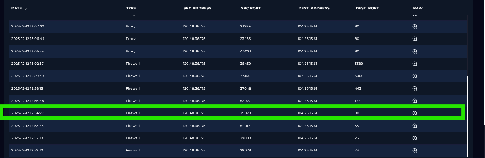
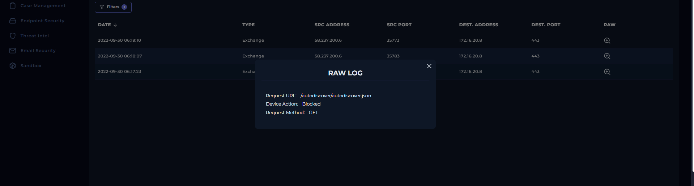
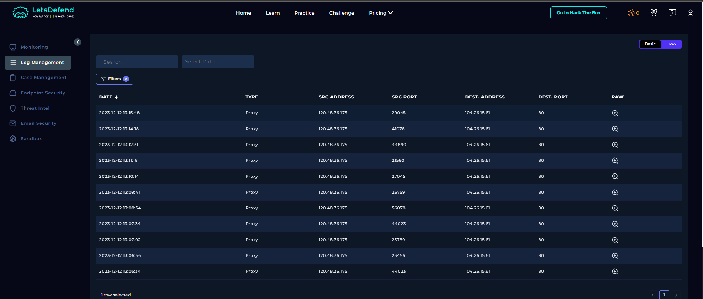
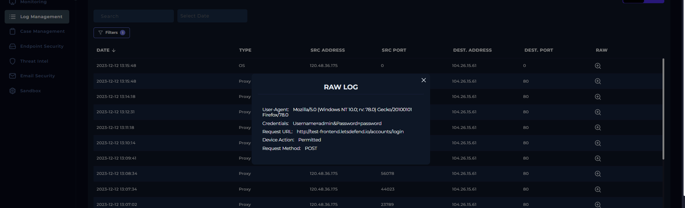
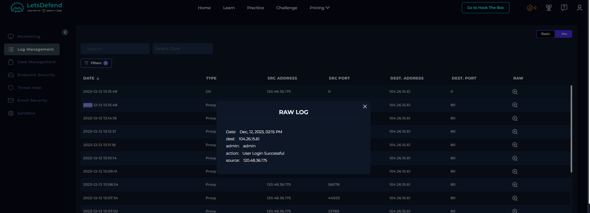

# SOC246 – Forced Authentication Detected

## 1. Alert Overview

| Field | Details |
|---|---|
| Alert ID | SOC246 |
| Alert Name | Forced Authentication Detected |
| Event ID | 208 |
| Severity | Medium |
| Event Time | 2023-12-12 14:15:00 +03:00 |
| Alert Type | Web Attack |
| MITRE ATT&CK | T1187 – Forced Authentication |
| Source IP | `120.48.36.175` |
| Destination IP | `104.26.15.61` |
| Host | `WebServer_Test` |
| Request URL | `http://test-frontend.letsdefend.io/accounts/login` |
| Request Method | POST |
| Device Action | Permitted |
| Log Sources | Firewall, Proxy, OS |

## 2. Investigation

### Step 1: Review Firewall Logs

Firewall logs showed connection attempts from `120.48.36.175` to `104.26.15.61` across several destination ports, including 21, 22, 23, 25, 53, 80, 110, 443, 3000, and 3389.

Most of these firewall events had the action `FW Deny`. However, the event at `2023-12-12 12:54:27` targeting destination port 80 had the action `FW Permit`.

**Finding:** The firewall denied multiple connection attempts, while at least one connection to port 80 was permitted. The permitted connection does not, by itself, establish whether authentication succeeded.

### Step 2: Analyze Proxy Logs

The proxy logs showed multiple HTTP POST requests from `120.48.36.175` to:

`http://test-frontend.letsdefend.io/accounts/login`

The requests used the same User-Agent:

`Mozilla/5.0 (Windows NT 10.0; rv: 78.0) Gecko/20100101 Firefox/78.0`

The requests contained different username and password combinations. One recorded attempt used:

- Username: `admin`
- Password: `password`

The corresponding proxy event recorded the device action as `Permitted`.

**Finding:** The repeated POST requests with varying credentials are consistent with password-guessing or brute-force-style authentication attempts. The available logs do not establish the complete list of attempted credentials.

### Step 3: Verify Authentication Success

At `2023-12-12 13:15:48`, an OS log was recorded for the same source and destination IP addresses. Its raw content stated:

- `admin: admin`
- `action: User Login Successful`
- `source: 120.48.36.175`
- `dest: 104.26.15.61`

This log provides direct evidence that a login for the `admin` user was reported as successful.

**Finding:** Authentication success was recorded after the repeated login attempts. The OS log does not independently establish what actions the account performed after authentication.

### Step 4: Review Endpoint Security

No related events were found in Endpoint Security during the investigation.

**Finding:** No additional endpoint evidence was available from this data source. This does not negate the successful-login evidence recorded in the OS log.

### Step 5: Check Whether the Activity Was Planned

The playbook classified the activity as **Not Planned** after checking the relevant email records for information about the source IP and hostname.

**Finding:** The investigation did not identify evidence that the activity was an authorized test.

## 3. Playbook Execution

| Playbook Check | Result |
|---|---|
| Tier 2 Escalation | Yes |
| Containment | Next |
| Was the Attack Successful? | Yes |
| Traffic Direction | Internet → Company Network |
| Planned Test? | Not Planned |
| Attack Type | Other |
| Is Traffic Malicious? | Malicious |

### Escalation and Containment

The playbook requires escalation to Tier 2 to initiate forensic investigation and incident response procedures.

The containment step was recorded as `Next`. Therefore, the available playbook results do not confirm that containment was performed.

## 4. Final Verdict

**True Positive — Successful Authentication Following Suspicious Login Attempts**

The alert is supported by multiple POST requests to the login endpoint using different credentials, followed by an OS log reporting `User Login Successful` for the `admin` account from the same source IP.

The firewall denied several connections, but other traffic was permitted. Endpoint Security contained no related events, and the available evidence does not establish what happened after the successful login.

**Recommended next steps:**
- Escalate to Tier 2 for forensic investigation.
- Review the successful session and subsequent activity associated with the `admin` account.
- Validate the account's authentication history and reset credentials if compromise is confirmed.
- Determine whether additional containment is required based on the follow-up investigation.
